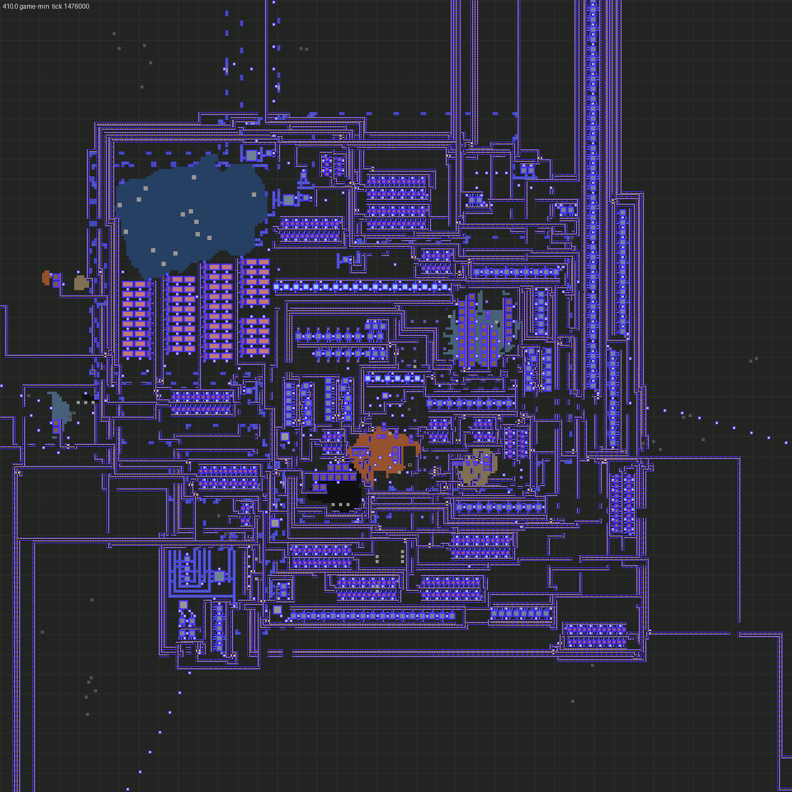
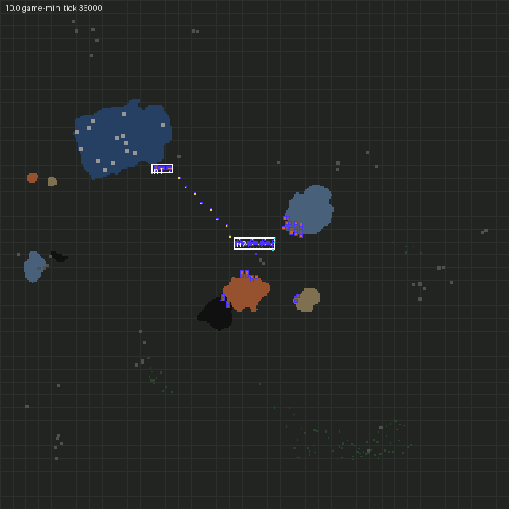
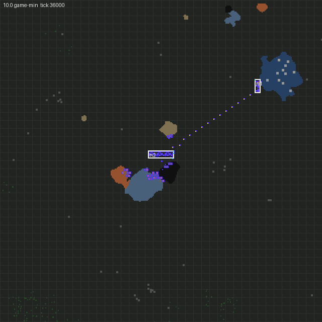
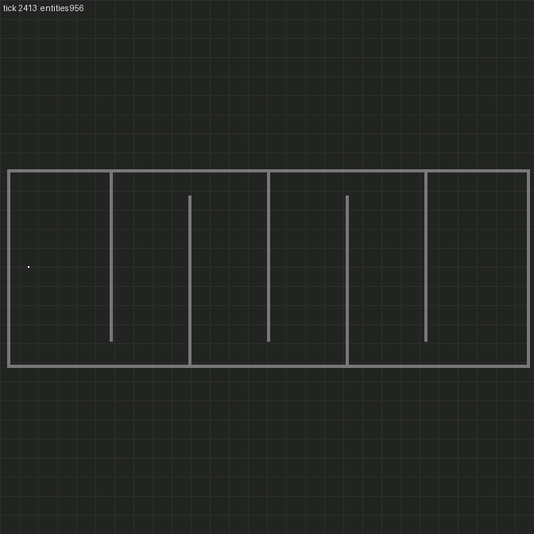
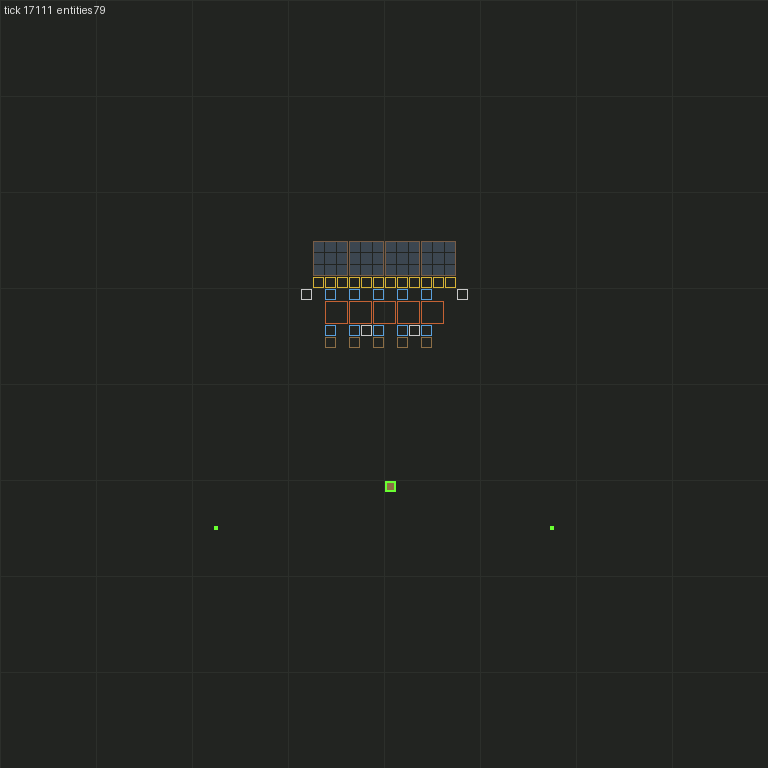
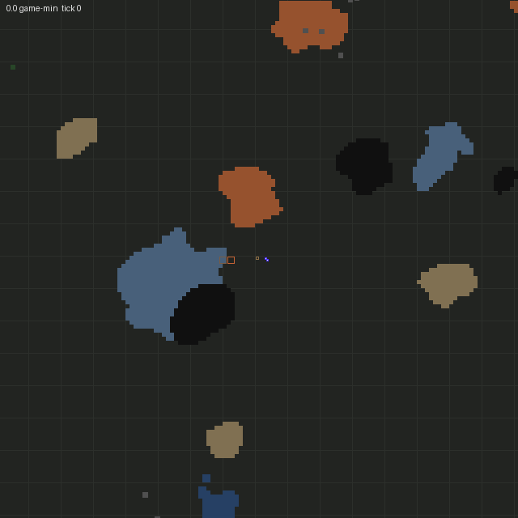
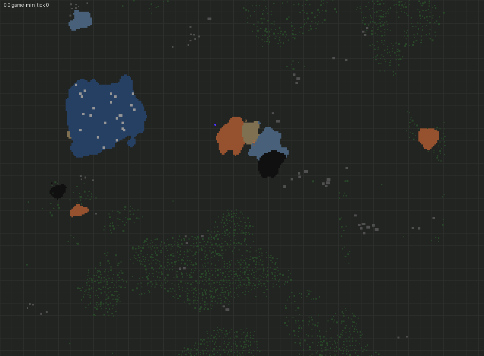
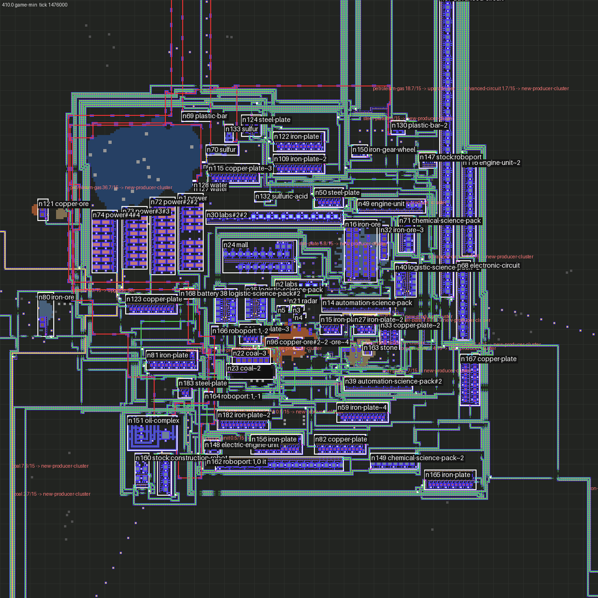

# Rival Engineers

A Factorio 2.0 mod where AI factions build their own factories next to yours, the way a player does. Each faction is
a small crew of real characters. They walk, mine by hand, craft, carry items and place every building themselves. There
are no scripted buildings and no free resources: each crew member starts with what a freeplay player gets. The AI plans what to build; the crew has to physically build it.



*One AI faction about 7 game-hours into a fresh map: smelter columns, assembler rows, steam power, an oil complex and
the first roboports. Every entity was placed by its crew. Drawn by the project's top-down renderer (blue: the
faction's buildings and belts; ore patches in colour; water in dark blue).*

## What it looks like

| | |
|:-:|:-:|
|  |  |
| Seed 44444, the first 7 game-hours (one frame per 10 game-minutes) | Seed 222, the first 9 game-hours |

Earlier milestones, from one character walking to a working base:

| Crew learns to move | Two crew members build from ghosts | Burner bootstrap from nothing | Green science (v1) |
|:-:|:-:|:-:|:-:|
|  |  |  |  |

The factory planner's view of the same base: every box is a module it designed and placed, labelled with what it makes.



## How it works

1. **Bootstrap.** A faction spawns with a crew carrying the freeplay starting kit (a burner drill, a stone furnace,
   a few plates). The crew hand-mine wood, stone and iron, and build more burner drills and stone furnaces. They keep going until they have the materials for steam power.
2. **Design.** From the research goal (say, 30 red + 30 green + 30 blue science per minute) the planner works out the
   recipe graph. It picks a production **module** for each step, sized to the rate that step needs. Modules are
   generated (smelter columns, assembler rows, mining outposts, chemical rows) or hand-curated blueprints.
3. **Layout.** Modules are placed on the real map, around cliffs, water, trees and ore. Belts are routed with A*,
   undergrounds and splitters. Pipes and pole lines are routed the same way.
4. **Build.** The plan becomes ghosts and jobs on a job board. Crew members claim jobs, fetch materials from depots
   or craft them, walk over and place each entity. M7 adds roboports and construction robots to take over part of this.
5. **Measure and repair.** The planner measures each module's real throughput against the plan and finds the cause
   of any shortfall: starved, backed up, unpowered or out of ore. It then grows, reroutes or rebuilds that part, and
   plans the next goal.

The full design and its decisions are in [`docs/SPEC.md`](docs/SPEC.md).

## Status

| Milestone | What it proved | |
|---|---|---|
| M0–M2 | A player-less character can walk, mine, craft and build; crews share a job board | done |
| M3 | Burner bootstrap from a vanilla start | done |
| M4 | Module library, placement and belt routing on real terrain | done |
| M5 | Steam power, pole planning, automated red science, measurement and repair | done |
| M6 (v1) | Green science at 30 + 30 per minute, all red/green research, two factions on one map | done |
| M7 | Blue science: oil processing, the full mall, construction robots | in progress |

M7 work is tracked in [`docs/reports/M7-report.md`](docs/reports/M7-report.md). Bugs found in long unattended runs
are listed in [`docs/BUGS.md`](docs/BUGS.md).

## Trying it

You need Factorio 2.0.77, Node 22 and Lua 5.2 or newer.

```bash
npm ci
npm run build             # builds the mod into mod/build
npm run review            # Steam Factorio: starts the sandbox scenario with the mod (you spectate)
```

`npm run review` uses its own profile in `.factorio-review/` and never touches your `~/.factorio`. The sandbox spawns
the AI factions and opens an inspector. It shows what each crew member is doing, the planner's current goal and the
factory graph. To use the mod in a normal game instead, link `mod/build` into your mods folder as `rival-engineers`.

## Testing

The AI is tested on four levels. All of them run headless:

- **T1:** pure-logic unit tests in plain Lua (`npm run test:unit`). These include replays of real plans that failed
  in long runs.
- **T2:** in-game tests on headless Factorio, in parallel shards (`npm test`).
- **T3:** soak runs on fresh maps for many game-hours, with a scorecard, frame dumps and timelapses
  (`tools/harness/soak.py`).
- **T4:** determinism checks: two runs of the same map, and a run resumed from a save, must match.

Setup, commands and the debugging workflow are in [`docs/DEVELOPMENT.md`](docs/DEVELOPMENT.md). Contributors and
coding agents start with [`AGENTS.md`](AGENTS.md).
