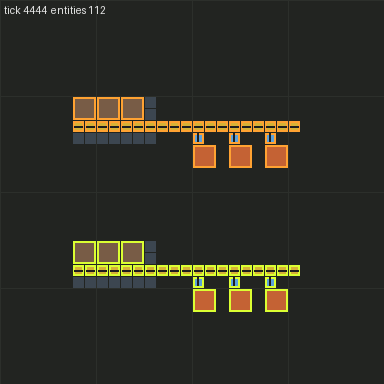

# M0 — Foundations and spike

Branch `m0-foundations` → `main`. Status: **acceptance met** (see below).

## Built

- **Repo and toolchain:** TypeScriptToLua 1.37.1 + TypeScript 6.0.2, typed-factorio 3.36.0 (Factorio 2.0.75 API
  types, the newest for the 2.0 line), with two TS projects (runtime and settings stages). `npm run build` writes
  the mod to `mod/build/`.
- **Mod skeleton** (`rival-engineers` 0.0.1): settings for faction count, crew size and debug parity toggles,
  storage init, async pathing service (`character/pathing.ts`), and remote interface `rival-engineers` with
  `version` and `dump_entities`.
- **Test infrastructure (T0 + T2):** `npm run typecheck`, and factorio-test 3.0.3 driving an isolated headless
  Factorio 2.0.77 in `.factorio-test/`. GitHub Actions runs both on every push and PR. factorio-test is
  vendored in `ci/mods/` (MIT), so **CI needs no Factorio credentials**. I verified this with a clean `HOME`
  and data dir.
- **Renderer:** `tools/render/render.py` turns entity dumps into PNG frames and GIF timelapses. Colour is by
  entity type, outline by force.

## Acceptance

| Criterion | Result |
|---|---|
| Repo, TSTL build | ✅ |
| factorio-test running headless in CI | ✅ locally, including a credential-less CI simulation. The first GitHub Actions run is on this PR. |
| Spike: walk, mine, craft, place, insert, pick up on a player-less character | ✅ all 8 engine-capability tests pass (below) |
| Renderer produces a PNG from a dump | ✅ |

### Spike findings (`mod/src/test/engine-capabilities.test.ts`)

A bare `character` entity with no `LuaPlayer` supports everything SPEC §5.1 needs, with **no fallbacks
required**:

| Action | API | Observed |
|---|---|---|
| Walk | `walking_state` | 8.9 tiles / 60 ticks (vanilla 0.15 t/tick). State **persists** if set only once. |
| Pathfind | `surface.request_path` + `on_script_path_request_finished` | Routes around a 17-tile wall |
| Mine resource | `update_selected_entity` + `mining_state` | 2 ore / 300 ticks = real hand-mining speed |
| Craft | `begin_crafting` | Real crafting time; nothing done at 20 ticks, both gears done by 70 |
| Place | `can_place_entity` → `remove_item` → `create_entity{raise_built}` | `can_place_entity` enforces `build_distance` = 10 (30 tiles rejected) |
| Insert | `can_reach_entity` + `entity.insert` | Reach enforced |
| Pick up | `mining_state` on a placed entity | Item returned to inventory |

These tests stay in the suite as **engine-assumption tests**, so a Factorio update that changes this behaviour
fails CI.

### Renders

Demo scene: two forces (distinct outlines), each a burner-drill → belt → inserter → furnace line.

Timelapse: [m0/demo-timelapse.gif](m0/demo-timelapse.gif)

## Deviations and assumptions

- **Target is Factorio 2.0.77 stable.** 2.1 (2.1.21) is out as *experimental*, and the newest typed-factorio
  (4.x) targets it. We pin 2.0 until 2.1 goes stable. Upgrading means bumping `FACTORIO_VERSION` in CI,
  `typed-factorio` and `info.json`.
- **T1 (pure-logic tests outside the game) is deferred to M1**, when there's pure logic to test (path smoothing,
  job ordering). The runner choice (system Lua + compiled output) gets decided then.
- **No `factorio-test.lock.json`.** The CLI only writes one when there are portal dependencies besides
  factorio-test. CI runs with `--no-frozen-lockfile` against the vendored zip.
- `CLAUDE.md` gained a "TSTL gotchas" section. The main one: closures inside `for (let …)` loops share one
  variable after transpiling. This bit the demo test.

## Questions for the user

None blocking.

## Next: M1 — Body

Character Controller with walk (path following + stuck detection and re-path), mine, craft, place, insert,
take and pick-up as resumable action state machines in `storage`, plus the T1 unit-test runner. Acceptance is
SPEC §8 M1.
