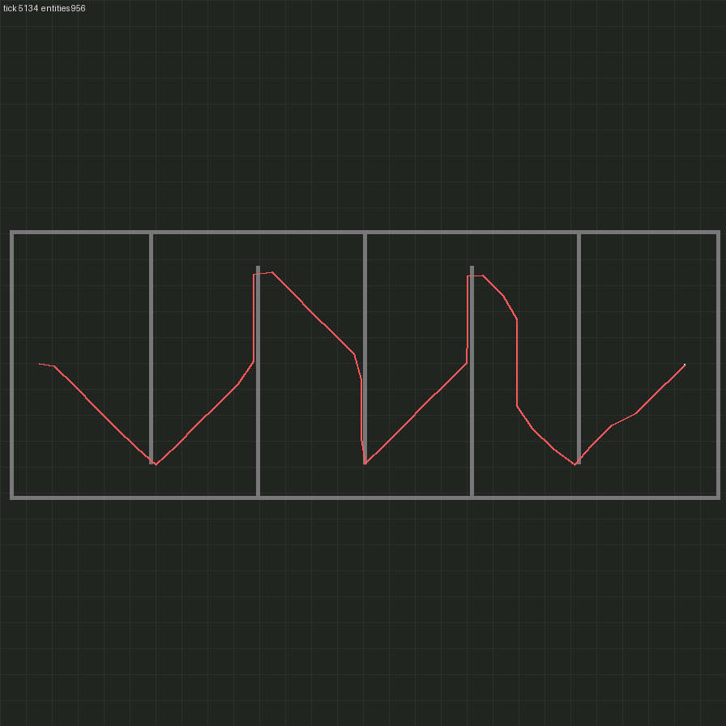

# M1 — Body

Branch `m1-body` → `m0-foundations` (stacked on the M0 PR). Status: **acceptance met** (see below).

## Built

- **Character Controller** (`mod/src/character/controller.ts`): one controller per character body, each with a
  queue of actions. An action is a resumable state machine stored in `storage.actions`. It is stepped once per
  tick from `on_tick`, under a per-tick budget of at most `controllerStepsPerTick` busy controllers, round-robin.
  Every action ends `succeeded`, `failed` with a stable reason string, or `cancelled`, and carries stats (re-paths,
  path tiles, walking ticks, items).
  - **walk(goal, radius)** (`walk.ts`): `request_path`, wait for the async result, then follow the waypoints by
    setting `walking_state` every tick with 8-way steering. Stuck detection: no progress (getting ≥ 0.1 tiles
    closer to the current waypoint) for `stuckTicks` → re-path from where it stands. If the path runs out short of
    the goal, it also re-paths. After `maxRepaths` re-paths the walk fails (`stuck` / `unreachable`). If the
    pathfinder finds no path it fails with `no-path`. When the pathfinder is busy it retries, with a bound.
  - **mine(target | position, count?)**: walks into *resource* reach (2.7 tiles), then drives `mining_state`
    until it has `count` of the product or the target is gone. Fails on `inventory-full` or `stalled`.
  - **craft(recipe, count)**: checks the recipe is enabled and hand-craftable (recipe category ∈ the character's
    crafting categories, so it is Space-Age safe) and that `get_craftable_count ≥ count`, then `begin_crafting`.
    It completes when the products are in the inventory. Missing ingredients fail before anything is consumed.
  - **place(item, position, direction)**: walks into `build_distance`, then runs the player's own
    `character.can_place_entity` check, removes the item and calls `create_entity{raise_built=true}`. The new
    entity is returned in `action.placed`.
  - **insert / take(entity, item, count)**: walk until `can_reach_entity`, then a reach-checked transfer. A
    partial transfer is rolled back. Failure reasons: `missing-item`, `target-full`, `not-enough`, `inventory-full`.
  - **pickUp(entity)**: walk into reach, then mine it with `mining_state`. It succeeds only if the item arrived.
  - **Queue API** for M2: `createController`, `enqueue`, `cancel`, `cancelAll`, `getAction`, `actionStatus`,
    `isIdle`, `destroyController`. These are also on the remote interface (`create_controller`, `enqueue`, `cancel`,
    `is_idle`, `action`). The last 64 finished actions per controller stay queryable.
  - **Death and invalidity:** `.valid` is checked every step. A dead character fails its running and queued
    actions with `character-invalid`, and the controller then rejects new work the same way.
- **Typed config module** (`mod/src/config.ts`): `getConfig()` is the only reader of settings. Overrides
  (`setConfigOverride`, plus the `set_config_override` / `get_config` remotes) live in `storage`. New
  runtime-global settings: `controller-steps-per-tick` (32), `stuck-ticks` (60), `max-repaths` (5),
  `action-stall-ticks` (1200). The debug parity toggles are now honoured and stay **off** by default:
  - teleport-when-stuck hops two waypoints ahead instead of re-pathing, bounded by `maxRepaths`.
  - instant-craft swaps ingredients for products at once when all direct ingredients are present.
- **T1 unit tests** (`mod/unit/`, `npm run test:unit`): pure modules are compiled by TSTL into `mod/build-unit` and
  run with plain Lua (`lua5.2` in CI, any 5.2+ locally) under a ~40-line assert harness. The first suite covers
  `character/steering.ts`: 8-way direction selection, including the 22.5° boundaries; waypoint advance and final
  tolerance; an 8-way walker simulation that must converge with < 15% overhead; and stuck detection, including
  wall-sliding without closing in. CI runs T1 between typecheck and the in-game tests.
- **Renderer:** `--trail` draws the character's walked path across dumps. Small entities no longer crash it at
  low `--scale`.

## Acceptance (SPEC §8 M1)

All T2 tests run with both debug toggles off. Each test asserts this, after clearing config overrides.

| Criterion | Test (`mod/src/test/controller.test.ts`) | Result |
|---|---|---|
| Walks 200 tiles around obstacles and arrives | `walks 200 tiles through a wall maze and arrives` | ✅ 200 tiles in a straight line, through a walled 216×81 box with 5 staggered inner walls |
| Mines 50 iron ore | `mines 50 iron ore` | ✅ exactly 50, at real hand-mining speed |
| Crafts 10 gears | `crafts 10 gears at real speed` | ✅ |
| Places a burner drill on ore and fuels it; the drill mines | `burner drill > is placed on ore and fuelled with coal, then mines` | ✅ the crew also places a chest at the drill's drop position, which receives the drill's ore |
| Stuck recovery | `stuck recovery: re-paths around a wall dropped onto its route` | ✅ a 13-tile wall is dropped across the route 25 tiles ahead mid-walk. The walker gets stuck, re-paths once and arrives |
| Save/reload resumes an in-progress action | `an in-progress walk resumes after a script reload` (`.after_reload_script`) | ✅ mid-walk with phase `follow` before and after the reload, then arrives on the stored path with 0 re-paths |

Supporting tests: no-path failure (walled-in goal), mining stops at depletion, craft without ingredients fails
cleanly, insert/take/too-much-take/pick-up of a full chest (contents returned), cancel mid-walk (stops at once,
queue continues), character death, debug toggles (instant craft, teleport-when-stuck), remote API and config
overrides, and a new engine-assumption test for the pathfinder force behaviour (below).

**Totals:** T2 has 26 tests passing (9 engine, 3 remote, 14 controller) and runs in about 13 s wall-clock locally.
T1 has 11 tests passing.

### Measured (`[m1]` lines in `factorio-current.log`)

| What | Number |
|---|---|
| Maze walk: 200 tiles straight-line, 402-tile path | 2 780 ticks (46 s game time), 2 695 of them walking → **0.149 tiles/tick**, i.e. vanilla running speed (0.15) |
| Path-request wait + stops | ~85 ticks over the walk |
| Controller CPU, one walking character | **0.027 ms/tick** (LuaProfiler over the maze walk, including `getConfig()` every tick). Extrapolated to 2 factions × 2 crew, that is ~0.1 ms/tick, well under the 2 ms target (D13) |
| Stuck recovery | 574 ticks for 60 tiles including 1 re-path. Detection costs `stuckTicks` = 60 ticks |
| Mining 50 iron ore | 6 085 ticks (120/ore = real speed, plus 34 ticks walking into reach) |
| Crafting 10 gears | 310 ticks (30/gear = real speed) |
| Burner drill output | 2 ore in 600 ticks (0.25/s = real speed) |

### Render

The maze walk, with the walker's trail sampled every 60 ticks, so corners look slightly cut:

Timelapse: [m1/maze-walk.gif](m1/maze-walk.gif)

## Key finding: the pathfinder walks through other forces' entities

`surface.request_path` treats every entity that the *requesting force could attack* as destroyable and plans
straight through it. That covers neutral walls and trees and other factions' buildings (it is the biter
pathfinder). Only own or allied entities and indestructible ones (rocks) block. The results also depend on the
geometry, because "destroying" has a cost to weigh against the detour, which made the first failures look random.
The M0 spike test only checked `#path > 2`, so it missed this.

**Fix:** character paths are requested as the **`neutral` force**, which attacks nothing, so every obstacle blocks.
This is what a walking player experiences. A new engine-assumption test pins both halves: as `player` the path
crosses a neutral wall, and as `neutral` it detours. The M0 pathfinder test now asserts a real detour. One side
effect: gates won't open for neutral paths. There are no gates in v1 (§4); revisit when P2 adds walls.

## Deviations and assumptions

- **Cancelling a craft** stops tracking it but leaves already-queued crafts in the character's crafting queue,
  as for a player who walks away. M2 can call `cancel_crafting` if it needs the ingredients back.
- **Per-tick budget** counts busy controllers stepped, not milliseconds: wall-clock time is non-deterministic and
  not readable from Lua. Idle controllers are free. Over-budget controllers are stepped round-robin, and since
  `walking_state` persists, a skipped walker keeps its heading for that tick.
- **Resource reach** is checked as distance to the resource centre ≤ `resource_reach_distance` (conservative).
  **Build reach** is distance to the position ≤ `build_distance − 1`, then the engine's `can_place_entity` decides.
- **take** is strict: it fails with `not-enough` if the entity holds fewer than `count`, rather than taking what is
  there. Easy to relax if M2's haul jobs want partial takes.
- **Placing on top of the walker:** the approach stops ≥ 3 tiles inside build range, so this didn't come up. If
  the character stands in the footprint, `place` fails with `cannot-place`. It does not step aside yet.
- **Reach multiplier** (a §5.7 debug toggle) is not implemented yet. Nothing needed it.
- Labs in `test/lab.ts` now advance by their own size (`2r + 64` gap). The old `4 × radius × index` overlapped
  labs of mixed sizes.

## Questions for the user (non-blocking)

1. Should `take` default to *as many as available, up to count* (lenient) instead of strict? I kept it strict;
   M2 will show which one haul jobs want.
2. Defaults `stuck-ticks = 60` and `max-repaths = 5` work in the tests. Tell me if you'd prefer
   them tuned for "never give up" in long soak runs.

## Next: M2 — Crew and jobs

Job Board on top of this queue API: jobs (`gather`, `craft`, `haul`, `place`, `fuel`, `clear`) with claims,
priorities and locality batching (place every reachable ghost from one standing spot, which needs a
"place-many" variant of `place` that keeps the walker still). Ghosts on the faction's force are filled from a
material stockpile. Acceptance (§8): two characters build a 40-entity ghost layout with no double claims and less
than 10% idle time while jobs exist. Also planned: the per-character idle/busy telemetry needed to measure that,
plus T1 tests for claim ordering and batching.
