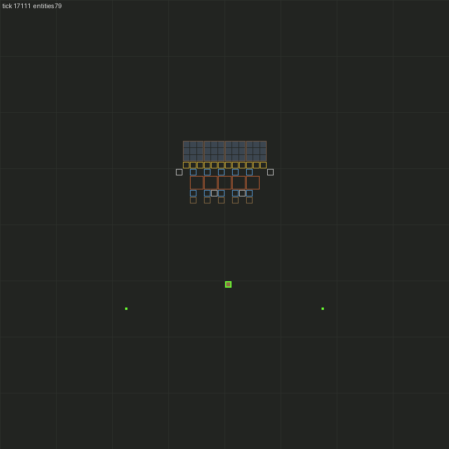
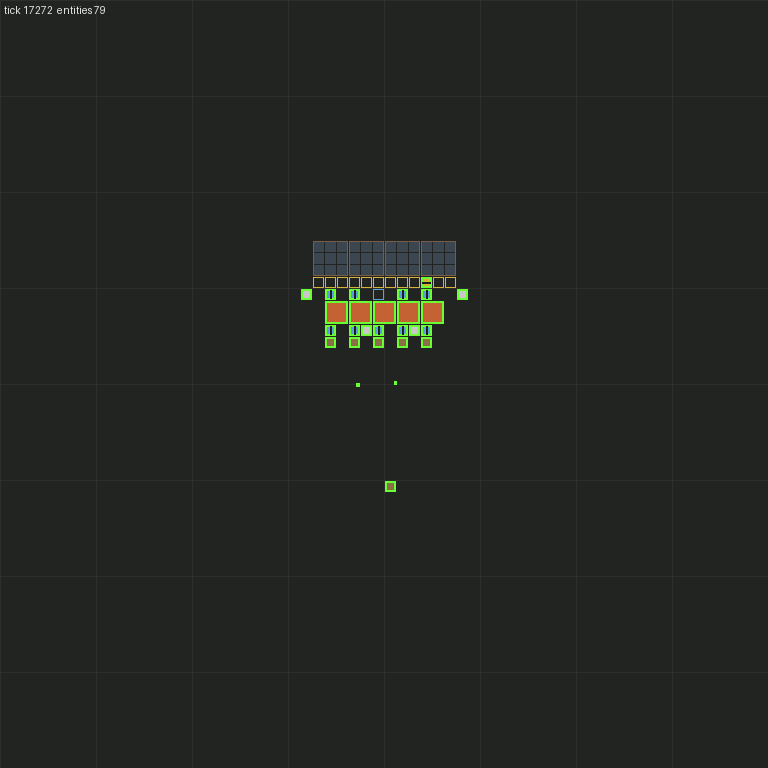
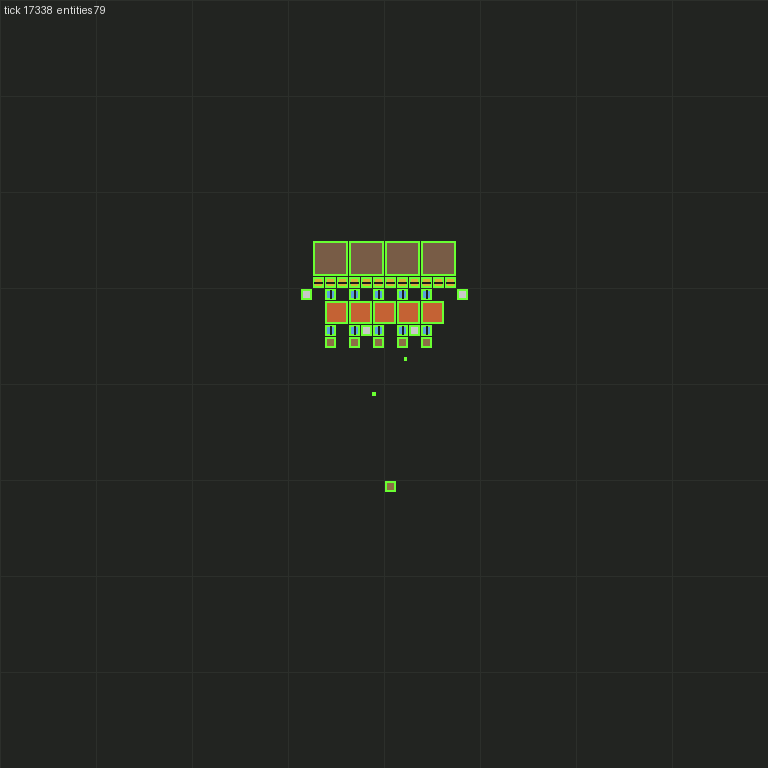

# M2: Crew and jobs

Branch `m2-crew-jobs` → `m1-body` (stacked on the M1 PR). Status: **acceptance met** (see below).

## Spec changes on this branch

- **v0.5 housekeeping and D20** (no steel production in v1), committed before M2 work.
- **v0.6** (user guidance): generators are the default for simple recipes at any stage. A curated module can be
  promoted to a generator by declaring `ModuleDef.expand` (repeatable unit, axis/axes, max units, per-unit rates and
  ports). §5.3's 8×8 grid is replaced by **real-terrain compact placement**: it respects cliffs, water, needed ore,
  trees and rocks (clearable at a cost) and the faction's own structures, and the corridor width is a policy
  parameter. A new pluggable **`LayoutPolicy`** (§5.3, selected via §5.7) supports policy tests and soak A/B
  comparison (§7). M4/M5 acceptance now requires real generated terrain with cliffs, water and existing structures.
- **v0.7** (interview): new **§5.8 Factory Graph and throughput**, inserted verbatim, with decisions **D21–D29**.
  Lane-preserving routing between modules is removed (single-item ports, `Port.side`). M4/M5/M6 acceptance
  reference the graph work.
- In the M2 commit, §5.1/§5.2 now describe what was implemented: ghost filling via `revive`, partial `take`,
  craft cancel, the reach multiplier, and claim/release/back-off semantics.

## Built

- **Job Board** (`mod/src/jobs/board.ts`): pure logic with no Factorio globals, so T1 can test it. There is one
  board per faction, in `storage`. A job has `kind` (`gather`, `craft`, `haul`, `place`, `fuel`, `clear`), `pos`,
  optional `footprint`, `materials`, `deps[]`, `priority`, `status` (`open → claimed → done | failed`), `claimedBy`,
  `attempts`, `retryAt`, `reason` and an opaque runtime `payload`.
  - **Selection:** highest priority first, then nearest to the crew member, then lowest id (deterministic).
    Ready means open, past its back-off, and every dependency done.
  - **Claims** are exclusive and all-or-nothing for a batch. Claiming a held job is refused and counted
    (`doubleClaims`). Every claim, release, completion and failure goes to a bounded **claim log**.
  - **Release:** a failed attempt backs off `job-retry-ticks × 2^(attempts−1)` and fails the job with its reason
    after `job-max-attempts`. A failed job also fails its dependents, transitively. Unpenalised releases (crew death,
    a character standing in the way) retry after a short delay and count as `deferrals`. After 40 deferrals they
    count as attempts after all.
  - **Locality batching** (`planBatch` / `chooseStandingSpot`): from the anchor job, it adds same-kind ready jobs
    nearby, then searches a half-tile grid for the standing spot nearest the walker that is within reach of every
    job, outside every planned footprint and other crew members' spots, and free (a runtime collision check, at most
    12 calls). If no spot exists it drops the farthest job and tries again. Reach is `build_distance − 1.5` for
    place and `reach_distance − 1.5` for fuel, so no place action has to walk.
  - `fitMaterials` and `missingMaterials` trim a batch to the materials available and compute the haul list.
- **Factions** (`mod/src/jobs/faction.ts`): `createFaction(name, {position?, crew?})` makes a LuaForce
  `rival-<name>`, cease-fire both ways with every non-biter force (D6), and spawns the crew (default `crew-size`).
  Also `addCrew`, `spawnCrew`, `addStockpile` (only the faction's own chests), `destroyFaction`, and
  `planGhosts(faction, {area?, fuel?})`. The last turns the faction's `entity-ghost`s into place jobs, once per
  ghost, with the item from `items_to_place_this` and the footprint from the ghost's box. It can optionally add a
  fuel job for every burner entity, depending on its place job.
- **Crew runtime** (`mod/src/jobs/crew.ts`): an idle member drops dead jobs (ghost gone, target gone) and selects
  an anchor whose materials it can get. Then it plans the batch, claims it, **hauls** the missing materials, walks
  to the spot and enqueues one controller action per job. A haul is a board job the member creates and claims for
  itself, carried out with **partial takes**. Each tick the member reads finished actions in order. When a job's
  last action succeeds the job completes. A failure cancels the job's other actions and releases the job.
  - **Materials:** availability = own inventory + the faction's stockpiles − **reservations** (items another member
    is on its way to take). So two members never plan with the same items, and an exact stockpile works.
  - **Executors:** place → `place` with the ghost; fuel → `insert` into the built entity; gather → `mine` (plus
    `insert` into `deliverTo`); craft → `craft`; clear → `pickUp` for own buildings, `mine` for trees and rocks.
  - **Death or invalidity:** the member's own hauls fail, every other claim is released with no penalty,
    reservations are dropped and its actions cancelled. Finished actions are read *before* this (see gotchas).
  - **Idle telemetry** per member: `ticks`, `idleTicks` (no claim while the board has ready jobs), `busyTicks`,
    `batches`, `jobsDone`, `jobsReleased`, `hauls`.
- **Tick entry** (`mod/src/tick.ts`): crew first, then controllers, with an optional profiler over both.
- **Remote interface:** `create_faction`, `destroy_faction`, `spawn_crew`, `add_crew`, `add_stockpile`,
  `plan_ghosts`, `set_faction_paused`, `faction_stats` (counters, jobs by status, per-crew stats).
  `dump_entities` now writes ghosts with the planned entity's footprint, and the renderer draws them as outlines.
- **New settings** (runtime-global): `job-max-attempts` (3), `job-retry-ticks` (120), `job-blocked-retry-ticks`
  (30), `batch-max-jobs` (12), `debug-reach-multiplier` (1, debug only).

### M1 follow-ups

- **Partial take:** `take {allowPartial: true}` takes what is there up to the count. It fails (`not-enough`) only
  if there is none. Strict mode is unchanged. Haul jobs use partial takes.
- **Craft cancel:** cancelling (or failing) a running craft calls `cancel_crafting` on the crafts it queued, and
  the ingredients come back. Crafting runs one action at a time per controller, so every queued craft is the
  action's own.
- **Reach multiplier: implemented** (debug only, default 1). It sets `character_build_distance_bonus`,
  `character_reach_distance_bonus` and `character_resource_reach_distance_bonus` to `base × (m − 1)`. These are
  the same per-character bonuses research uses, so the player-equivalent checks (`can_place_entity`,
  `can_reach_entity`, `build_distance`) all honour it with no special cases. The uint bonuses round down.
- **Placing over a ghost works under player rules:** `character.can_place_entity` passes with a ghost present
  (ghosts don't collide) and fails with a real obstacle on the ghost. The fill uses `ghost.revive`, so the entity
  keeps the ghost's settings (as a player building over a ghost does), and a failed fill leaves the ghost in place.
  An earlier draft destroyed the ghost and called `create_entity`. It was replaced because that loses the ghost's
  settings and had to recreate the ghost on failure.

## Acceptance (SPEC §8 M2)

Every T2 test clears config overrides and asserts that all debug toggles are off (teleport, instant craft,
reach multiplier = 1).

| Criterion | Test (`mod/src/test/jobs.test.ts`) | Result |
|---|---|---|
| Two crew jointly build a 40-entity ghost layout from a stockpile | `two crew jointly build a 40-entity ghost layout from a stockpile` | ✅ 4 electric drills on ore, 12 belts, 5 burner inserters, 5 stone furnaces, 5 inserters, 5 chests and 4 small poles, plus 10 fuel jobs. Every planned entity exists at its position on the faction's force, no ghosts remain, every burner holds its coal, and the **exactly-sized** stockpile ends empty |
| No double claims | same | ✅ `doubleClaims = 0`, and a **claim-log replay** shows no job claimed while held and each job done once |
| Idle < 10% while jobs exist | same | ✅ **0.0%** for both members (0/227 ticks), each did a real share (20 and 30 jobs) |
| A failed job is released and retried or failed with a reason, and doesn't block others | `a blocked ghost fails with a reason after bounded retries and blocks nothing else` | ✅ a neutral wall sits under one burner-inserter ghost. The job fails after 3 attempts with `cannot-place: …`, its fuel job fails `dep-failed:<id>`, and the other 39 are built |
| Crew death mid-job releases its claims | `a crew member's death releases its claims and the other finishes the build` | ✅ killed while holding 9 claims. On the next tick none is held by the dead member (its haul failed), and the survivor finishes everything (46 jobs) with no failures |
| Two factions don't take each other's jobs or materials | `two factions build concurrently without taking each other's jobs or materials` | ✅ two labs, 2 crew each, built at the same time. Each board planned only its own 50 jobs, each exactly-sized stockpile ends empty, every claim-log entry is by the faction's own crew, and each crew stayed in its own lab |
| Save/reload mid-build resumes | `a build resumes after a save/reload mid-build` (`.after_reload_script`) | ✅ reloaded after ≥ 10 completions with > 20 jobs active, then the build finished with no failures and a clean claim log |

Supporting tests: every job kind runs (gather + deliver, craft from stockpiled plates, clear a tree, fuel a
furnace). In `controller.test.ts`: partial take, craft cancel returns ingredients, ghost fill under player rules
(and blocked fill keeps the ghost), mining a tree 8 tiles away, and the reach-multiplier debug toggle.

**Totals:** T2 has **37** tests passing (9 engine, 3 remote, 19 controller, 6 jobs) in about 11 s wall-clock
locally. T1 has **25** (14 board, 11 steering). The board's T1 suite covers priority-over-distance, nearest-first
with id ties, accept filters, dependency readiness, exclusive all-or-nothing claims, back-off doubling and failure,
transitive dependency failure, death release, release delays and deferrals, standing-spot reach/footprint/runtime
veto and check bound, batch grouping and caps, `extraAvoid`, material fitting, and a 40-job two-member drain
simulation with no double claims.

### Measured (`[m2]` lines in `factorio-current.log`)

| What | Number |
|---|---|
| 40 entities + 10 fuel jobs, 2 crew | **227 ticks (3.8 s game time)**. Crew 1: 20 jobs, 4 batches, 4 hauls. Crew 2: 30 jobs, 4 batches, 4 hauls. 58 claims (50 jobs + 8 hauls), 0 releases |
| Idle while ready jobs exist | **0.0% / 0.0%** |
| AI CPU (crew + controllers), 2 crew | **0.17–0.20 ms/tick** averaged over the build (≈ 38–45 ms total), well under D13's 2 ms for 2 × 2 crew |
| Blocked ghost | failed after 3 attempts (120 + 240 ticks of back-off) |

The build is fast because both members start ~14 tiles from the stockpile, each batch is 6–12 placements from one
spot, and a placement takes one tick once in reach (see question 2).

### Render

Start (ghost outlines, both crew and the stockpile chest), mid-build (24 of 40 placed, tick +165) and done:

  

Timelapse (one frame every 15 ticks): [m2/build-timelapse.gif](m2/build-timelapse.gif)

## Finding: what in red/green depends on steel (from `data/base/prototypes/technology.lua`, 2.0.77)

D20 says v1 researches every red/green tech without producing steel, because "researching techs needs only science
packs". 2.0 **trigger technologies** break that assumption:

- **`steel-axe` is a trigger tech: "craft 50 steel-plate".** It can't be completed without steel production.
  No pack-researched tech depends on it, so it is the only casualty.
- **`oil-processing` is a trigger tech: "mine crude-oil"**, which needs a pumpjack (steel, and oil is a §4
  non-goal). **22 techs** whose cost is red/green packs sit behind it: plastics, advanced-circuit,
  sulfur-processing, battery, explosives, cliff-explosives, flammables, modules (+ speed/efficiency/productivity),
  bulk-inserter, inserter-capacity-bonus-1/2, mining-productivity-1, chemical-science-pack (the tech),
  electric-energy-accumulators, modular-armor and 5 equipment techs.
- Other triggers are harmless: `automation-science-pack` (craft a lab), `electronics` (10 copper plates),
  `steam-power` (50 iron plates).
- Steel as a **prerequisite** (research order only, fine under D20): automation-2, engine, solar-energy,
  electric-energy-distribution-1, advanced-material-processing, military-2, heavy-armor, steel-axe.
- Steel as an **ingredient** of red/green unlocks v1 would otherwise build: assembling-machine-2,
  medium/big poles, engine-unit, solar panel, steel furnace, piercing rounds. Under D20, v1 builds AM1, small
  poles and stone furnaces only.

So under D20 + §4, §3.2 "every technology that needs only red and green science" is satisfiable for **39 of 61**
pack-researched red/green techs plus 4 of the 5 trigger techs, but not all 66. See question 1.

## Deviations and assumptions

- **Haul look-ahead dropped.** The interrupted draft had a `haul-lookahead-jobs` setting (fetch materials for
  unclaimed jobs too). Carrying items for jobs you haven't claimed lets another member claim them with nothing to
  build with. Hauls now cover exactly the claimed batch (≤ `batch-max-jobs`), with stockpile reservations. The
  setting was replaced by `job-blocked-retry-ticks`.
- **Materials gate selection:** a member only claims jobs whose materials it can get (inventory + stockpile −
  reservations). A job with no materials stays open (it will be fed by M3's gather/craft jobs) instead of burning
  attempts. The idle metric still counts such jobs as "ready", which is the conservative reading.
- **"Ready jobs" for the idle metric** = board-ready jobs (open, back-off over, dependencies done), counted once
  per faction per tick after planning.
- **Ghost-removed jobs fail** (`ghost-removed`). Re-planning lost ghosts belongs to the planner (M5).
- **Factions are created by remote/test call**, not automatically at map start. Spawn placement (§5.7) arrives with
  the burner bootstrap in M3.
- **Batches are same-kind** (place with place, fuel with fuel). Gather, craft and clear run one job per batch.
- **Stockpile choice:** the nearest chest that holds the item. Takes are split across chests if one is short.
- **Tests use exact stockpiles** (except the death test, which needs a surplus because the dead member's
  inventory goes to its corpse).

## Questions for the user (non-blocking)

1. **§3.2 vs D20/§4 (needs a decision before M6):** `steel-axe` needs 50 crafted steel plates, and 22 red/green
   techs need the `oil-processing` trigger (mine crude oil). Options: (a) define §3.2 as "every red/green tech
   reachable without oil or steel production" (39 pack techs + 4 triggers), or (b) allow a one-off steel smelt for
   `steel-axe` (a stone furnace fed iron plates, not a module), keeping oil out. I'd suggest (a) plus (b) if cheap.
   I haven't changed §3.
2. **Placement speed:** like M1, a place action takes effect on the tick the walker is in reach, so a batch of 12
   lands in 12 ticks. That matches a player dragging, but it's faster than click-by-click play. Do you want a
   configurable per-placement "hand speed" delay for realism, default 0?
3. `batch-max-jobs = 12` and `job-max-attempts = 3` are guesses that work in tests. Soak runs will tune them.

## Next: M3, burner bootstrap

- **Faction spawning** per §5.7 (`auto-distance` etc.) at map init, vanilla starter items, crew from `crew-size`.
- The **gather / craft job chain** feeds place jobs: wood from trees for poles, stone for furnaces, iron/copper/coal
  hand-mining, and hand-crafting burner drills and furnaces. A simple bill-of-materials expansion turns a missing
  item into gather → craft jobs with deps. The board, executors and material accounting are already in place.
- A **scripted burner-phase heuristic** (allowed by §5.5 if documented) places burner drills on iron, copper, coal
  and stone with furnaces or chests at their outputs. Crew keep them fuelled (fuel jobs) and empty them (haul to the
  stockpile).
- Done when the "first electricity" materials are gathered (§8). A first T3-style soak on a real seed will tell
  whether clear jobs for trees and rocks are needed during placement.
