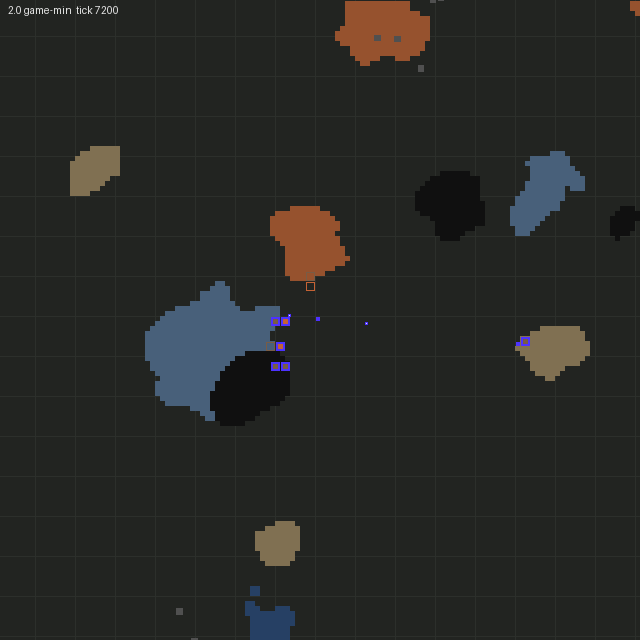
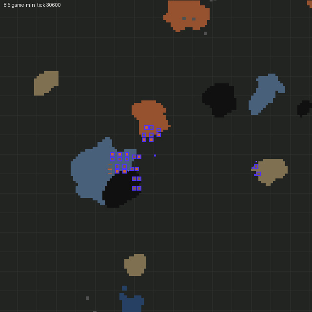

# M3: Burner bootstrap

Branch `m3-burner-bootstrap` → `m2-crew-jobs` (stacked on the M2 PR). Status: **acceptance met** (see below).

## Spec changes on this branch

- **v0.8 (user decisions).**
  - **D30 research goal:** red/green technologies reachable without steel production or crude oil, computed
    from prototypes at runtime (`mod/src/strategy/research.ts`). §3.2 is rewritten with the derivation rule.
    **The count is 42, not 43.** The M2 report counted "4 of 5 trigger techs", but `oil-processing` (trigger:
    mine crude oil) is itself unreachable. That leaves 39 pack techs plus `steam-power`, `electronics` and
    `automation-science-pack`. The T2 test pins 42 and gives the reason.
  - **D31 hand speed:** a configurable placement delay (below).
- **v0.9 (M3).** §5.5 documents the burner bootstrap: heuristics H1–H7, world knowledge, stall detection and
  replanning. §5.7 covers spawning, §7 the soak harness, and §5.1/§5.2 the walk escape and the new haul payloads.
  **D32:** faction starting areas through map-gen starting points (see the finding below). The user accepted
  it during M3; later milestones assume it.

## Built

- **Hand speed (D31):** `place-delay-ticks` (default **8**) and `belt-place-delay-ticks` (default **3**). A
  placement takes that long once the character is in reach. Why these defaults: a player placing distinct entities
  moves the cursor, maybe rotates, and clicks, about 0.12–0.17 s per entity at a brisk pace (7–10 ticks), so 8.
  Belts are drag-placed while the cursor sweeps, so about 3 ticks per belt, or 20 belts/s, which a standing player
  dragging across the screen reaches. M2's semantics are unchanged: its 40-entity build now takes **360 ticks**
  (was 227), still with 0% idle and no failures.
- **Spawning (§5.7)** (`world/spawn.ts`, `autospawn.ts`). `auto-spawn` creates `faction-count` factions on the
  first tick. It never runs under factorio-test.
  - `auto-distance` (default): spots on rings from `spawn-min-distance` (300) away from the player spawn, players
    and other factions. With `spawn-starting-area` (default on, D32), the first not-yet-generated spot becomes a
    `MapGenSettings.starting_points` entry before it is generated, so map-gen gives it a starting area. Without
    it, generated regions are searched on a 16-tile grid for a spot with iron, copper, coal and stone within
    `spawn-resource-radius` (96).
  - `fixed-offsets` and `scenario-defined` (the `spawn_faction` remote) are also implemented. `random-ring` is
    not.
  - **Starter items:** each crew member gets the freeplay `created_items`: 8 iron plates, 1 wood, a pistol,
    10 magazines, 1 burner drill and 1 stone furnace. They are read from the `freeplay` remote interface when it
    exists (it does in `--create` maps), else from the freeplay defaults copied from
    `base/script/freeplay/freeplay.lua`. Freeplay's crash site moves the plates into wreckage the player mines
    back; the crew gets them directly. Factions start with **no research**.
- **World knowledge** (`world/resources.ts`): crew don't chart. At start the brain generates the chunks within
  `scan-radius` (**128 tiles**) of the base, as a player exploring would, and clusters resource entities into
  patches. Patches are picked by distance minus 8 tiles per doubling of size. When a needed resource or trees are
  missing, H7 explores 64 tiles farther, up to 384, and rescans.
- **Strategy layer, burner bootstrap** (`strategy/bootstrap.ts`, `strategy/catalog.ts`): a goal-driven loop per
  faction every `brain-interval-ticks` (30).
  - **Catalog:** drill, furnace, chest, fuel and ore → plate pairs are read from prototypes (cheapest
    hand-craftable burner drill and furnace, cheapest chest, the resource product with a fuel value).
  - **Goals:** a depot, then sites interleaved by resource (`bootstrap-sites`, default
    `iron-ore=8,coal=4,stone=2,copper-ore=4`). Coal gets **self-feeding drill pairs** (each drill's output is the
    other's fuel slot). Ore gets a drill feeding a furnace and stone a drill feeding a chest. The
    first-electricity kit (`first-electricity-items`, default offshore pump, boiler, steam engine and 10 small
    poles) comes once each resource has half its sites.
  - **Demand-driven production:** jobs' materials and the kit's items are the demand. Shortfalls become collect
    transfers from machines, hand-crafts (raw materials; the crafting queue makes intermediates; recipes and
    counts from prototypes), or hand-mining. Ore is mined straight into a furnace of its kind.
  - **Upkeep:** burners are refuelled below 2 minutes of fuel. Research triggers (`steam-power`: 50 plates,
    `electronics`: 10 copper plates) fire from furnace output, which unlocks pipes and poles for the kit.
  - Everything goes through the M2 Job Board; the crew does all of it physically through the M1 controller. The
    heuristics are documented in the file header and SPEC §5.5 (H1–H7).
- **Job Board and crew extensions** (`jobs/`):
  - **Payloads:** `transfer` (collect from a machine into the depot), `deposit` (a member empties its pockets
    into the depot between jobs; brain factions only), and craft-with-delivery. Fuel jobs can also feed ore.
  - **Partial inserts:** `insert` has `allowPartial` for deliveries; leftovers get deposited.
  - **Telemetry:** per-crew busy ticks by job kind.
  - **Replans:** `resetMember` drops a member's work during a replan.
- **Stall detection (§3):** progress means a plan step: a goal done, a site part placed, or a plan craft done.
  After `stall-ticks` (54000 = 15 game-minutes) with no progress, the brain logs a stall with a reason (current
  goal, what the plan waits for, failure reasons since the last progress, job counts). Then it **replans**:
  - it drops all jobs;
  - it removes unbuilt site ghosts (partly built sites keep their built part);
  - it rescans and plans again.

  The stall counts as recovered at the next progress.
- **Controller fixes found by soaking:**
  - **Walk escape:** the pathfinder can't start from the 0.6-tile gap between two adjacent machines. A crew member
    got wedged between the drills of a coal pair and failed 17 728 deposit walks in a row. Walks now step to a
    free spot about a tile away and ask again (up to 3 times).
  - **Ghost-safe mining:** mining an ore tile under a ghost deconstructs the ghost. The controller refuses to mine
    when a ghost is selected.
- **Telemetry** (`telemetry.ts`, settings `telemetry-interval-ticks`, `frame-dump-interval-ticks`,
  `frame-dump-radius`, all off by default):
  - `script-output/rival-engineers/telemetry.json` holds per faction: the goal timeline, milestones with ticks,
    stalls, built sites, crew stats, pockets, last action and depot contents;
  - a `[re-telemetry]` log line with the AI profiler per interval;
  - `done.json` once every faction has the kit;
  - entity frames (with water tiles) per faction.
- **Soak harness (T3 basics)** (`tools/harness/soak.py`, `npm run soak`). See SPEC §7. It uses `--create` plus
  `--benchmark` in `.factorio-test/soak/` (separate from factorio-test's `.factorio-test/data`). Config overrides
  go through a generated helper mod. It stops early on `done.json` and writes `out/soak/<run>/scorecard.{md,json}`.
  `--gif` renders a timelapse per seed and faction. Configs: `soak.toml` (acceptance, 5 seeds),
  `two-factions.toml`, `no-starting-area.toml` (variant).
- **Renderer:** resources are coloured by ore, with water tiles and cliffs, and a game-minute stamp.
- **Remote:** `spawn_faction`, `start_bootstrap`, `faction_report`, `write_telemetry`, `research_goal`;
  `dump_entities` takes a surface and water flag.

## Acceptance (SPEC §8 M3)

Every acceptance run uses default settings, with all debug toggles off. Soaks override only the telemetry outputs
and `factionCount`.

| Criterion | Evidence | Result |
|---|---|---|
| T3: ≥ 4 of 5 fixed seeds reach "first-electricity materials gathered", no permanent stall | `npm run soak` (`tools/harness/soak.toml`), seeds 11, 222, 3333, 44444, 555555 | ✅ **5/5**, 7.1–9.5 game-minutes, 0 stalls |
| Two factions on one map both progress without interfering | `tools/harness/two-factions.toml`, seed 11 | ✅ both done (6.8 and 14.0 min), 680 tiles apart; neither force's entities ever appear in the other's frames; 0 double claims, 0 job failures |
| T2: spawn placement validity | `bootstrap.test.ts` › spawn placement | ✅ two factions on a real-terrain surface: ≥ 300 tiles from the player spawn and each other, on land, iron/copper/coal/stone within 96 tiles, freeplay starter items, 0 technologies researched |
| T2: resource finding | › resource scan | ✅ patches clustered (gap of 3 tiles splits), sizes and amounts exact; picks by distance and size; skips patches under the minimum |
| T2: a self-feeding coal drill pair | › coal drill pair | ✅ the brain builds the pair (each drop point inside the other drill), then it runs 3 game-minutes with **no** fuel job active; the surplus reaches the depot |
| T2: stall detection fires and recovers | › stall | ✅ the scanned stone patch is removed and another appears where only a rescan finds it; the stall fires after 1800 ticks (override) with reason `no stone within 120 tiles; no spot for site:chest:stone`, the replan rescans, and the site is built (recovered 90 ticks later) |
| Research-set count | `research.test.ts` | ✅ **42** (see spec changes); configured packs and exclusions change it as expected |

**Per seed** (one faction, default crew of 2; game-minutes):

| Seed | Kit gathered | Iron mining | Coal pair | Stone | Copper | Self-sustaining | steam-power | electronics | Stalls | AI ms/tick avg / p99 |
|---|---|---|---|---|---|---|---|---|---|---|
| 11 | **7.5** | 1.5 | 1.8 | 3.3 | 3.1 | 3.3 | 4.0 | 3.9 | 0 | 0.136 / 0.147 |
| 222 | **7.1** | 1.2 | 3.4 | 1.6 | 4.5 | 4.5 | 3.8 | 5.3 | 0 | 0.140 / 0.162 |
| 3333 | **8.1** | 1.3 | 3.1 | 2.4 | 6.0 | 6.0 | 4.2 | 6.7 | 0 | 0.114 / 0.120 |
| 44444 | **8.8** | 0.8 | 1.9 | 4.3 | 4.8 | 4.8 | 3.6 | 5.5 | 0 | 0.132 / 0.144 |
| 555555 | **9.5** | 3.1 | 3.4 | 7.1 | 4.7 | 7.1 | 5.7 | 5.4 | 0 | 0.141 / 0.153 |

When the kit is done, a typical base has 1 depot, 4–8 iron smelting sites, 1–2 coal pairs, 1–2 stone sites and
2–3 copper sites. The rest of the plan continues after the kit.

**Totals:** T2 has **44** tests passing (9 engine, 3 remote, 20 controller, 6 jobs, 2 research, 4 bootstrap) in
about 25 s wall-clock locally. The bootstrap tests take about 7 s of that. T1 has **25**, unchanged.

### Scorecard summary (`out/soak/m3-one-faction/scorecard.md`)

- **Speed:** 7.1–9.5 game-minutes to the first-electricity kit, against the brief's "a decent human, well under an
  hour". It is fast but physically consistent. The crew spends **53–75 %** of its time hand-mining, about 380 items
  over 8 minutes for 2 crew at real speed (0.5/s). That matches the bill: about 150 iron ore, 105 stone, 60 coal and
  a few copper and wood. Two engineers who never idle (0–1 % of crew-ticks without a claim) beat a typical player;
  hand speed is human (D31), and mining, crafting, walking and smelting are real-time.
- **Crew time by job kind:** gather 53–75 %, collect transfers 6–20 %, walking to work spots 7–19 %, crafting
  5–10 %, hauls 1–4 %, deposits 1–2 %. Placement and fuelling are under 1 % (fuelling walks count as "walk").
- **CPU:** AI (brain + crew + controllers) **0.11–0.14 ms/tick** average for one faction with 2 crew. p99 over
  1-minute intervals is ≤ 0.17. Two factions: 0.18 ms/tick (D13 target: 2 ms). Wall-clock is about 0.5 ms/tick for the
  whole game in `--benchmark`, so about 30 game-minutes per real minute.
- **Spawn:** the first starting-area spot worked on every seed. With `spawn-starting-area` on, the spawn takes about
  0.5 s at the first tick.

### Render

Seed 11 at 2 minutes (iron smelting started) and when the kit is done (8.5 min). Ore is coloured, purple outlines
are the faction's buildings, and the depot sits between the patches:

 

Timelapse, one frame per 30 game-seconds: [m3/bootstrap-seed-11.gif](m3/bootstrap-seed-11.gif)

## Finding: resources are sparse outside starting areas (why D32)

The first soak placed factions on naturally generated land, 300+ tiles out. Spawn searches over 40 regions often
found no spot with all four resources within 96 tiles. On seed 2, a 1536 × 1536 scan showed iron only within about
400 tiles of the origin, and none beyond. In 2.0, non-starting-area patches are few and far apart, so a faction
300 tiles from the player would start much worse than a player (D5).

The fix is the vanilla PvP scenario's mechanism. The faction's spawn is added to `MapGenSettings.starting_points`
while its surroundings are still ungenerated, and map-gen then gives it a starting area like the player's. It is
deterministic, uses no scripted resource placement, and only affects chunks generated afterwards. It is a setting,
and with it off the search fallback still works.

**Variant without starting areas** (`no-starting-area.toml`, same seeds, 2 h cap): **3/5** seeds pass, at 26.9, 113.5 (3 stalls, all recovered) and 17.3 min. Seed 222 never builds its depot
(every walk to the hub fails `no-path`, 7 unrecovered stalls), and seed 44444 has 6 unrecovered stalls. The user
has since decided that factions always get starting areas, so this variant is not pursued further.

This is not the acceptance configuration. It shows what D32 buys, and two gaps for later:

- a hub the crew can't reach (across water) makes every job fail `no-path`, and replanning picks the same hub;
- far-apart patches mean long walks.

## Deviations and assumptions

- **D32 starting areas** give factions a player-like start (D5) at the spec's default 300-tile distance. The user
  confirmed it mid-milestone.
- **The research count is 42**, not the 43 in the brief (see spec changes).
- **Done criterion:** M3 ends at the milestone `first-electricity-materials`: the kit's items are in the depot or
  crew pockets. The harness stops there. The remaining bootstrap sites (to 8/4/2/4 drills) continue afterwards and
  aren't needed for M3. "Self-sustaining" is its own milestone: every resource has a working drill, with smelting
  on iron and copper and fuel from a coal pair.
- **Starter items:** each crew member gets the full freeplay `created_items`, including the 8 plates freeplay puts
  into crash-site wreckage. No crash site is modelled.
- **Exploration** generates chunks synchronously (`force_generate_chunk_requests`): 128 tiles at start, plus a ring
  per H7 step. That causes a one-off hitch of up to about 0.5 s per faction, fine for v1. Asynchronous generation
  rescanned half-generated chunks in an early version.
- **No outputs collected without demand.** An early version emptied every furnace at 50–80 plates; the depot
  filled four wooden chests with unneeded plates and crew time went to hauling. A full furnace now just pauses its
  drill. Depot chests are added when the depot has under 3 free slots.
- **Pocket items are pooled only through the depot.** Before the depot exists, the brain counts the best-stocked
  member's pocket, not the sum. Two members holding 1 wood each can't craft a chest.
- **Fuel** is the first resource product with a fuel value (coal). Wood is never burnt.
- **Hand speed covers placement only.** Insert and take have no extra delay; mining and crafting have their real
  times.
- **Telemetry ms/tick** comes from the mod's own profiler per telemetry interval (p99 over 1-minute intervals, not
  per tick). `--benchmark` prints per-tick timings only for runs that finish, and the harness stops early.
- **Seeds:** nearby seeds can give identical starting areas at the same spot (seeds 2/3 and 4/5 did), so the
  acceptance seeds are spread out (11, 222, 3333, 44444, 555555).

## Questions for the user (non-blocking)

1. **The kit is fast (7–10 game-min).** Every action runs at player speed, but two tireless engineers outpace a
   human. If you want a more human pace, the obvious knobs are "think time" between jobs or a crafting/mining
   efficiency below 100%. Both are cheap settings; I didn't add them, since parity says real speeds.
2. **Bootstrap targets** (`iron-ore=8,coal=4,stone=2,copper-ore=4`, kit at half) are guesses. M5's planner will
   size burner mining from the steam/assembler build it wants next.

## Next: M4, modules and routing

- Module library pipeline (generators first: smelter column, mine outpost, steam block; curated with `expand`), tag →
  filter → in-game validation.
- A* belt router with undergrounds and rip-up, and the early-compact `LayoutPolicy` placing on **real generated
  terrain**. `bootstrap.test.ts`'s `realSurface` and the starting-area spawn give a ready test bed.
- Factory Graph physical layer and capacity math (T1), and the undersized-belt lab (T2).
- Carry-overs from M3: reachability checks when choosing the hub and patches (the variant's `no-path` failure),
  and replans that change the hub when failures are mostly `no-path`.
