# M4: Modules and routing

Branch `m4-modules-routing` → `m3-burner-bootstrap` (stacked). M4 is split in two halves on the same branch:
**M4a, the module library**, and **M4b, the belt router, real-terrain placement and the physical graph layer**.
Both are done.

Status of the M4 acceptance (SPEC §8): module library pipeline, ≥ 10 modules, ≥ 1 curated module with `expand`, all
passing validation: **met** (M4a, re-validated under D33). Router lab with 5 modules, early-compact LayoutPolicy on
real generated terrain, physical layer, capacity math, T1 capacity/overflow tests and a T2 undersized-belt lab:
**met** (M4b, below). Full T2 suite: 69/69 pass.

## M4a: module library

### Built

- **ModuleDef format** (`mod/src/modules/types.ts`), TS types used at runtime and by T1 tests, plus the JSON format of
  `data/modules/*.json` (`CuratedModuleFile`: a ModuleDef without its computed fields). Module-local tile
  coordinates (top-left corner (0, 0), entity centres), canonical orientation, single-item ports (D23) with an
  optional lane `side`, `site` + `anchor` (water tiles for `shore`, drill mining areas for `resource-patch`),
  `expand`, `provenance`, `requiresTech`, `upkeep` (burners the crew must fuel), `notes`.
- **Rates are computed, never entered** (`rates.ts`). From prototypes: machine speed / recipe energy, drill speed /
  mining time, lab speed / unit time, inserter throughput (one item per full turn × a calibrated efficiency),
  burner fuel draw, steam (boiler, engine and pump limits), electric demand. Internal intermediates are balanced
  exactly: final machines run at a common fraction of capacity, intermediate makers share demand in proportion to
  capacity (a small LP; the graph inside a module is acyclic). One engine for generated and curated modules.
- **Prototype facts** behind an interface (`facts.ts`): `prototype-facts.ts` reads `prototypes` in game,
  `mod/unit/vanilla-facts.ts` is a hand table for T1. Nothing vanilla is hardcoded in the library itself except
  generator defaults (entity names), all overridable by parameters.
- **Geometry** (`geometry.ts`): footprints, occupancy (overlap check), transforms (mirror then rotate, in the
  module frame) for entities, ports (lane `side` swaps on mirror) and anchors; `portOutsideTile`.
- **Generators** (`generators.ts`, deterministic, from prototypes; parameters: count, belt, inserter, pole, machine):

  | Generator | Layout | Unit (expand) | Inputs → outputs |
  |---|---|---|---|
  | `smelter-column` | two mirrored furnace rows around one belt; ore and fuel enter on separate ports and merge onto the two lanes inside | 4 furnaces | ore, coal → plates/bricks |
  | `mining-outpost` | electric (3×3) or burner (2×2) drills on 1–2 sides of a belt; `site = resource-patch` | 2 rows (electric) / 1 row | → ore |
  | `steam-block` | offshore pump (west, water outside the footprint: `site = shore`), boilers with 2 engines each, burner inserters on a coal belt | 1 boiler | coal → electricity |
  | `assembler-row` | N assembling machines between an output belt and a two-lane input belt; 1–2 inserters per side sized from the recipe | 2 machines | any recipe with ≤ 2 solid ingredients |
  | `red-line` | units of red – gear – red, gears by direct insertion | 3 machines | iron, copper → red |
  | `circuit-block` | C K C K C (3 cable : 2 circuit), each circuit assembler fed cable by 2 inserters from each neighbour | 5 machines | iron, copper → circuits |
  | `lab-array` | pairs of labs, the second fed by the first (lab-to-lab inserter); red + green merged on one belt | 2 labs | packs → research units |

  Each generator places its own small poles in a periodic pattern (growing never moves a pole) and declares
  `expand`. T1 checks `expandModule(gen(n), k) ≡ gen(n + k)` entity for entity, for every generator.
- **Curated modules** (`data/modules/`, built by `tools/modules/curate.py` from specs in `tools/modules/curated/`,
  blueprint strings cached in `data/modules/sources/`, attribution in `data/modules/ATTRIBUTION.md`):

  | Module | Source (factorioprints, licence: none stated) | Normalisation |
  |---|---|---|
  | `green-line-hellpet` | "Science Pack Logistic (green) - 0.18", HellPet | AM2 → AM1, fast → yellow inserters; the two inserters that took plates from the neighbouring tile's bus became belt ports; whole chain from plates (cable, circuit, gear, inserter, belt, 6 science assemblers) |
  | `red-tile-ramqvist` | "Tileable Science Production…" (Automation 1.5/s, gear input), Christoffer Ramqvist | AM2 → AM1, labels and bus undergrounds removed; **declares `expand`** (period 6 rows = 4 science assemblers, max 6 units) |
  | `mall-polse` | "Mall (Early game)", Pølse mølsen | AM2 → AM1, fast → yellow; lamps and two firearm assemblers removed; AM2 (steel) → gears, fast inserter → iron chest, gun turret → burner inserter; the chest buffer at the inlet replaced by iron and copper ports; 12 products into chests (`chest-out` ports) |

  The green line is **not** expandable: its feeder block is not periodic and every cut through it breaks a
  direct-insertion link (recorded in its notes). Grow it by placing another copy.
- **Validation lab** (T2, `mod/src/test/module-lab.ts`, `modules.test.ts`): stamps the module into a cleared lab
  (water and ore created from its anchor), powers it from an `electric-energy-interface` on a pole next to the power
  port (a steam block gets the interface as its load instead), feeds every input port by inserting items at the back
  of a feeder belt outside the port, empties sink belts every tick and output chests every second, refuels the
  crew-fuelled burners (`upkeep`), and measures once the module is in a steady state. Feed: **exactly 1.0 × declared**
  throughout (D33, user decision 2026-10-14). Steady state: after a minimum warm-up (45 s fast / 90 s slow), two
  consecutive groups of 3 windows (30 s / 60 s) agree within 3% on every output (malls: on their plate value) and
  every feeder delivered its full feed over the last group; warm-up capped at 15 / 60 game-minutes. Runs at
  `game.speed` 100. Test names carry `validation fast:` or `validation slow:` for filtering.
- `stampModule` (real entities or ghosts), `expandModule`, `expandTail`, `expandMoves`, `V1_CATALOG`,
  `curatedModule`, `generatedModule` (memoised per session; derived from prototypes only).

### Validation results (T2, game speed 100, fed 1.0 × declared, measured after steady state; D33)

| Module (catalog entry) | Declared | Measured | % | Warm-up to steady state |
|---|---|---|---|---|
| smelter-column iron, 12 furnaces | 3.75 plates/s | 3.660 | 97.6 | 15.0 min |
| smelter-column copper, 4 | 1.25 | 1.250 | 100.0 | 23.0 min |
| smelter-column stone-brick, 4 | 1.25 bricks/s | 1.203 | 96.3 | 19.0 min |
| mining-outpost iron, 4 rows × 2, electric | 4.0 ore/s | 4.000 | 100.0 | 3.5 min |
| mining-outpost coal, 3 rows × 2, burner | 1.5 | 1.500 | 100.0 | 3.5 min |
| steam-block, 2 boilers | 3.6 MW | 3.533 MW | 98.1 | 3.5 min |
| assembler-row gears, 4 | 3.024 gears/s | 3.017 | 99.8 | 3.5 min |
| assembler-row cable, 2 | 3.36 cable/s | 3.358 | 100.0 | 3.5 min |
| assembler-row belts, 2 | 3.024 belts/s | 3.017 | 99.8 | 3.5 min |
| red-line, 2 units | 0.4 red/s | 0.400 | 100.0 | 7.0 min |
| circuit-block, 1 unit | 1.787 circuits/s | 1.792 | 100.3 | 3.5 min |
| lab-array, 4 labs (researching the largest red+green tech) | 0.1333 units/s | 0.1333 | 100.0 | 8.0 min |
| curated red-tile-ramqvist | 1.0 red/s | 1.000 | 100.0 | 7.0 min |
| curated green-line-hellpet | 0.28 green/s | 0.280 | 100.0 | 9.0 min |
| curated mall-polse (plate value of all products, 15 min) | 7.088 | 6.551 | 92.4 | 7.0 min |
| curated mall-polse coverage (chests capped at 1 slot, 20 game-min) | every product | all 12 made | pass | n/a |

With the earlier 1.1× feed after a 3× primed warm-up (M4a as first submitted), the same modules measured 98.9–119%
(mall 107%). At 1.0× the gear and belt rows come down from 119% / 113% to 99.8%: the excess was the over-feed.

Times: the 16 validation tests take about 3.5 min (the smelter columns, now `slow`, need 15–23 game-minutes to
stabilise). Rendered modules: `docs/reports/m4/*.png`.

| Smelter column (12) | Steam block (2) | Circuit block | Red tile (curated) | Green line (curated) | Mall (curated) |
|---|---|---|---|---|---|
| 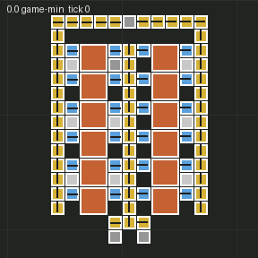 | 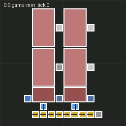 | 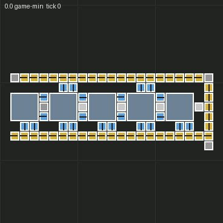 | 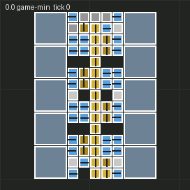 | 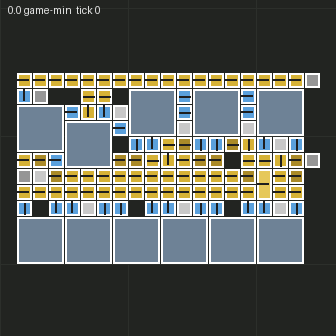 | 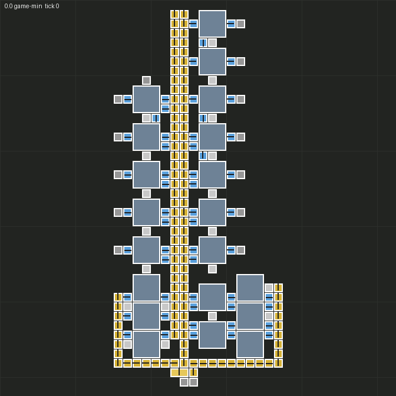 |

### Tests

- **T1** (`mod/unit/modules.test.ts`, 15 tests; 40 T1 tests in total): ratio sanity against hand-computed numbers
  (stone furnace 0.3125 plates/s, 12 furnaces = 3.75/s and 0.27 coal/s; AM1 speed 0.5 → 1 gear craft/s capped by two
  inserters; cable; red line 0.1/s per assembler; circuit block; steam 1.8 MW and 0.45 coal/s per boiler; electric
  drill 0.5/s, burner 0.25/s; labs 1/unit time and the inserter-limited case), layout invariants for 15 generator
  instances (no overlaps, inside the footprint, every powered entity covered, one pole network, single-item
  ports on the edge), expansion ≡ regeneration for every generator, `expandTail`/`expandMoves`, transforms (all
  4 rotations × mirror stay valid and powered; port side swaps on mirror; 4 quarter turns are the identity).
- **T2**: 16 new tests (15 catalog entries + mall coverage). Validation group with the D33 rule: ~3.5 min locally.
- **CI** (GitHub Actions `Test`, T0–T2) on `m4-modules-routing`: success (3 min 28 s).

### Findings

- **Inserter direction in 2.0 = the side it picks up from** (direction north: pickup north, drop south). Verified
  with `pickup_position`/`drop_position`.
- **Yellow inserter throughput** measured ≈ 0.90–0.95 items/s from belts and ≈ 0.84–0.86 from machines, i.e. about
  one item per full turn (60 × 0.014 = 0.84) or a little better. The engine uses 0.9 (belt) and 1.0 (machine) of
  0.84/s; every declared rate is within 0–19% below measurement (conservative).
- **A burner furnace's inserter does not insert ore while the furnace has no fuel, and furnaces hoard coal.** Fed
  exactly at the declared coal rate, the first furnaces on a fuel lane fill their fuel slots before passing coal on,
  so the last ones start late. At 1.0× (D33) the columns plateau for minutes (copper ×4: 49–51% of declared from
  1 to 2 game-min; iron ×12: still 75% after 3 min) and only reach steady state after **15–23 game-minutes**, then
  measure 96–100%. They are therefore tagged `slow` with a 60-minute warm-up cap. The steady-state check requires
  every feeder to keep up, which is what tells the hoarding plateau (ore backs up) from the real steady state. For
  M5: a new smelter column takes ~20 minutes to reach its rate unless the crew primes its fuel lane.
- **Mall coverage at 1.0× needs longer than 10 minutes:** with chests capped at one slot, `pipe-to-ground` was not made
  within 10 game-minutes at 1.0× (it was at 1.1×); within 20 minutes every product appears.
- **Mall throughput is not per-product.** Products share gears and circuits; the assemblers nearest the trunk inlet
  take most of them, so per-product rates range from 0% to 300% of the proportional split while the total is 107%.
  The validation therefore checks the plate value of all products together (≥ 90%) plus a coverage run with chests
  capped at one slot (every product made in 10 min). See proposal P1.
- **3:2 cable:circuit with AM1 and yellow inserters is inserter-limited**: the outer cable assemblers pass cable
  through two inserters only, so a unit makes 1.79 circuits/s, not 2. Declared honestly.
- Factorio only allows `require` while control.lua is parsed: the curated data (`modules/curated_data.lua`,
  generated by `tools/build-mod.mjs`) loads at file scope.

### Deviations and assumptions

- **Modules contain their own small poles**; the `power` port is one of them, for the planner's pole network to
  connect (SPEC §5.4 says pole networks between modules belong to the planner, which still holds).
- **Schema additions** to SPEC §5.4's ModuleDef (proposal P2): port kind `chest-out` (malls), `generator`,
  `recipes`, `mirrorable`, `anchor`, `upkeep`, `notes`, `Rate.kind` (item / power / research), and
  `ModuleExpand.insertAt` (needed to say where units go).
- **Generator counts are quantised** so poles stay periodic: furnaces in fours, assemblers and labs in pairs,
  electric drills in pairs of rows.
- The **green line takes plates** (not circuits) and is not expandable; the curated module with `expand` is the
  red-science tile. A tileable green design (Ramqvist) needs circuits from the bus and was not used.
- The **steam block uses burner inserters** (no power bootstrap problem; they fuel themselves from the coal they
  carry). Electric inserters there are not supported.
- **Lab array rates depend on the technology**: the module declares them for `unitTime` (default 30 s); the
  validation lab regenerates it for the technology it researches.
- Save harvesting was not used for M4a: factorioprints gave clean early-game sources for the three layouts that
  need curation, and generators cover the rest (SPEC §5.4 sourcing recommendation, online first).
- Blueprint strings are cached in the repo (`data/modules/sources/`) for reproducibility, with attribution; the
  site states no licence.

### Proposals: decided

The user decided M4a's three proposals on 2026-10-14 (via the manager, not in this session):

- **P1 (mall validation): accepted.** ≥ 90% of the declared plate value of all products plus a product-coverage run;
  every other module keeps ≥ 90% per output. SPEC D33.
- **P2 (ModuleDef schema): accepted.** Documented in SPEC §5.4.
- **P3 (validation feed): changed by the user.** No 1.1× feed and no primed warm-up: feed exactly 1.0× and measure
  after a steady state (detected automatically, capped warm-up). SPEC D33, implemented as described above.

## Interface for M4b (how the planner consumes modules)

Everything below is in `mod/src/modules/` and is pure unless marked (runtime).

1. **Getting a module.** `curatedModule(id)`, `generatedModule(generator, params)` (runtime, memoised) or the pure
   generator functions with a `ProtoFacts` (`prototypeFacts` in game). `V1_CATALOG` lists representative instances.
   Choose by `recipe`/`rates.outputs`, `requiresTech` (all must be researched) and `site`.
2. **Coordinates.** A ModuleDef is canonical: footprint `w × h`, entities and ports in module-local coordinates
   (top-left (0, 0), entity centres). Place it with an integer world `origin` (its top-left tile):
   `world = origin + local` (`stamp.ts` `worldPos`). Every entity lies inside the footprint; routes must not enter
   it except at ports.
3. **Rotation and mirroring.** `transformModule(def, { rot, mirror })` returns the module as placed, again with its
   top-left at (0, 0) (footprint swapped for odd `rot`). Mirror happens before rotation. Check `rotatable` and
   `mirrorable`. Do this after any expansion (transforms drop `expand`).
4. **Ports** (single item, D23), after the transform:
   - `belt-in`: `pos` is the module's first belt tile (on the footprint edge), `dir` its flow direction. The router's
     last belt must sit on `portOutsideTile(port)` (= `pos − dirVector(dir)`) facing `dir`.
   - `belt-out`: `pos` is the last belt tile; items leave onto `portOutsideTile(port)` (= `pos + dirVector(dir)`),
     where the router's first belt goes (any direction but back into the module).
   - `side` (absent on every v1 module): the lane the items must be on, relative to `dir`; mirroring swaps it.
     Satisfy it by side-loading onto the port tile from that side.
   - `power`: a small pole inside the module; connect the pole network to it (small pole wire reach 7.5).
   - `chest-out` (mall): a chest the crew empties (Job Board collect jobs).
5. **Site.** `site = "shore"`: `anchor.water` rectangles (module-local, outside the footprint) must be water and the
   footprint land (the steam block's pump sits on the west edge facing west). `site = "resource-patch"`:
   `anchor.miningAreas` (one per drill) should cover ore of `anchor.resource`; a mining module may overlap ore,
   nothing else should.
6. **Expand.** `def.expand` = unit (entities, footprint), `axis`, `insertAt`, `maxUnits`, `perUnit` (rates and
   machines), `ports: "shift"`. `expandModule(def, k, facts)` returns the grown module (recomputed rates; ports
   beyond `insertAt` shift). To grow a built module: `expandMoves(def, k)` says which entities to remove and
   re-place and the origin shift (either the tail moves forward or the head moves back), then place the grown
   module at `origin + originShift`. Plan the space for `maxUnits` when reserving room (D27 headroom).
7. **Rates.** `rates.inputs` / `rates.outputs` in items/s at full speed, with `kind`: `item`, `power` (`electricity`
   in W: an input is the module's maximum electric demand, an output is a steam block's production) and `research`
   (`research-unit`/s). `upkeep.fuel` lists burners the crew must refuel. `laneCapacity(facts, belt)` gives items/s
   per lane for edge capacity math (§5.8).
8. **Ghosts.** `stampModule(surface, force, def, origin, { ghost: true })` creates the ghosts the Job Board builds
   (assembler recipes and underground types are set on the ghost).

## M4b: placement, routing and the physical graph layer

### Built

All new code is in `mod/src/planner/`. Everything except `terrain.ts` and `runtime.ts` is pure and covered by T1.

- **Terrain model** (`grid.ts`, `terrain.ts`): per-tile obstacle classes (free, tree, rock, own entity, foreign
  entity, water, cliff, unknown) plus the resource under each tile, for one region per plan and per faction. The
  terrain is scanned chunk by chunk under a per-tick budget (`terrain-chunks-per-tick`, default 2) and stored sparsely
  in `storage`. Ungenerated chunks are requested and retried. Chunks are marked dirty on built, mined, died, revived
  and destroyed events (players, robots and script) and rescanned under the same budget, so nothing scans the full
  map per tick. Own ghosts count as own structures (planned intent). The placement and router layer their own
  overlay on top (`layout.ts`): module footprints, tiles that module belts and inserters touch outside their
  footprint, reserved port outside tiles, route tiles, corridors and underground spans per line.
- **LayoutPolicy** (`policy.ts`): the SPEC §5.3 interface plus what the planner needs (topology, ore protection,
  mining coverage, search radii, D25 utilization, D24 overflow order, D27 headroom, router and placement weights).
  Policies are a registry of data plus registered packing scorers. `selectPolicy` takes the `layout-policy` setting
  (`auto` = highest `applies`) and config overrides (`layout-corridor-min` / `-preferred`, `layout-topology`,
  `belt-utilization`). The one policy, **`early-compact`**, uses corridors of min 1 and preferred 2, a
  compact-cluster packing, expand-first, clears trees and rocks at a cost (cap 400 per module), point-to-point
  topology and 99% utilization.
- **Placement** (`placement.ts`): for each module instance, every allowed rotation × mirror and every origin within
  a radius of the target (cluster centre, nearest shore tile, nearest ore of the resource). The radius grows
  24 → 48 → 96. Summed-area tables over the search window make each candidate O(1).
  - Hard constraints: terrain and the layout overlay, no ore under non-mining modules, `corridor.min` free tiles to
    other modules, clearing cost under the cap, shore anchors on water, every drill's mining area ≥ 60% ore of the
    resource.
  - Port clearance: each belt port's outside tile and the tile beyond it are free of modules and obstacles.
  - Score (compact-cluster): distance to the cluster centre, distance from each port to where its connection comes
    from, ports facing away, clearing cost, a bonus per neighbouring module tile within the preferred corridor, and
    ore coverage.
  - Search is coarse-to-fine: a stride-2 pass, then ±1 around the 3 best per transform, with a full scan as
    fallback. Resumable.
  - Expansion (`tryExpand`, `expansionCandidate`): grows a placed module of the same generator, recipe and resource
    by k units, using `expandMoves` to keep the end that moves fewer entities. New tiles get the same checks as a
    placement. It reports the ports that moved, so their routes can be redone.
- **Belt router** (`router.ts`): A* on (tile, heading) states.
  - Moves: belts straight or turning (a turn costs extra), and undergrounds entered straight with the exit 2..max
    tiles ahead. The max comes from the prototype: 5/7/9. Undergrounds pass under water, cliffs, trees and other
    routes, but not under module footprints (policy option) or unknown land, and never interleave with another span
    on the same line.
  - Start: the producer's outside tile with the port's heading. Goal: the consumer's port tile with its direction.
    `Port.side` arrivals come from that side over an unfed blocker belt behind the port tile, so they side-load
    instead of curving.
  - Costs: trees and rocks (clearing), ore tiles and corridor tiles (factor 0.9) are policy weights. The heuristic
    is admissible.
  - Rip-up mode lets a search pass through other routes' tiles at a cost and reports them as victims.
  - **Splitter taps** (topology `splitter-tap`): a multi-source start from every straight belt of the producer's
    existing routes that has a free side tile.
  - Resumable: `stepSearch` runs N expansions per call.
- **Plan job** (`plan.ts`): a resumable state machine that lives in `storage`.
  - Places site modules first, then the module with the most links to modules already placed (expand-first when a
    request carries `expandUnits`).
  - Routes the connections shortest first. **Rip-up-and-reroute**: a connection that fails normally is retried in
    rip-up mode. Its victims (and the taps hanging off them) are ripped and re-queued, at most `maxRipups` (3) times
    each.
  - If rip-up still fails, one of the connection's modules (consumer first; never site-anchored or existing ones;
    at most twice) is taken out with all its routes and re-placed away from its old footprint.
  - Connections without a producer become one-tile **external stubs** (fed by the crew or another plan).
  - Work budget: one placement candidate or A* expansion = 1 unit, one summed-area table tile = ½.
- **Physical graph layer** (`graph.ts`, `capacity.ts`).
  - Nodes: module instances with world ports and port rates. Port rates are inserter-limited, from the rate engine.
  - Edges: routes, with their path (belts, underground pairs, splitters, blocker), tier and lanes (2), plus length,
    underground and splitter counts.
  - Each edge has a **planned rate**: the consumer's demand, plus its taps for a trunk. Unless given, demand is
    min(producer port, consumer port).
  - Each edge gets a **capacity check** (`checkEdge`): nominal = lanes × lane capacity from prototypes
    (15/30/45 per belt, 7.5/15/22.5 per lane), usable = nominal × 99% (D25), and which limit binds (belt, producer
    or consumer).
  - Each edge gets a **D24 overflow decision** (`decideOverflow`) in the policy's order:
    1. Upgrade to the slowest researched tier that suffices.
    2. n parallel routes if n ≤ `maxParallel` (2).
    3. A new producer cluster.

    Endpoint-limited edges go straight to a new producer cluster. The decision is only emitted; M5 acts on it.
  - Logical flows map to their physical edges (a tapped flow → trunk + branch).
- **Output to the Job Board** (`runtime.ts`, `build-list.ts`).
  - `startPlan` adds a job that is stepped every tick (scan, then plan, under budget). `startBuild` turns a finished
    plan into faction work in two phases.
  - Phase 1: **clear jobs** for every tree and rock on the footprints and route tiles. It comes first because the
    controller refuses to mine where a ghost is selected.
  - Phase 2: **ghosts** on the faction's force with **place jobs** (and fuel jobs for burners), through the M2 path
    (`addPlaceJob`, refactored out of `planGhosts`). A splitter tap replaces the tapped belt in the build list.
  - `stampLayout` builds a plan with script (tests) or as ghosts.
- **Graph export** (D29): `dump_graph(planId, file)` (remote), `exportGraph`. `tools/render/render.py --graph`
  overlays module boxes with ids and ports (inputs cyan, outputs magenta). Edges are drawn along their paths,
  coloured by planned utilization (green < 50%, yellow < 90%, orange to the cap, red over it), with undergrounds
  dashed, splitters as squares, external stubs grey and a label on any edge whose decision is not "none". The
  in-game overlay is M5's.
- **Settings** (§5.7): `layout-policy` (auto), `layout-corridor-min` / `-preferred` (0 = policy), `layout-topology`
  (policy), `belt-utilization` (0.99), `planner-work-per-tick` (100), `terrain-chunks-per-tick` (2).
- **Remote:** `start_plan`, `plan_status`, `dump_graph`.

### Acceptance (SPEC §8, M4 row)

The set: iron **mining outpost** (electric, 2 rows × 2) → **smelter column** (iron, 4 furnaces) → **gear assembler
row** (2) → **red tile** (curated `red-tile-ramqvist`, gear + copper) → **lab array** (2 labs, red only). Coal for
the smelter and copper for the red tile are external stubs. The real-terrain runs add a **steam block** (1 boiler,
`site = shore`, coal stub), so 6 modules.

| Test | Result |
|---|---|
| **Routing lab** (T2, flat lab with an iron patch): 5 modules placed and routed; `checkLayout` finds no route in a footprint, on blocked terrain or sharing a tile, and every route arrives at its port tile with the port's direction; built with script, every route followed in game (`belt_neighbours`, underground `neighbours`) from producer to consumer; powered by test interfaces and fed coal and copper, it runs for 8 game-minutes | **pass**: 4 routes, 43 belt tiles (longest 29), 0 undergrounds; 4 red packs in the labs and research at 27.7% after 8 game-minutes |
| **Real terrain** (T2, 5 fixed seeds, default Nauvis generation, biters off, cliffs on, the starting lake; 4 of the faction's own entities and 6 walls pre-placed near the centre, 3 chests of another force): the same checks plus the steam block's water anchors are water, each drill area ≥ 50% iron, and every route connects in game after a script build | **5/5 valid** (table below) |
| **Crew-built** (T2, seed 123456 on its own surface): faction with 2 crew; stockpile = the plan's bill + 200 coal; 3 trees planted on the longest route; `startBuild`: clear jobs, then ghosts and place/fuel jobs | **pass**: 284 entities and 3 trees, built in 6627 ticks (1.8 game-min); no ghosts left; every route connects; it runs: 4 red packs in the labs, research 26% after 8 game-minutes |
| **Undersized belt** (T2): a 20/s flow planned on a routed yellow belt around a pond | capacity check over (planned 20 > usable 14.85); decision `upgrade-tier → fast-transport-belt` (logistics-2 researched), `parallel-route × 2` without it; **yellow measured 15.00/s**; after acting on the decision (rebuilt fast), **25.00/s** (fed 25/s) |
| **T1**: router primitives, placement, policies, capacity and overflow | 21 planner tests (below), all pass; 61 T1 tests in total |

Real-terrain seeds (budget 100 units/tick; terrain scan 32 ticks at 2 chunks/tick for a 224 × 224 region):

| Seed | Valid | Routes / belt tiles (longest) | Undergrounds | Trees/rocks cleared | Ticks to plan (scan + place/route) | AI time while planning | Placement (outpost, steam) |
|---|---|---|---|---|---|---|---|
| 123456 | yes | 4 / 88 (77) | 0 | 0 | 544 (32 + 512) | 459 ms (0.84 ms/tick) | outpost 85 W 52 S, steam on the lake NE |
| 987654 | yes | 4 / 71 (60) | 1 | 0 | 531 (32 + 499) | 456 ms (0.86 ms/tick) | outpost 98 W, steam NE |
| 555555 | yes | 4 / 106 (91) | 1 | 0 | 573 (32 + 541) | 555 ms (0.97 ms/tick) | outpost 95 N, steam W |
| 31337 | yes | 4 / 91 (74) | 0 | 3 | 527 (32 + 495) | 482 ms (0.91 ms/tick) | outpost 110 W, steam NE |
| 2718281 | yes | 4 / 44 (33) | 1 | 0 | 706 (32 + 674) | 647 ms (0.92 ms/tick) | outpost 57 E, steam W |

No connection needed a rip-up or a re-placement on these maps. Rip-up and re-placement are exercised by T1 tests.

### Router and planner cost (budgeted computation)

- **Budget:** `planner-work-per-tick` = 100 units (default), `terrain-chunks-per-tick` = 2. The most work in one tick
  was 135–150 units (one summed-area row can overshoot by its width / 2).
- **In game** (AI profiler around on_tick, which runs only the planner in these tests): **0.84–1.03 ms/tick** while
  a plan is active. Planning the whole set takes **411 ticks** (lab) and **527–706 ticks** (real terrain): 7–12 s
  of game time, 0.42–0.65 s of CPU in total.
- **Routing alone** is small: 110–5247 A* expansions per set (4 searches), i.e. 2–53 ticks at 100 expansions per
  tick. **Placement dominates**: 42–71k units, mostly the summed-area tables (~8–14k tiles per module window) and
  ~6k candidates per module after the coarse-to-fine scan. Before that, it was 100k+ units per set.
- **T1 (plain Lua 5.4, synthetic 120 × 100 map):** 41k units in 91–145 ms, about 2.2–3.5 µs per unit; in game it is
  ~10 µs per unit (terrain lookups through chunk tables).
- At 150 units/tick the same plans took 1.3–1.7 ms/tick, too much of D13's 2 ms for all AI, so the default is 100.

### Tests

- **T1** (`mod/unit/planner.test.ts`, 21 tests):
  - Router: a straight route; turns and arriving with the port's direction; undergrounds across a 3-wide river,
    failing across 6 with yellow (max 4 tiles between) and working with fast (max 6); never inside a footprint
    (around it; under it only when the policy allows); side constraint (left/right arrival heading, blocker tile);
    trees cleared at a cost vs avoided by policy (then an underground); rip-up and reroute (a walled pocket only C
    can use, A ripped and rerouted); splitter tap (and point-to-point refusing a second consumer on one port).
  - Placement: compact next to its partner with corridor ≥ min; keeps off water, cliffs, structures and ore; corridor
    overrides; the steam block on a shore; the outpost on its patch (coverage ≥ 0.9).
  - Policy: expand-first grows an existing smelter (4 → 8 furnaces) instead of placing a copy; new-module-first
    places a copy; a walled-in module can't grow so a copy is placed; selection by config and `applies()`; a newly
    registered policy wins `auto` at its stage; overrides.
  - Capacity: tiers from prototypes (15/30/45, 7.5/15/22.5 per lane, underground 5/7/9); 99% cap (14.85 fits,
    15 overflows, one lane is half, endpoint limits).
  - Overflow: upgrade if researched, smallest sufficient tier, parallel without research, new cluster when too much
    or producer-limited, policy order respected.
  - Plan: the 5-module set on a synthetic map with a lake, cliffs, trees, ore, own and foreign structures (valid,
    graph with 6 edges within capacity, cost printed); a walled-in module re-placed and routed; build list (the
    splitter replaces the tapped belt, underground pairs typed); tile keys.
- **T2** (`mod/src/test/routing.test.ts`, 9 tests): routing lab, 5 seeds plus the ≥ 4/5 aggregate, crew-built,
  undersized belt. Seed, crew and aggregate tests carry `[slow]`. They add about 75 s to the suite.
- **Full suite locally: 69/69 pass in 6.5–9 min** (the D33 validation group is ~4–5 min of it). CI: see the PR.

### Renders

Lab (planned and running), a real-terrain seed with the graph overlay, and the crew-built plan
(`docs/reports/m4/m4b-*.png`). Module boxes are white; routes are coloured by planned utilization (all green here,
under 50% of a yellow belt); external input stubs are grey; undergrounds are dashed.

| Real terrain, seed 555555 (graph overlay) | Real terrain, seed 31337 | Seed 31337, core (zoomed) |
|---|---|---|
| 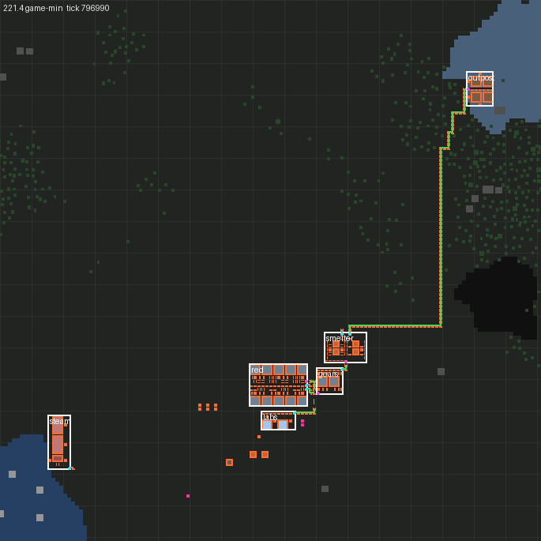 | 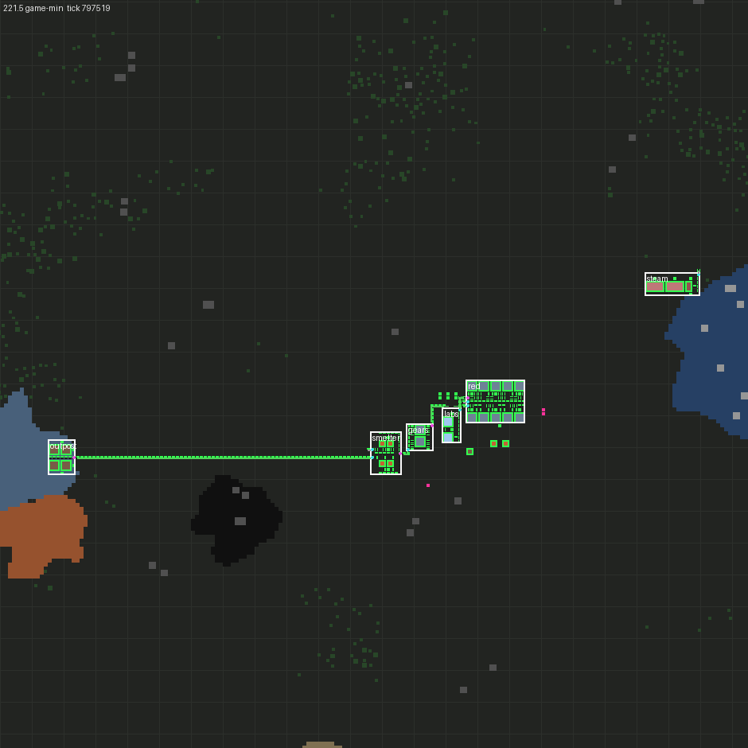 | 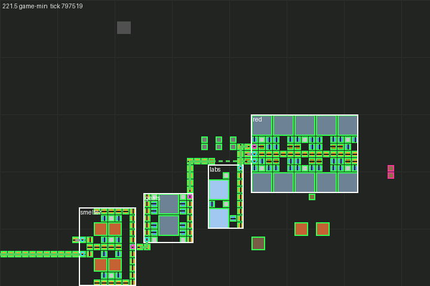 |

| Routing lab (running, graph overlay) | Crew-built plan (running) |
|---|---|
| 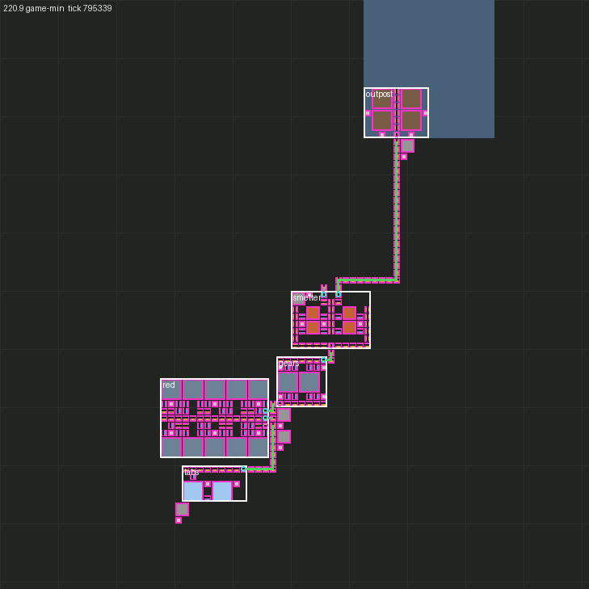 | 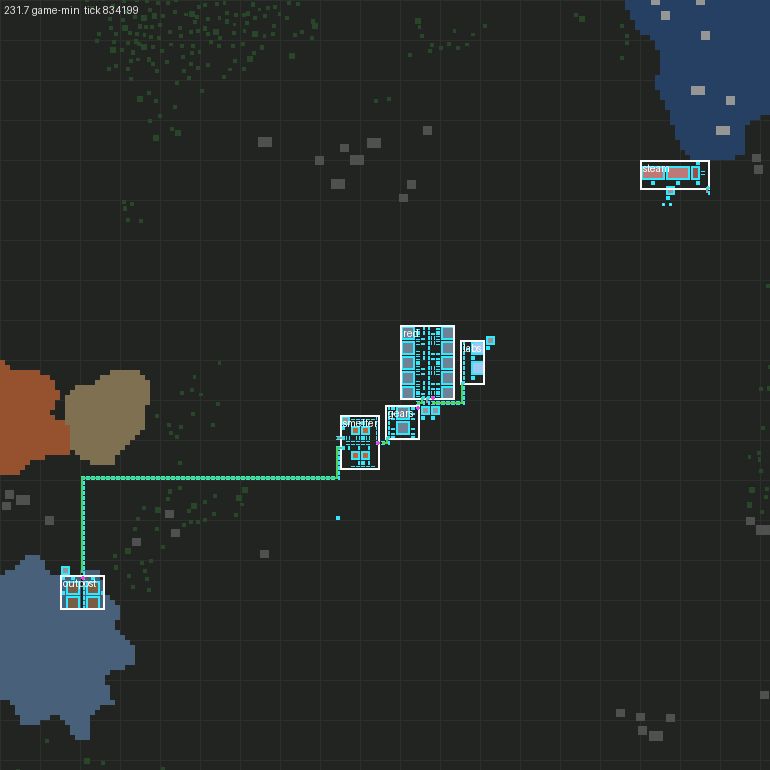 |

Seed 555555: the outpost sits on the iron patch at the top right (blue-grey), the steam block on the lake at the
bottom left. The core (smelter → gears → red tile → labs) hugs the pre-placed furnaces and chests (orange outlines),
and the long ore belt runs around the coal patch (black).

### Findings

- **Undergrounds in 2.0:** `create_entity{type = "input" | "output", direction = flow direction}` for both ends;
  every built route was followed through `neighbours` to its consumer.
- **The starting area has few trees.** Placement treats trees as a cost, so modules avoid them: only seed 31337
  needed clearing (3–4 trees). The crew test plants three trees on a route to exercise the clear-then-build path.
- **Smelters are placed near the base, not near the ore.** The outpost lands on the nearest iron with ≥ 60%
  coverage per drill (57–110 tiles out), and its ore belt is the longest route (60–91 tiles). This is what "compact
  around existing production" asks for. Whether the smelter should move to the patch instead is a planner (M5)
  question; see Questions.
- **Port clearance matters.** Without it, one seed (31337) put the red tile's three adjacent bottom-edge ports one
  tile from the gear row, and the middle port could not be routed even with rip-up. Requiring the tile beyond each
  port's outside tile to be free fixed all seeds. Module re-placement remains as a fallback.
- **Run-to-run terrain differences.** Seed 31337's layout differed by a tile between a standalone run and a full-suite
  run, starting at the first (outpost) placement, i.e. before any routing. The tests log a hash of the scanned
  region per seed: it differs between the two kinds of run for 4 of the 5 seeds (123456 matches). So the generated
  terrain differs (probably what earlier tests generate first), not the planner, which is pure given its terrain. All
  seeds are valid in both kinds of run. A T4 determinism check should cover planning in a fixed run order.
- **factorio-test CLI watchdog:** it kills Factorio after 15 s without stdout. Long in-game runs now print a heartbeat
  and `factorio-test.json` sets `outputTimeout` to 180.

### Deviations and assumptions

- **Power between modules is not planned** (pole network = M5). The tests power each module from a test
  electric-energy-interface next to its power pole and feed external stubs by script, like the validation lab.
- **The real-terrain set has 6 modules:** the 5 of the lab plus the steam block, so "the steam block lands on a shore"
  can be checked. Unconnected inputs (coal, copper) are one-tile external stubs.
- **Belts may cross ore at a cost** (3 per tile); modules may not (except mining modules). The spec says "never build
  over ore the faction will need": I applied that to footprints and treated belts as a soft cost. All ore currently
  counts as needed.
- **Edges assume 2 lanes.** No v1 port declares lanes. A producer that fills one lane would show in measurement
  (M5).
- **Parallel routes need port pairs.** With single-item ports, `parallel-route` means another producer/consumer pair
  (a second module copy): the decision says how many, and M5 must build them.
- **The real-terrain verification builds with script** (after clearing trees and rocks with script) for all 5 seeds,
  and with the crew for one. The crew build uses a stockpile of the exact bill, not a gathered one.
- **Modules re-placed after a routing failure** avoid their old footprint only. Fixed (existing) modules never move.
- **Planning is per request.** The terrain is scanned before placing (the region must be generated). Changes during
  planning are rescanned under budget but don't invalidate decisions already taken. v1 assumes a static world (D28).

### Proposals (not decisions; also in SPEC §11)

- **P4, LayoutPolicy fields (proposed):** add to SPEC §5.3's interface what the planner uses: `topology`, `protectOre`,
  `minOreCoverage`, `searchRadii`, `utilization` (D25 per policy), `overflow { order, maxParallel }` (D24),
  `headroom` (D27), `router` and `placement` weights.
- **P5, port clearance (proposed):** a placement rule that every belt port has two free tiles straight out (its outside
  tile and the next), so corridors of width 1 never box a port in. It is implemented and makes all seeds valid.
- **P6, belts over ore (proposed):** belts (not modules) may cross ore at a policy cost, instead of never.
- **P7, planner budget (proposed):** default 100 work units per tick, about 1 ms/tick while a plan is active (D13 is a
  soft 2 ms total). Tune against the M5 soak.
- **P8, `Port.lanes` (proposed):** an optional port field (1 or 2) for edge capacity, default 2.

### Questions for the user

- Should the early policy pull the smelting column **toward its ore patch** (short ore belt, long plate belt), or keep
  it **compact around the base** as now (long ore belt)? Both are cheap to express as packing weights.
- Is a **6-module real-terrain set** (adding the steam block) the right reading of "the same set ... the steam block
  lands on a shore"?

### Next steps (M5)

- Pole network planner (MST over module power ports) on the same terrain model and layout overlay; the steam block
  feeding it.
- The recipe-graph planner producing `PlanRequest`s (modules, connections, rates) from goals, with the D27 headroom,
  and acting on the overflow decisions (tier upgrades, parallel module pairs, new clusters) and on expansion moves.
- Measurement and reconciler on the graph edges (`measuredRate`), the in-game overlay, and a T4 determinism check that
  includes planning (same seed → same terrain hash → same layout).
- Faster placement if needed (cache summed-area tables per window across modules; prune by score bound).
