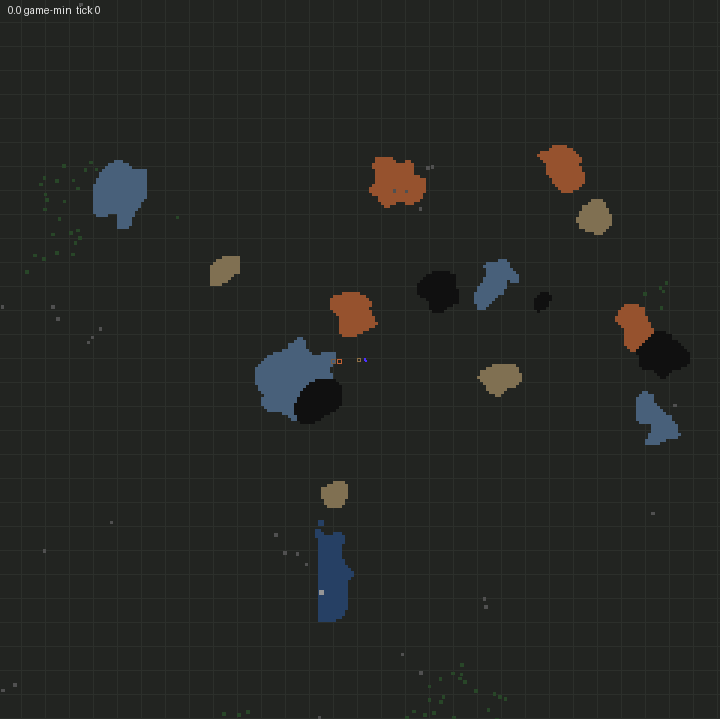
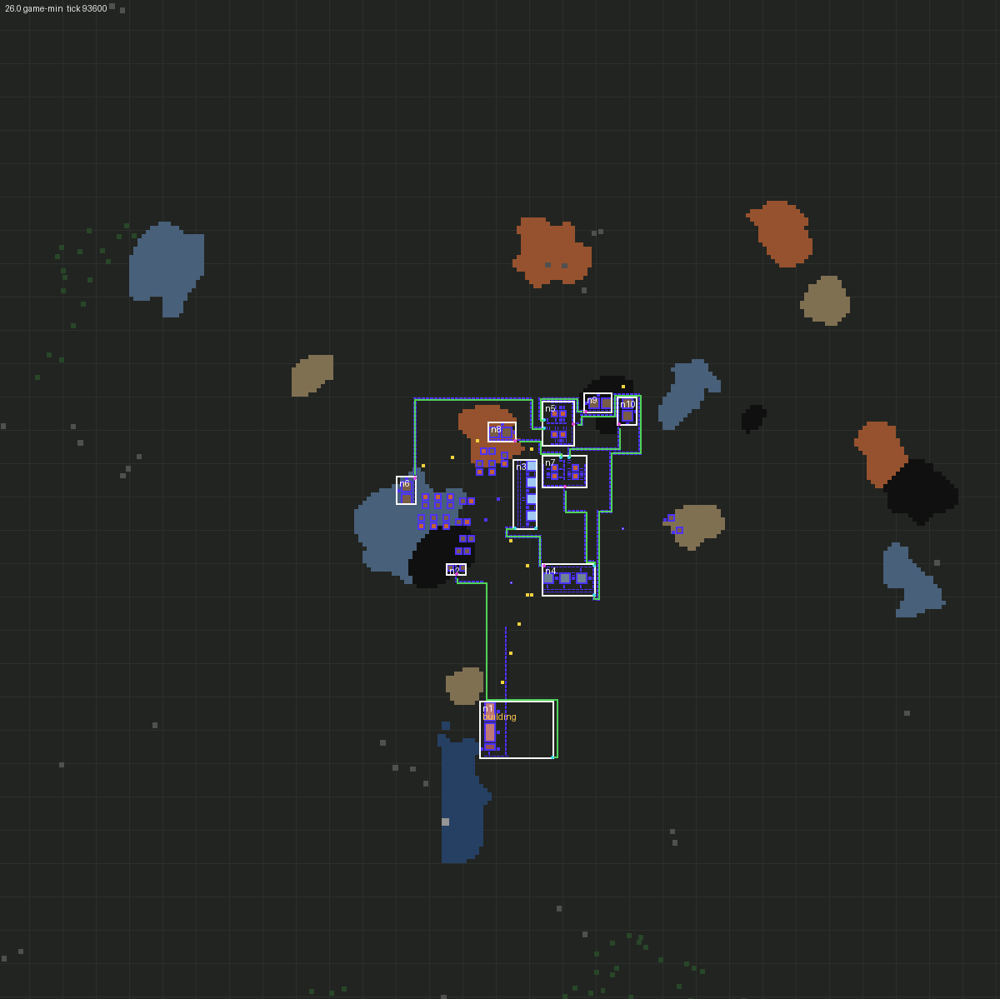
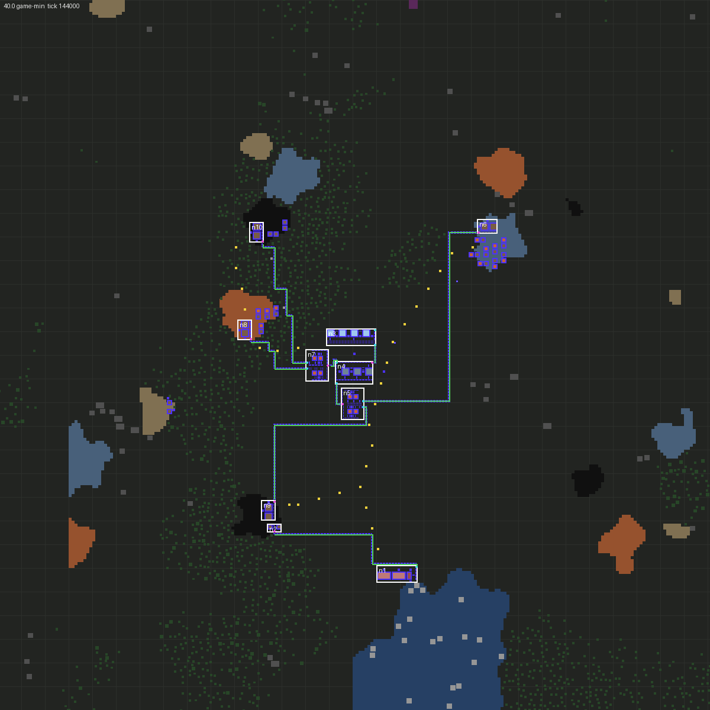
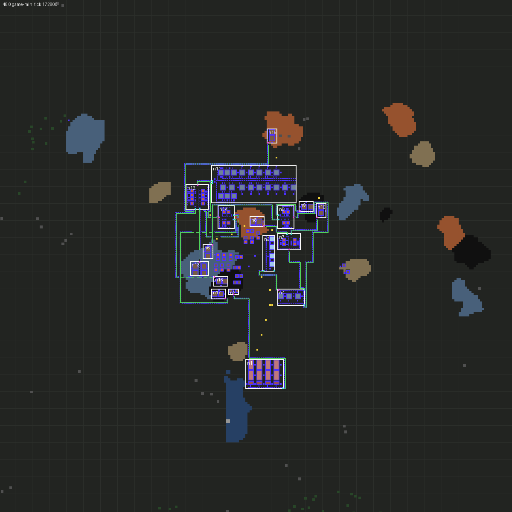

# M5: Power and planner

Branch `m5-power-planner` → `m4-modules-routing` (stacked). M5 is split in two halves on the same branch: **M5a, the
planner and power** (this section) and **M5b, measurement, reconciler, in-game overlay and the near-ore smelting policy
option** (to follow). The branch has `origin/m4-modules-routing` merged in (parallel T2 shards and soak seeds, live
review setup).

Status of the M5a part of the M5 acceptance (SPEC §8): from a fresh start, a faction with the default crew reaches
**automated red science feeding labs with research progressing on 5 of 5 fixed seeds** (bar: ≥ 4 of 5), in **25.8–45.8
game-minutes**, with no permanent stall. T1 solver, goal-diff, pole-planner and growth tests pass; the T2 power-up and
planner-driven expansion tests pass; the full T2 suite passes (75/75 after the merges, plus the new engine pin).

## Built

All runtime-free code is covered by T1 (`mod/unit`). New files: `strategy/solver.ts`, `strategy/design.ts`,
`strategy/factory.ts`, `strategy/research-queue.ts`, `planner/logical.ts`, `planner/power.ts`, `planner/grow.ts`,
`character/triggers.ts`, `test/factory.test.ts`, `tools/harness/m5_scorecard.py`, `tools/harness/m5.toml`,
`tools/harness/m5-mall.toml`.

- **Solver (D21)** (`strategy/solver.ts`, pure). A `Solver` interface (`start`, `step` under a budget, resumable state in
  plain tables) with the v1 **recursive ratio solver** behind it. Input: target rates, machines and drills in preference
  order, the resources on the map, items to treat as raw, the fuel, boiler and engine, and the enabled recipes. It orders
  items consumers-first (DFS over the recipe graph; a cycle is reported, since the ratio solver handles DAGs only),
  propagates demand once per item, and gives per-recipe crafts/s and fractional machine counts (category → the first
  machine that can craft it, so Space Age's `pressing`/`electronics` categories work), mining drills per resource, the
  burner fuel, the electric demand and the steam supply (boilers, engines, boiler fuel) as a **fixed point** (electric
  coal drills need power whose boilers burn coal). Locked recipes are planned with and reported with their technology.
  An LP solver can implement the same interface (P3).
- **Factory design and goal diff** (`strategy/design.ts`, pure). From a stage target ("labs consume N packs/s"):
  - **Module selection, generators first (D34):** structural rules over prototypes. A resource item gets a mining outpost,
    a one-ingredient furnace recipe a smelter column, a two-ingredient recipe with a one-ingredient intermediate a red line
    (or a circuit block when the intermediate yields ≥ 2), anything else with ≤ 2 ingredients an assembler row. The lab
    array is the sink, sized for the target at the mean unit time of the research goal's pack technologies.
  - **Sizing:** each module grows its generator parameter in the same quanta `expand` uses until its output covers the
    demand; input port rates scale with the module's load. The solver's consumers-first order drives the walk.
  - **Topology (D22):** point-to-point gives each consumer port its own producer (so each smelter column gets its own coal
    outpost); splitter-tap shares one producer per item.
  - **Power last:** the steam block is sized to every module's full-speed electric demand; then all fuel demands
    (furnaces and boilers) are mined, iterating to a fixed point. The steam block's own coal outpost uses **burner drills**
    until electric drills are enabled (it must run before there is power); production outposts use electric drills when
    their technology is researched or in the research goal.
  - **D24 overflow on every flow:** checked against the usable capacity of its belt (D25). Remedies in the policy's
    order: a faster researched tier for that edge (the connection carries its own belt tier into the plan), otherwise the
    **target is split into n production clusters** (parallel routes need parallel port pairs, i.e. module copies). A module
    that cannot grow big enough splits the target the same way.
  - **Goal diff:** design nodes are matched to the logical graph by **role** (`labs`, `automation-science-pack>labs`,
    `iron-plate>automation-science-pack>labs`, `coal>power`, …). Missing roles become build goals in order power → labs
    → production → mall; built nodes short of their need become **grow** goals (units of `expand`).
- **Logical graph layer (§5.8)** (`planner/logical.ts`, pure, persisted per faction in `storage.factories`). Nodes =
  production units (`module`, `outpost`, `power`, `labs`, `sink` for the mall, `source`) with capacity and planned rates,
  electric demand or supply, lifecycle (planned → building → built), and **slots for M5b**: `status` (`unknown` until
  the reconciler classifies it), `statusReason`, `measured`. Edges = belt flows (one item, D23) and power flows, with
  planned rate, D27 headroom rate, the belt tier, the D24 remedy applied, and **`measuredRate`/`measuredTick` for M5b**.
  Each node is the module instance of the same id in the faction's layout (physical layer); each belt edge lists its
  route ids, each power edge its pole lines. `upstream(graph, node)` walks feeders nearest first (for M5b's root-cause
  trace). Exported with the physical layer (`factoryGraph`, `dump_factory_graph`).
- **Strategy layer** (`strategy/factory.ts`). Takes over each faction at the `first-electricity-materials` milestone
  (`factory-enabled`). Every brain interval:
  1. **Design** for the current stage (`factory-targets`, D27 staged targets: `item=n,...;...`, default
     `automation-science-pack=10` per minute), cached while tech, graph and stage are unchanged.
  2. **Goals:** one goal *plans* at a time, on top of the faction's layout (so the base stays compact and later plans
     see earlier ones); any number *build*. Production waits until power and labs are built and the technologies its
     modules need are researched; the mall waits for production. A plan that fails is retried with a larger region and a
     different cluster centre (hub, then 24 tiles off it in turn).
  3. **Build:** a finished plan's layout becomes the faction's; its new parts become graph nodes and edges and are built
     by the crew through the Job Board (clear jobs, then ghosts and place jobs; burners get a first load of fuel).
     Planned tiles are added to the bootstrap's reservations so its sites and hand-mining keep off them. Ghosts whose
     jobs failed or were dropped get new place jobs every 30 s, with the failure reasons logged; a build is never abandoned.
  4. **Research (§5.5)** (`strategy/research-queue.ts`): technologies that unblock goals first (their prerequisites
     first, cheapest first), then the rest of the D30 set. Packs are **hand-crafted and put into the labs** only for
     technologies that unblock a goal (`automation`, `electric-mining-drill`); the rest of the research goal waits for
     automated packs.
  5. **Upkeep:** burners the crew must fuel (module `upkeep.fuel`: the steam block's burner coal drills).
  6. **Milestones** (in the brain's milestone list, so telemetry and the scorecard see them): `planner-takeover`,
     `<goal>-planned`, `<goal>-built`, `first-power`, `automated-red-science`, `grow-built`, `mall-built`.
  7. **Stalls (§3):** once the bootstrap is done (it detects its own before), no progress (placements, crafts, research
     progress) for `stall-ticks` logs a stall with the active goals and waiting reasons and recovers: crew reset, non-build
     jobs dropped, place jobs re-planned for leftover ghosts.
- **Power:** the steam block on a shore (M4 site constraint) plus the **pole network planner** (`planner/power.ts`,
  pure, budgeted, a phase of the plan job). Modules carry their own poles; the planner joins pole *components*: union-find
  over poles within wire reach, a component is powered when it holds a generator module's pole, and the unpowered
  consumer component nearest the powered set is joined next (Prim) by an A* over pole positions (hops up to the wire
  reach, longest first, on free tiles; trees and rocks at a clearing cost, corridors and ore at a small cost; wires span
  water). A failed search is retried with a wider window (16 → 48 → 112 tiles) before it is reported. Small wooden poles
  only (D20); the crew gathers the wood. Sized from demand: the steam block's boiler count comes from the design and
  grows (expand) when demand rises.
- **Growth of built modules (expand-first)** (`planner/grow.ts`, pure): rip the module's routes, `tryExpand` (with the
  module's own footprint and its ripped route tiles counted as free), reroute, and diff world entities: what the crew
  picks up (moved entities, belts of rerouted routes) and what it builds. Unchanged entities stay.
- **D24 overflow actions:** upgrade-tier → the edge's connection is planned with the faster belt; parallel-route and
  new-producer-cluster → production clusters (`#1`, `#2`, … roles). None triggered at the stage 1 target (all flows are
  well under a yellow belt); T1 covers both remedies.
- **Material supply loop (decided, documented):** the bootstrap brain stays the faction's economy. Its demand loop (H4)
  sees the materials of every active job, the factory's place jobs included, and collects, hand-crafts or hand-mines
  them. Once science is automated, the **curated mall** (`factory-mall`, default `mall-polse`) joins the design as a
  second sink at `factory-mall-utilization` (0.25 of its full-speed plate demand: it only runs while its chests have
  room); its output chests become the **first collect source** of the economy, before hand-crafting. Hand-crafting stays
  the fallback for what the mall doesn't make (labs, poles, offshore pumps…).
- **Plan job extensions** (`planner/plan.ts`, `router.ts`, `layout.ts`, `runtime.ts`, `build-list.ts`): plans on a base
  layout (a copy; existing modules `fixed`, existing routes `Route.fixed` and never ripped), a pole phase, per-connection
  belt tiers, no undergrounds until `logistics` is researched, the faction's terrain reused across plans with the
  bootstrap's reservations overlaid, part-wise builds (only what a plan added), **mining outposts placed after and near
  the module they feed**, and the **tile beyond each belt port reserved** for that port (P15).
- **Engine findings fixed** (details under Findings): emulated `craft-item` triggers for crew hand-crafts; the craft
  stall check on intermediate chains; craft jobs only for what the stock covers.
- **Settings (§5.7):** `factory-enabled`, `factory-targets`, `factory-region-radius` (112), `factory-entities`,
  `factory-research-unit-time` (0 = computed), `factory-hand-feed-labs`, `factory-build-priority` (90), `factory-mall`,
  `factory-mall-utilization`, `soak-done-milestone`.
- **Remote:** `factory_report`, `start_factory`, `dump_factory_graph`. **Telemetry:** a `factory` report per faction
  (goals, node lifecycles, design summary, research, waiting reasons, automation check), research state, a sample of open
  jobs; graphs per frame in `script-output/rival-engineers/graphs/<faction>/`; `done.json` at `soak-done-milestone`.
- **Tools:** `tools/harness/m5_scorecard.py` (M5 pass rule, phase breakdown), `render.py --graph-dir` (per-frame
  graph overlay in timelapses, poles, node lifecycle).

## Acceptance re-run after the economy change (2026-10-15, final commit 18ca1fd)

Commit 4ebf208 (craft chunks sized to the stock) changed the bootstrap economy after the acceptance run below, and a
manager re-run on it scored **3/5** (222 and 3333 failed). Root causes, all fixed with regression tests:

- **Seed 222: production unroutable without undergrounds.** Before `logistics` the router has no undergrounds, so belts
  can't cross; the 7-flow cluster next to the fixed labs rip-up cycled on every attempt and every retried goal (69
  failed plans, AI 2.5 ms/tick of thrash). The economy change only moved the bootstrap's sites. Fix: after a production
  or mall goal fails all attempts without undergrounds, their technology becomes a prerequisite and is researched with
  hand-fed packs (**P16, proposed**). Seed 222 then plans in one attempt with 0 rip-ups (+~3 game-min of research).
  T1 replay of the captured plan: `mod/unit/plan-replay.test.ts`.
- **Seed 3333: a big rock under an outpost.** A 2×2 rock off the tile grid: walks to within the short reach of its
  *centre* found no path (every end node next to it collides), its clear job failed, the build stamped ghosts over it
  and waited for good. Fix: walks to trees/rocks aim at their box plus the margin; leftover-ghost rounds also re-clear
  trees/rocks under the ghosts; rocks partly under a ghost are mined from a corner. T2 test with the same neighbourhood.
- **Seed 77 (extra seed): hand-mining picked up an ore belt.** A mine job planned before the ore route was built ran
  after it; mining acts on whatever is selected, so it picked up two belts and the iron smelters starved. Fix: no
  mining of ore under a built entity (trees over ore are mined first, as by a player; mining restarts after an obstacle
  is cleared). Also found: `stampModule` lost the index of a failed entity (push(nil) in Lua), so stamping failures went
  unreported; now indexed and logged. T2 tests for both mining cases.

| Seed | Pass | Automated red science (game-min) | Bootstrap | Power + labs | Research to unblock | Production build | Automation verified | Stalls |
|---|---|---|---|---|---|---|---|---|
| 11 | ✅ | **27.2** | 7.0 | 3.7 | 3.7 | 10.8 | 2.0 | 0 |
| 222 | ✅ | **29.9** | 6.6 | 4.4 | 10.3 (incl. `logistics`) | 6.6 | 1.9 | 0 |
| 3333 | ✅ | **43.7** | 8.8 | 10.5 | 7.4 | 15.6 | 1.4 | 0 |
| 44444 | ✅ | **32.2** | 7.4 | 9.0 | 4.3 | 9.8 | 1.8 | 0 |
| 555555 | ✅ | **40.7** | 9.4 | 6.2 | 10.7 | 12.5 | 2.0 | 0 |

**5/5** on commit 18ca1fd (`out/soak/m5-final3`, `-j 5`). An earlier round with 5 extra seeds (7, 77, 777, 7777,
77777) passed 9/10 before the seed-77 fix (seed 7777 slow: power + labs 37.9 min); seed 77 passes from its snapshot
after the fix (29.9 min); the extra seeds were not re-run on the final commit. M3 soak on the final commit: **5/5**,
first-electricity materials at 6.6–9.4 game-min. Wall times of these runs are inflated: the laptop ran on battery
(≈1 GHz) for most of the session.

## Test workflow (fast debug loop)

The previous loop was "fix, run a full soak (~17 wall-min for a stuck seed), find the next bug". Now (README →
Development):

1. **Fail fast** (`[run.fail_fast]` in `m5.toml`): a seed stops at its 2nd stall, 8 failed plans in a row or 20 rounds
   of unplaceable leftover ghosts. Seed 222 stopped after 303 s instead of running 1008 s; a 3333-type build stall stops
   after 10 game-min of leftovers instead of 2 game-hours. The soak's own summary now scores the config's
   `soakDoneMilestone` (it scored M3's for M5 runs and said "5/5"); `m5_scorecard.py` prints each failing seed's open
   goals, stall reasons, latest plan-failure kinds and leftover ghosts.
2. **Snapshots** (`--snapshots 5`: a sped-up headless server, since `--benchmark` never saves) and **resume**
   (`--from-save`, with the current build). Fix checks from the last checkpoint: 3333's 16 s (vs ~8 min to reach the
   stall), 222's 2.5 min, 77's 2 min. `--helper-lua` injects debug probes (`tools/harness/probes/status.lua` logs every
   machine's status and contents; a 20 s probe run found 77's starved smelters and the missing belts).
3. **Failed plans as T1 tests**: each failed plan dumps its graph (render over the nearest frame) and its input
   (request, base layout, terrain) as Lua; `plan-replay.test.ts` replays it in plain Lua in ~10 s, with env overrides
   for router experiments. Seed 222's failure reproduced exactly; four router variants were ruled out in a minute.
4. **More seeds per round**: one 10-seed round found the seed-77 bug. Concurrency: at `-j 10` each instance ran at
   ~6.4 ms/tick vs ~2.1 at `-j 5` (each Factorio uses several threads), so `-j 10` had ~30% less throughput than
   `-j 5`; keep `-j 5` (battery caveat above).

## Acceptance (SPEC §8 M5, M5a part)

**T3 soak** (`python3 tools/harness/soak.py -c tools/harness/m5.toml -j 5`, then `m5_scorecard.py`): one faction, default
crew of 2, every setting at its default except telemetry outputs and the milestone that ends the run; 3-hour cap.

| Seed | Pass | Automated red science (game-min) | Bootstrap | Power + labs | Research to unblock | Production build | Automation verified | Stalls (recovered) |
|---|---|---|---|---|---|---|---|---|
| 11 | ✅ | **25.8** | 6.8 | 3.9 | 4.0 | 9.1 | 1.9 | 0 |
| 222 | ✅ | **28.4** | 7.4 | 4.9 | 7.2 | 7.1 | 1.8 | 0 |
| 3333 | ✅ | **45.3** | 13.6 | 8.1 | 7.4 | 15.2 | 1.0 | 0 |
| 44444 | ✅ | **45.8** | 7.5 | 8.9 | 4.3 | 24.1 | 0.9 | 1 (1) |
| 555555 | ✅ | **39.0** | 10.0 | 10.7 | 6.2 | 11.2 | 1.0 | 0 |

**5/5** (bar ≥ 4/5). Phases: bootstrap = start → first-electricity materials (M3); power + labs → labs built and powered;
research to unblock → production planned (`automation` and `electric-mining-drill` researched with hand-fed packs);
production build → the red chain built; automation verified → the `automated-red-science` check (P14) holds. Full
scorecard: [m5/acceptance-scorecard.md](m5/acceptance-scorecard.md).

What gets built (seed 11): steam block (1 boiler) + burner coal outpost; lab array (4 labs); red line (2 red + 1 gear
assemblers); iron and copper smelter columns (4 stone furnaces each); iron and copper outposts (2 electric drills
each); one electric coal outpost per smelter column; pole lines between them. 10 modules, 8 belt flows, 160–225
placements for production.

**The automation check (P14):** when the red producer is built, hand-feeding stops (its open jobs are dropped) and the
packs left in the labs are counted. The milestone needs the labs to complete more research units than those leftovers
(+5) while the red line made ≥ 10 packs. On every seed the leftovers were 0 (labs had used up the hand-fed packs) and
it took 0.9–2.1 game-min after the build.

**Slow parts, honestly:** the production build dominates (7–24 min). The crew of two hand-crafts every building from
burner-smelted plates (≈ 170 entities: belts, inserters, 3 assemblers, 6–8 electric drills, poles from gathered wood)
while also keeping the burner economy running. Seed 44444's 24 min includes one recovered stall: 15 game-min without a
placement, the build at 160 of 160+ entities; the stall recovery (crew reset, non-build jobs dropped and re-derived)
unblocked it and the build finished 20 s later. The root cause is not identified (likely a stuck claim or reservation
in the economy; the next soak's telemetry has an open-job sample to tell). Seeds 3333 and 555555 start slower (bootstrap 10–14 min, power 8–11 min: the
shore is far from the hub and the steam block's coal belt is long).

Planner retries: 5 production plans failed at least once (routes boxed in by each other after 3 rip-ups); each
succeeded on a later attempt with a different cluster centre (2nd–4th attempt). Plan cost per goal (scan + place +
route + poles, at 100 work units/tick): power 212–421 ticks, labs 89–184 ticks, production 713–1946 ticks (74k–200k
work units, 7–43 A* searches).

**T1** (`npm run test:unit`, 8 files, all pass): `solver.test.ts` 7 (30+30/min → 3.75 Fe/s, 1.25 Cu/s, 12 + 4 furnaces,
5/6/1.25/0.75/0.5/0.5 assemblers, 7.5 + 2.5 drills; fuel 0.36 coal/s and the electric fixed point in closed form;
10 red/min; locked recipes; raw overrides; budget-1 stepping ≡ one step; burner drills), `design.test.ts` 8 (module
selection, the 10 red/min design and its plate flows equal to the solver's, power roles, goal diff order and contents,
expand-first growth units, D24 upgrade vs cluster split, module-cap split, splitter-tap), `power.test.ts` 6 (a pole line
over 40 tiles within reach, around a lake and cliffs, none without a generator or when adjacent, budgeted ≡ one-shot,
an unreachable consumer reported), `grow.test.ts` 1 (4 → 8 furnaces, 4 added, the moved end rebuilt, its route
rerouted and valid).

**T2** (`test/factory.test.ts`):
- **Power-up:** a steam block placed on a shore by the planner, a lab array 40 tiles away, the pole network planned
  (a line of small poles), everything stamped as **ghosts and revived the way the crew builds**; the boiler fuelled and
  the labs fed: both labs are on the engine's electric network with energy, and `automation` research progresses.
- **Planner-driven expansion:** a built 4-furnace smelter column fed by an 8-drill outpost smelts **1.24 plates/s**;
  `planGrowth` grows it by one unit (22 entities picked up, 45 built, the ore belt rerouted), built by revive: **2.49
  plates/s** with 8 furnaces.
- Engine pin (`engine-capabilities.test.ts`): a player-less hand-craft of a lab does **not** research
  `automation-science-pack`.
- Full suite after both merges: 75/75 (8 shards), and the new tests.

**CPU:** see the section below.

### Timelapse and renders (graph overlay)

Seed 11, one frame per 2 game-minutes, from takeover to automated red science; module boxes with their graph ids,
belt flows coloured by planned utilization, poles yellow, node lifecycle labels:

| Seed 11 at 26 min (power node growing after the mall joined the design) | Seed 555555 at 39 min | Seed 11 at 48 min, mall built |
|---|---|---|
|  |  |  |

**Mall (beyond the acceptance):** on seed 11 run on (`m5-mall.toml`), the mall goal (the curated mall plus its own
smelters and outposts, 7 modules, 6 flows) was planned at 28.3 min, once `logistics` was researched with automated
packs, while the steam block grew by 3 boilers for it; it was built at 47.6 min (136 placements). The run stopped there,
so its output chests supplying later builds is implemented but not yet exercised in a soak (M5b/M6 runs continue past
it).

## CPU (D13: 2 ms/tick soft target for all AI, 2 factions × 2 crew)

Measured with the mod's AI profiler (brains, factory planner, layout planner, crew and controllers) per game-minute, on
seed 11 run alone (`tools/harness/m5-mall.toml`, `-j 1`, no other Factorio running), one faction with 2 crew, from the
start through automated red science (25.8 min) to the mall built (47.6 min):

| Phase | AI ms/tick, average | Worst game-minute |
|---|---|---|
| Bootstrap (0–6.8 min) | 0.204 | 0.209 |
| Takeover → automated red science (6.8–25.8 min) | 0.353 | 0.741 (the production plan's minute) |
| Automated red science → mall built (25.8–47.6 min) | 0.436 | 0.747 (the mall plan's minute) |
| Whole run | 0.374 | 0.747 |

The peaks are the layout planner at its budget (`planner-work-per-tick` 100 ≈ 1 ms/tick while a plan runs, M4/P7):
production plans take 700–1,950 ticks (12–33 game-s) and the mall plan 2,357 ticks. Between plans the factory layer adds
≈ 0.1–0.2 ms/tick over the bootstrap (the design is cached; the per-think work is goal bookkeeping, hand-feeding and upkeep
scans, and the larger Job Board). For D13's 2 factions × 2 crew: ≈ 0.75 ms/tick on average and ≈ 1.5 ms in a minute
where both plan at once, under the 2 ms soft target. Two factions planning in the same tick could exceed 2 ms in that
tick; a shared planner budget across factions would cap it (not done). The acceptance scorecard's 0.7–1.1 ms/tick
figures come from 5 concurrent games plus another agent's soaks on the same laptop and are inflated (CLAUDE.md).

## Findings

- **Crew hand-crafting does not fire `craft-item` research triggers.** The engine fires them for a player's crafting and
  for machine output (furnace plates complete `steam-power` and `electronics`, M3), but not for a player-less
  character: `automation-science-pack` (craft a lab) never completed and the first soak deadlocked waiting for the red
  science recipe. The controller now emulates the trigger for crew crafts (`character/triggers.ts`, proposal P9); an
  engine test pins the gap.
- **Long hand-crafts looked stalled.** A craft's progress was `gained + crafting_queue_progress`, but the queue progress
  restarts at 0 for every intermediate; a lab (≈ 21 s of circuits, gears and belts) passed the 20 s stall limit and was
  cancelled, leaving its finished intermediates behind. The first soak piled up 3,800 circuits and 3,850 gears that
  way. Progress now also counts finished queue entries.
- **Big craft jobs on a scarce raw item never start.** The bootstrap chunks craft jobs by 60 raw items; for small poles
  that is a job needing 30 wood, claimable only when the depot holds all 30. Trees are scarce in starting areas, so the
  last poles of a build waited for good. Craft jobs are now created only for what the stock covers; the rest stays
  demand, so gathering continues.
- **Placement order matters for outposts.** Outposts were placed first, on the ore nearest the hub; the steam block's
  coal outpost on seed 555555 landed 120 tiles from the steam block and its belt ran along the labs' input side, which
  then could not be routed. Outposts are now placed after the module they feed, on the ore nearest it, and the tile
  beyond every belt port stays reserved for that port (P15).
- **Routing failures are mostly mutual blocking**, not terrain: "blocked by X (ripped 3 times already)". Moving the
  cluster centre on retry was enough on every seed. A smarter remedy (rip-up across goals, re-placing the consumer of
  the failing route first) is future work.
- **Point-to-point coal:** each smelter column gets its own coal outpost (3 coal outposts incl. the steam block's). It
  works on every seed's starting-area coal patch; splitter-tap topology would need one.
- **Growth works in the field:** after automated science the mall joins the design, the electric demand rises and the
  steam block grows in place (+3 boilers on seeds 11 and 222, its coal belt rerouted), and the burner coal outposts
  feeding it grow (+2 rows on 3333 and 44444).
- **Revived small-pole ghosts connect** to poles in wire reach (T2 power-up), so the pole planner only has to keep hops
  within reach.

## Deviations and assumptions

- **Stage 1 target 10 red/min** (`factory-targets`): the M5 bar is "automated red science feeding labs"; the v1 target
  (30 + 30/min) is M6's stage 2. Staged targets and headroom (D27) are in place: stages advance when everything of a
  stage is built; edges record their headroom rate. Space is not reserved for the next stage's growth (expansion grows
  into free space when it can; when it can't, the shortfall is a waiting reason and the D24 cluster remedy applies at
  design time).
- **Hand-fed research before automation** (P10): `automation` and `electric-mining-drill` are researched with
  hand-crafted packs (35 packs) in the planned lab array. Without that, assemblers and electric drills cannot be built.
- **The steam block's coal comes from a burner-drill outpost** (crew refuel it): electric drills need the power it
  makes. Production outposts are electric.
- **Logical nodes include the mall as a `sink`**, power edges run from the (first) power node to each consumer.
- **The bootstrap keeps running** after takeover: its remaining burner sites, upkeep and demand-driven economy continue
  (they are the material supply). Its stall check runs until its goals are done, the factory's afterwards.
- **No undergrounds before `logistics`.** The router plans without them until underground belts can be crafted.
- The acceptance soak ran 5 seeds concurrently (`-j 5`) while another agent's soaks also ran: wall-clock and AI ms/tick
  in that scorecard are inflated; the CPU section uses a `-j 1` run.

## Proposals (also in SPEC §11, all proposed)

P9 crafting triggers emulated for the crew · P10 hand-fed research only for unblocking technologies · P11 stage 1 target
10 red/min and lab sizing · P12 goal order (power → labs → production → mall → growth; one plan at a time) · P13 material
supply (bootstrap economy, then the mall at 25% as the first collect source) · P14 the `automated-red-science` check ·
P15 port approach tiles reserved · P16 undergrounds researched when a production plan is boxed in (re-run, above).

## Interfaces for M5b

- **Where measured rates go:** `storage.factories[faction].graph` (`planner/logical.ts`). Per node: `measured = { tick,
  window, inputs: Rate[], outputs: Rate[] }`, `status` (`NodeStatus`: `ok | starved | backed-up | unpowered |
  unfuelled`, `unknown` until measured) and `statusReason`. Per edge: `measuredRate`, `measuredTick`. Planned values to
  compare against: `node.planned.{inputs,outputs}`, `node.capacity`, `edge.plannedRate` (and `headroomRate`).
- **Finding the entities:** a node's id is its module instance in `f.layout` (`findModule(f.layout, id)`: `rect`,
  `origin`, `def` with world-ready local positions; `def.ports` for port tiles (`portTile`, `portOutside` in
  `planner/layout.ts`)). A belt edge's `physical` lists route ids (`f.layout.routes[id].steps` = the belt tiles, first
  and last for port sampling); power edges list pole line ids (`f.layout.poleLines`).
- **Root cause:** `upstream(graph, nodeId)` (nearest feeders first) and `edgesInto`/`edgesFrom`. `node.lifecycle` tells
  built nodes from ones under construction (only `built` should be classified).
- **Replanning hook:** the strategy acts on the graph each think (`strategy/factory.ts` `think`): a reconciler step
  after `updateGoals` can emit goals; `startGrow`/`startGoal` show how goals are made and `designNow` caches by a key
  (add the reconciler's state to it if it changes the design).
- **Overlay:** `factoryGraph(name)` returns both layers (+ planned poles) for `registerOverlayLayer` (review setup) and
  for `dump_factory_graph`. Node `lifecycle` and edge `overflow` are there for colouring.
- **Policy option (D35, near-ore smelting):** placement order already places outposts after their consumer
  (`placementOrder` in `planner/plan.ts`); a policy flag can invert it for smelters (place the smelter near its outpost)
  through `ModuleRequest`/`PlacementRequest.center`.
- **Scorecard:** `tools/harness/m5_scorecard.py` reads telemetry `factory` reports; add measured utilization there.

## Questions for the user (non-blocking)

1. Is **10 red/min** a fine stage-1 target for "automated red science" (M6 adds 30 + 30)? Larger targets mostly add crew
   build time at this stage.
2. P10: is hand-crafting the ~35 packs that unblock assemblers and electric drills acceptable as "player-like", or should
   the faction build an early burner-fed hand-assembly line instead? (Players do hand-craft the first packs.)

## M5a.2: starting water and faction conflicts (2026-10-15)

Three items from the user: water at spawned starting areas, two factions sharing one water source, and D40.

### 1. Water at spawned starting areas: implemented

**Cause.** `starting_lake_positions` (the noise variable behind the starting lake) is derived from
`map_gen_settings.starting_points`, so appending a faction's spawn there (D32) should give it a lake. It does in T2 and
in soaks (every faction had water 18–64 tiles away, seeds 11–555555). It doesn't in the sandbox scenario (the user's
review): no water within 200 tiles of either faction in the user's autosave, so both factions went to the origin lake.
A new game **queues ~10 chunks around the origin before `on_init`** and computes their tiles on worker threads
(`[chunks] on_init: 400 chunks, 196 generated, max pending radius 10`). Those chunks aren't "generated" yet, so the spawn
finder treats spots at ~336 tiles as fresh. Their tiles were computed before the starting point existed: no lake. The
starting ores still appear because resources are placed at a later chunk stage. Proof: `calculate_tile_properties` on
the same spots predicts a lake 36–64 tiles away (elevation < 0) where the generated tiles have none. Soaks don't show
it because `--create` saves the map before the benchmark run spawns the factions.

**Fix (`world/spawn.ts`, P17 proposed).** After a starting-area spawn is generated, tiles within `spawn-water-radius`
where the surface's own elevation noise is below 0 but the tile is land become `water`/`deepwater`, as vanilla would
place them (tile autoplace `water_base(0,100)` / `water_base(-2,200)`). This happens only when at least
`spawn-lake-repair-min-tiles` disagree: a correctly generated area differs in 2–10 shore tiles out of 36,864, so soak
maps are unchanged (acceptance times match), while stale lakes are 200–2,400 tiles. Trees, rocks and ore in the new
water are removed (`set_tiles`), as map generation would never put them there. A starting-area spawn now also needs
water within `spawn-water-radius`, else the next ring spot is tried. The repair is deterministic: it uses only noise
and tile state.

**Evidence.** The sandbox scenario run headless 5 times (`--start-server-load-scenario`, the same flow as the review):
10/10 factions have water within 64 tiles, and the repair fired 6 times (208–2,330 tiles). Before the fix: 2 of 6
factions had water. T2 (`test/world_test`): a lake whose tiles were generated before its starting point is repainted
(2,148 tiles vs 2,160 for correct generation); two factions spawned next to chunks queued at game start both have water.

### 2. Two factions sharing one water source: a real problem; barebones claims + repair built

**Reproduction.**
- (a) The user's review autosave, resumed with the old build: in that save each faction already had its own water. The
  shared case came from an earlier run, and both factions reached automated red science (`review3`).
- (b) `tools/harness/shared-water.toml`: two factions at ±70 tiles around the origin, so both use the origin's lake
  (the user's picture: steam blocks on one lake, coal trunks side by side). Pre-fix code: **0/5**.
  - Seeds 3333 and 11: faction 1's **bootstrap** put a self-feeding coal drill pair on tiles faction 2 had planned for
    its power outpost. Faction 2's ghosts were "cannot-place" for 20 rounds, and fail-fast stopped the seed. Bootstrap
    sites ignored other factions' plans, and the planner ignored other factions' ghosts (`terrain.ts` classified them
    as free).
  - Seeds 44444 and 555555: faction 2's research stalled (1 boiler, power built on the shared lake).
  - Seed 222: 8 plan failures in a row (routing boxed in).
  - A ghost removed by another force's build counted as "done", so a goal could be marked built with a missing piece.

**Built (P18, P19 proposed).**
- **Claims** (`world/claims.ts`): another faction's `brain.reserved` tiles and its ghosts are FOREIGN in a faction's
  planner view (`claimView`), in bootstrap site placement (`rectFree`, depot search) and in growth. A finished plan
  whose new parts lie on claimed or foreign ground is a failed attempt, re-planned in the same region (`contested`).
- **Conflict repair** (`planner/conflicts.ts`, `planner/reroute.ts`, `strategy/factory.ts`): a goal's parts are checked
  against the world before every leftover-ghost round and before the goal counts as built.
  - Blocked route: rerouted around the blocker. The crew first picks up the old pieces the new route doesn't reuse
    (clear jobs, items kept), then builds the new ghosts.
  - Blocked module or pole: the goal gives up its location. Built entities are deconstructed, its parts leave the
    layout and its nodes the graph, and the design plans it again elsewhere.
  - Repairs wait while another goal of the faction is planning, since that plan replaces the layout when adopted.
  - At most `conflict-max-repairs` (3) per goal, then the old retry rounds.
- T2 (`test/conflicts_test`, 4 tests): claims and foreign ghosts are FOREIGN; bootstrap sites stay off another
  faction's claim (fails with the check disabled); a blocked route is rerouted, connects end to end
  (`followRoute`), and leaves no old pieces; a blocked module is dropped with clear jobs for all its built entities.

**After.** `shared-water` on the fixed code: no blocked ghosts, stalls or runtime conflicts any more, and one contested
plan was caught and re-planned (555555). It is still **0/5**, now because one faction's production plan finds "no
feasible position" for a coal or copper outpost 8 times in a row. At ±70 tiles both factions share one starting area,
and the second faction's hub ends up inside the first one's base (seed 44444: hub (19,-29), 3,521 claimed tiles in its
region; the only coal patch is covered by the other faction's drills and their claimed margins). This is resource
contention from a deliberately extreme setup, not the user's case: with D32 the factions are ~670 tiles apart. Their
only shared resource was the lake, which part 1 removes.
- The reroute plans a fresh A* path, so in the T2 case it rebuilt all 60 pieces: the router doesn't prefer reusing old
  belts. The items come back; a reuse bonus is an M6 refinement.

**2-faction runs on the final code** (`m5-two-factions.toml`, defaults, D13: 2 factions × 2 crew): see "Results".

### 3. D40: already a setting

The bootstrap's drill counts are the runtime setting `bootstrap-sites` (default `iron-ore=8,coal=4,stone=2,copper-ore=4`).
Each smelting site is one drill plus one furnace (a burner drill's 0.25 ore/s fits a stone furnace's 0.3125/s), and coal
counts drills in self-feeding pairs. The first-electricity kit counts are `first-electricity-items`. Nothing to change.
The bootstrap's other tuning constants (`SITE_WINDOW`, fuel minutes, `PAIR_KEEP`...) predate this rule and are not
counts of drills or furnaces. They could become settings too if the user wants.

### Results (final code)

- T2: **84/84** (`npm test`, 359.6 s, 8 shards) on 2cd630d (2093c1d only adds `CLAUDE.md`).
- M5 acceptance on **2093c1d** (`out/soak/m5a2-accept`): **5/5**, no stalls. Game-min to automated red science
  (before this work in brackets): 11: 27.0 (27.2), 222: 31.4 (29.9), 3333: 43.7 (43.7), 44444: 30.9 (32.2),
  555555: 40.7 (40.7).
- 2 factions (`out/soak/m5a2-2f`, 5 seeds): **5/5 seeds, 10/10 factions** reached automated red science, no stalls (faction 1 / faction 2, game-min: 11: 26.1 / 38.7, 222: 31.4 / 42.2, 3333: 45.2 / 40.4, 44444: 30.9 / 31.1, 555555: 40.8 / 43.0). AI 1.41–1.64 ms/tick at -j 5 (inflated by concurrency; D13 target 2).
- Before the fixes (`w2f-base`, same config, 5 seeds): 5/5, both factions done (29.9–45.2 min), AI ~1.38 ms/tick at -j 5.

### Magic numbers for the user

| Name | Where | Value | Why this value | Setting? |
|---|---|---|---|---|
| `spawn-water-radius` | `settings.ts`, `world/spawn.ts` | 96 tiles | Same as `spawn-resource-radius`. Observed starting lakes start 18–64 tiles from the spawn. | yes |
| `spawn-lake-repair-min-tiles` | `settings.ts`, `world/spawn.ts` | 50 tiles | Correct generation disagrees with the noise in 2–10 tiles, stale lakes in 200–2,400; 50 sits between them. | yes |
| `spawn-lake-repair` | `settings.ts` | on | Off only to reproduce the bug. | yes |
| `conflict-max-repairs` | `settings.ts`, `strategy/factory.ts` | 3 per goal | Guess: enough for a reroute plus a relocation, without endless deconstruct/rebuild cycles. | yes |
| Shared-water offsets | `tools/harness/shared-water.toml` | `70,10;-70,10` | Test setup to force both factions onto the origin lake. | harness config |
| Claim margins | `world/claims.ts` (via `brain.reserved`) | 1 tile around sites and modules | Existing reservation margins, reused as claims. Open question below. | no (existing) |

The water/deepwater thresholds (0, -2) and the tile probabilities come from game data (exempt).

### Questions for the user (non-blocking)

1. P17: repaint the starting lake (implemented), or move spawns beyond the area a new game queues (~450+ tiles
   out instead of ~336)?
2. P18: should another faction's **margins** (1 tile around its sites and modules) count as claimed? They cost space
   where factions share an ore field; dropping them only helps factions that spawn close together.
3. Should factions ever share an ore field (spawns closer than the default 300 tiles), or should `spawn-min-distance`
   guarantee separate resources?

## M5a.3: crew mining, trip batching, depletion, mixed ore (2026-10-15)

Backlog B1, B3, B4, B6 (from the user's live-run reviews) and B8 (D44–D46, added by the manager mid-task).

### B1: tree and rock mining (d9e024a)

**Mining arena** (`test/mining-arena.test.ts`, T2, ~10 s per group): a character mines every Nauvis tree and rock
prototype (16 trees, 3 rocks) from 8 directions at off-grid positions, dense random clusters of mixed trees and rocks,
trees over iron ore (hand-mine the ore under them, then clear them), trees and rocks in the gaps of furnace rows,
drill pairs, belts and chests, and the densest 24×24 window of two real generated forests. A target counts only when
the action succeeded **and** the target is gone (or the gathered count arrived). Half the trees run as clear jobs
(mine until gone), half as wood gathers (mine until the yield arrived), like the bootstrap's jobs.

| Group | Before | After | Mean / p90 ticks after |
|---|---|---|---|
| prototypes × 8 directions | 184/184 | 184/184 | 129 / 272 |
| dense clusters | 96/126 attempted (76%) | 132/132 | 90 / 99 |
| trees over ore | 51/52 | 57/57 | 192 / 421 |
| next to buildings | 32/32 | 32/32 | 116 / 261 |
| real forest (2 seeds, 40 each) | 71/80 (89%) | 80/80 | 74 / 79 |
| crew through the Job Board, real forest, trips | 38/40 jobs, 4 releases, 108 s | 40/40, 0 releases, 61 s | |

Every failure was `stalled` after `action-stall-ticks` (20 s) of no progress. **Cause:** trees' selection boxes are
tall; in a forest the tree south of the target covers its centre and its whole collision box. The controller selected
at the centre and the collision-box corners, found only the neighbour, made it the "obstacle" and mined at the
target's position: the neighbour was out of mining reach, so nothing happened. The corner scan also left the selection
on the last corner's entity. Approaching from one side (the old single-job crew runs came from the depot, south)
hides it; trips inside a forest approach from every side, which matches the user's "odd angle" description. The
user's 70% likely also counts the 20 s of standing before each release.
**Fix:** `selectPoint` scans a 5×5 grid over the target's *selection box* (nearest to the character first) for a point
where the target itself is selected and mines there (cached per action). If none exists, the covering tree or rock is
mined first, after walking into its reach if needed (chains up to 3 deep); a ghost, or a built entity over ore, still
refuses. The arena is the regression test with a 100% bar per group.

### B3: trip batching (d4a3acc)

`planTrip` (board, pure, T1-tested): the anchor job plus the nearest ready trip jobs (clears, and gathers from trees or
rocks delivered to a depot) within `trip-radius` of it, chained nearest-neighbour, up to `trip-max-jobs`, while their
products fit in `trip-inventory-fill` of the free slots. Gathers in a trip deliver once at the end; brain factions
deposit the rest as before. The bootstrap now opens up to crew × `trip-max-jobs` wood jobs (ore gathers still one per
member, since they feed furnaces). **Crew arena** (same 40-job real forest, one crew member, depot 22 tiles away):
one job per trip took 27 depot deposits and 228 game-s; with trips 2 deposits and **61 game-s** (3.7× faster).
In the soak, seed 11's crew did 2 trips and 9 deposits in the bootstrap.

### B4: depleting bootstrap sites (D43, fa77b4d)

Each think, a built mining site's drills are checked: ore left in each drill's mining area ÷ its rate. Under
`bootstrap-depletion-minutes` (10) the site gets a replacement goal at the front of the goal list; the old site keeps
running until the replacement is built, then it is **retired**: no more fuel, feeding or collecting, and clear jobs
pick up its entities (re-added after a replan). A new site must hold `SITE_MIN_LIFE` (2) × the lead time of ore, so
poor edge tiles don't get a site that is replaced at once. T2 (`burner bootstrap` "a depleting mining site is
replaced..."): a stone site's ore is drained to 12; a replacement is built on rich tiles and the old drill and chest
are picked up. **It matters in practice:** every M5 acceptance seed replaced 2–4 iron/stone sites before reaching
automated red science (seed 555555: four iron smelt sites, the first at ~20 game-min).

### B6: mixed-ore drills (minimum fix, f9daf1a; bootstrap part in fa77b4d)

- Mining module placement rejects a candidate when any drill mining area holds ore other than the module's resource
  (summed-area `ore` vs `res` layers, O(1) per candidate); growth (`tryExpand`) rejects grown drill areas that reach a
  foreign ore. T1 regression (`planner` "mining outpost on a mixed patch"): iron with copper specks except a pure
  corner lands on the corner; it failed before the fix (copper at 18,24); an all-mixed patch finds no spot.
- Bootstrap burner drills check their prototype mining area too (for 2×2 burner drills it equals the footprint, which
  already had to be all one ore, so this only guards other drills).
- The full version (mixed spots allowed with sorting belts, priced by belt length) is **P20, proposed**: no acceptance
  seed needed it.

### B8: D44–D46 (f9daf1a)

- **D44:** `spawn-min-distance` default 450 (was 300). No test or soak config assumed 300 (they read the setting);
  `shared-water.toml` keeps its deliberate fixed offsets (±70, one shared field) as a stress config. The lake repair
  already only fires when ≥ 50 tiles disagree, so it is the fallback: it did not fire in this round's soaks.
- **D45:** margins were already part of claims since M5a.2 (`brain.reserved` holds them). Cost: claim lookups are
  hash lookups, independent of the claim size; 2-faction AI time at -j 5 is 1.49–1.69 ms/tick vs 1.41–1.64 in M5a.2
  and ~1.38 before claims existed (concurrency-inflated, D13 target 2). No noticeable cost.
- **D46:** a faction claims the whole ore field under each bootstrap drill and mining module (`claimOreField`: flood
  over tiles of that ore, joined within 2 tiles, up to 160 tiles from the seed tile). Other factions see those tiles as
  foreign ground and their ore as `claimed:<ore>` (so a drill area reaching it is refused like a foreign ore); their
  bootstrap sites, mining modules, growth and hand-mining stay off it. Spawn scoring ignores patches nearer to another
  faction's base than to the candidate spot. T2 (`faction conflicts` "factions never share an ore field"): a field of
  two clumps is claimed whole, the other faction's planner sees it as claimed ore and its coal pair goes to the
  separate field.

### Results (final code f9daf1a; docs-only commits after it)

- T2: **92/92** (`npm test`, 416 s, 8 shards) on f9daf1a. T1: 9/9 files.
- M5 acceptance on f9daf1a (`out/soak/m5a3-r1`): **5/5**, no stalls. Game-min: 11: 34.1, 222: 47.1, 3333: 31.6,
  44444: 42.3, 555555: 29.4. Not comparable with M5a.2's times: the 450-tile spawns put every faction on a different
  map spot (two seeds got faster, three slower).
- 2 factions on f9daf1a (`out/soak/m5a3-2f`, 5 seeds): **5/5 seeds, 10/10 factions**, no stalls (faction 1 / 2:
  11: 36.7 / 25.9, 222: 47.5 / 36.2, 3333: 31.0 / 44.1, 44444: 40.9 / 44.6, 555555: 29.0 / 43.8). AI 1.49–1.69 ms/tick
  at -j 5.

### Magic numbers for the user

| Name | Where | Value | Why this value | Setting? |
|---|---|---|---|---|
| `SELECT_GRID` | `character/controller.ts` | 5 points per side | A 5×5 scan of a tree's selection box always found a free point in the arena; at most 25 selection probes, only when the cached point stops working. | no |
| `MAX_COVER_DEPTH` | `character/controller.ts` | 3 | Tree over tree over target; deeper chains never appeared in the arena. | no |
| `trip-max-jobs` | `settings.ts`, `jobs/crew.ts`, `strategy/bootstrap.ts` | 20 jobs | ~40 s of tree mining per trip; a 40-tree forest took 2 trips. Also sets the bootstrap's wood jobs (crew × 20). | yes |
| `trip-radius` | `settings.ts`, `jobs/board.ts` | 16 tiles | About a module site plus its margin; keeps a trip local. | yes |
| `trip-inventory-fill` | `settings.ts`, `jobs/crew.ts` | 0.8 of free slots | Leaves room for what a trip picks up besides its products; trees (0.04 slot) never hit it, huge rocks (~1 slot) might. | yes |
| `bootstrap-depletion-minutes` | `settings.ts`, `strategy/bootstrap.ts` | 10 min | Enough to craft and build a replacement drill + furnace with the bootstrap economy (sites were replaced 0.3–50 s after the flag in the soaks). | yes |
| `SITE_MIN_LIFE` | `strategy/bootstrap.ts` | 2 × the lead time (20 min of ore) | A new site on poor edge tiles would be replaced right away. | no |
| `PRIORITY_RETIRE` | `strategy/bootstrap.ts` | 60 | Same as collecting output (transfer), below placement and fuel. | no |
| `FIELD_JOIN` | `world/claims.ts` | 2 tiles | Same join distance as the resource scan's patches. | no |
| `FIELD_RADIUS` | `world/claims.ts` | 160 tiles | Bounds the flood of one field claim; starting fields are well under 100 tiles across. | no |
| `spawn-min-distance` | `settings.ts` | 450 tiles | User decision D44. | yes (existing) |
| Arena `TARGET_TIMEOUT`, `CONCURRENT` | `test/mining-arena.test.ts` | 1800 ticks, 12 cells | Test parameters: a target takes 74–430 ticks; 12 concurrent walks keep the pathfinder queue realistic. | test only |

### Questions for the user (non-blocking)

1. P20: build the sorting variant for mixed-ore spots, or keep refusing them?
2. Should ore gathers to the depot (hand-mined stone or coal) also batch into trips? Today only trees, rocks and
   pick-ups do, since ore gathers usually feed furnaces one at a time.

### Wall-clock time (estimates)

(a) Full `npm test` runs: 1 × ~7 min. (b) Targeted tests (arena groups, controller, bootstrap, conflicts, job board,
T1): ~15 runs, ~8 min. (c) Soaks: M5 acceptance 5 seeds × 1 round (~25 min) and 2 factions 5 seeds × 1 round
(~35 min) at -j 5. (d) Everything else (reading, design, code, report): ~1.5 h.

## M5b: measurement, reconciler, graph overlay, near-ore smelting (2026-10-15)

SPEC §5.8 (D26, D29), §8 M5, D35. Commits d270953, c798fcf, a52925f, adda91d (final code).

### Built

- **Measurement** (`strategy/measure.ts`, runtime). Per Factory Graph node, every `measure-interval-ticks` (300): each
  machine of a built node (crafting machines, drills, labs, boilers, steam engines, found once per build in the
  module's rect) goes into one state class by its `status`: working, starved (missing ingredients, no ore, no water),
  blocked (output full), unpowered, unfuelled, idle (no research, no recipe…). Crafting machines add `products_finished`
  deltas × the recipe's products and ingredients (counted rates); a starved crafter's input inventory says which
  ingredient is missing, a starved lab which pack. Drills and labs have no counter: rates are the working share × full
  speed (`estimated`). Steam engines add generated power (`load` = generated / the node's full output). The module's
  **inserters** are sampled for power and fuel too: furnaces behind unpowered inserters only say `no_ingredients`
  (found by the T2 tests). Cumulative counters go into a ring; `node.measured` is the difference across the ring
  (a sliding window of `measure-window-samples`, 12 = 1 game-min). **Chests are never sampled**, so D42 buffer chests
  are never demand. Per **belt edge**, one probe at a time per faction (`measure-probe-ticks`, 600): the belt tile at
  the consumer's port is sampled more often than an item takes to cross it; items on belts keep a `unique_id`, so new
  ids per second are the flow the consumer actually gets (15.00/s measured on a saturated yellow belt). The probe also
  records how often the tiles at both ports were full. Edges are probed round-robin, the reconciler's requests first.
  Results: `node.measured` (rates, state shares, missing items, inserter power/fuel), `edge.measuredRate`,
  `measuredTick`, `measuredFull {from, to}`, `capacityRate`.
- **Reconciler** (`strategy/reconcile.ts`, pure, T1 `mod/unit/reconcile.test.ts`, 12 tests). Each sample:
  1. **Classify** every built node past `reconcile-warmup-ticks` (counted from the latest build of the node and its
     direct feeders): power nodes are unfuelled / starved (no water) / ok; otherwise ≥ 50% of machine time without power
     or fuel (machines or the module's inserters) marks unpowered / unfuelled; else a **deficit** (measured output below
     planned × (1 − `reconcile-shortfall`)) takes the state with the most machine time (starved, backed-up, unpowered,
     unfuelled; under 10% is noise). Idle nodes (labs without research) and sinks (the mall) are ok.
  2. **Hysteresis:** a node's status changes only after the new raw status held for `reconcile-confirm` (3) evaluations.
  3. **Root cause:** starved → the most-missing item's in-edge: a stale edge asks for a probe first (no action); the edge
     at ≥ 90% of its belt's capacity → **at-capacity** (undersized belt); items waiting at the consumer's port →
     **intake-limited** consumer; items piling up at the producer and not arriving → **broken** edge; otherwise the
     producer: if it is starved/unpowered/unfuelled recurse into it; if it makes much more than arrives the belt is
     **filling** (wait); if it runs flat out (≥ 85% working) it is **undersized**; else "below plan". Unfuelled → its
     fuel edges the same way, or **crew fuel** when it has none. Unpowered → the power node: unfuelled/starved recurse;
     at ≥ 85% load **undersized power**; else the **pole line** is suspect. Backed-up → downstream: a broken or full
     edge, or the consumer's own cause, else **low demand**.
  4. **Remedies** (P21, proposed) for root causes only, deduplicated (a starved consumer and its backed-up producer give
     one remedy): undersized producer or power → a **grow** goal (+1 `expand` unit, the M5a expand-first machinery,
     never while a plan is in flight); broken route / pole line → a **repair** goal (`checkBuild` finds the missing
     belts or poles, ghosts and place jobs for the crew); crew fuel → an **upkeep** pass now. At most
     `reconcile-max-remedies` (3) per root cause, `reconcile-cooldown-ticks` (5 min) apart. At-capacity edges,
     intake-limited modules, depletion (D28) and low demand are reported only.
  Node `status`, `statusReason`, `statusTick`, `cause {kind, id, what, why}` are in the graph export; the telemetry
  `factory.reconciler` report has evaluations, status counts and changes, causes, remedies and probes; `m5_scorecard.py`
  prints a reconciler section per seed.
- **In-game overlay** (`review/graph-overlay.ts`, layer "Factory graph" in the inspector, Ctrl+Shift+I): each module's
  box coloured by status (green ok, amber starved, blue backed-up, purple unpowered, red unfuelled, grey unknown /
  under construction) with `role: status · measured/planned/s` (power: load %), the root cause under the box, and each
  belt edge as a dashed line between its ports with `item measured/planned/s` (orange when under 75% of plan).
- **D35 near-ore smelting** (`LayoutPolicy.smelting`: `compact-core` | `near-ore`, setting `layout-smelting`, default
  unchanged: `compact-core`). Near-ore: each smelter's ore outposts are placed before it (on the ore nearest the cluster
  centre) and the smelter clusters around its outpost's port. T1: iron 70 tiles from the consumer: compact-core puts the
  smelter 11.5 tiles from the gear row and 64.5 from the outpost, near-ore the reverse.

### Tests

- **T2 `test/reconciler.test.ts`** (5 tests, ~70 s): outpost → smelter column → gear row built from real entities.
  (1) **Deliberately starved**: the outpost has no power; the gear row and the smelter are classified **starved** with
  root cause the **outpost** (unpowered, no power node). (2) **Backed-up**: the gear row has no power; the smelter is
  **backed-up** with root cause the gear row. (3) **Unfuelled**: furnaces without coal → **unfuelled**, cause crew fuel;
  the gear row starves with the smelter's fuel as root cause. (4) **Labs fed by an undersized belt**: 12 fast labs
  could take 36 packs/s through fast inserters, a 25/s source feeds a yellow belt: the probe measures **15.0/s**, the
  labs are starved and the root cause is the pack edge **at capacity**. (5) **End to end**: a belt is cut out of the
  built ore route; the edge is found broken, a **repair** goal re-places it, the crew (one member, belts in a chest)
  builds it and the smelter is **ok** again.
- T1: reconciler (13), D35 near-ore placement (1).

### Results

| Check | Commit | Result |
|---|---|---|
| Full T2 (`npm test`, 372 s, 8 shards) | a52925f | **97/97** |
| M5 acceptance (`m5.toml`, 5 seeds, -j 5, `out/soak/m5b-final2`) | a52925f | **5/5**, no stalls: 11: 34.1, 222: 47.1, 3333: 31.6, 44444: 42.3, 555555: 29.4 game-min |
| Two factions (`m5-two-factions.toml`, 3 seeds, `out/soak/m5b-2f`) | a52925f | **3/3 seeds, 6/6 factions**, no stalls (11: 36.7 / 25.9, 222: 47.5 / 36.2, 3333: 31.0 / 44.1) |
| T1 (10 files) and the 5 reconciler T2 tests | adda91d | pass |

**adda91d** (the final code commit) changes only the reconciler's warm-up rule (below). At the user's request (in
session, 2026-10-15) the full suite and the acceptance soak were **not** re-run on it, only T1 and the targeted
reconciler T2 tests. The manager runs the two-faction soak and CI after hand-off (SPEC §9 v0.14).

The acceptance minutes equal M5a.3's to the decimal: measurement only reads the world, and no remedy fired before
`automated-red-science`, so the runs are the same deterministic games.

### Reconciler in the soaks

- **Acceptance runs** (stop at automated red science): 295–493 evaluations and 90–138 edge probes per seed. Most nodes
  were still in their 5-min warm-up when the runs stopped (production was built 1–3 game-min before). Status changes:
  2–4 to ok, 1 to starved (the labs, hand-fed, before production) and 0–2 to backed-up (seed 11's steam coal outpost
  while the steam block grew). **No remedies fired.**
- **Seed 11 to the mall built** (`m5-mall.toml`, 61 game-min, -j 1, on a52925f): 645 evaluations, 238 probes, no
  remedies, no stalls. Measured belt flows match plan: iron ore 0.3/0.33/s, plates 0.4/0.33, copper 0.2/0.17,
  red packs to the labs 0.2/0.17, steam coal 0.2/0.31 (that edge's both ports full: the boilers burn less than
  planned at low load). **Finding, fixed in adda91d:** at the end every node read "unknown: not built". The steam block
  was being grown (the mall raised the electric demand), and the warm-up rule treated a feeder under construction as
  unbuilt, so every consumer of a growing steam block went blind. Since the steam block grows on every seed that builds
  the mall, that is a real gap. A feeder now only needs to have been built once. T1 regression added. Not yet observed in
  a soak (the user stopped that run).
- So far the reconciler has **classified correctly and stayed quiet** on healthy factories. Its remedies are proven only
  by the T2 tests (repair end to end, grow/upkeep paths in T1). M6's longer runs (green science, 30+30/min) are where
  it should start acting.

### CPU (D13)

A/B on seed 11, `m5-mall.toml`, -j 1 (alone on the laptop), whole run to the mall (61 game-min): measurement and
reconciler at their defaults **0.512 ms/tick** total AI; with sampling every 10 min and remedies off 0.557 ms/tick.
The cost is below run-to-run noise (< 0.05 ms/tick). Per faction every 300 ticks: one status read per machine and
inserter (~100–150 entities at the mall stage), inventory reads only for starved machines, and one probe sample
(two `get_detailed_contents`) every 24 ticks. The -j 5 acceptance runs read 0.97–1.08 ms/tick vs 0.68–0.79 in M5a.3's
round. Those numbers move with concurrency and machine state (the same minute measured 3.7 s and 15.8 s per 3,600
ticks in two rounds), so they are not a cost measure.

### Magic numbers for the user

| Name | Where | Value | Why this value | Setting? |
|---|---|---|---|---|
| `measure-interval-ticks` | `settings.ts`, `strategy/factory.ts` | 300 (5 s) | Fine enough for 1-min windows; ~100 status reads per sample is negligible. | yes |
| `measure-window-samples` | same | 12 (1 game-min) | Long enough to average crafting cycles (a red pack is 5 s, a gear row's output arrives in bursts), short enough to react within minutes. | yes |
| `measure-probe-ticks` | `strategy/measure.ts` | 600 (10 s) | ±1 item is ±0.1/s; a 15-edge factory is re-probed every ~2.5 min. | yes |
| `reconcile-remedies` | `strategy/factory.ts` | on | Off = classify and report only (for A/B or debugging). | yes |
| `reconcile-warmup-ticks` | `strategy/reconcile.ts` | 18000 (5 min) | Belts fill and furnaces hoard fuel after a build (CLAUDE.md: up to 15–23 min for a thin fuel lane). A shorter warm-up mistook filling belts for undersized producers in the T2 runs. | yes |
| `reconcile-confirm` | same | 3 evaluations (15 s) | Hysteresis: one odd window doesn't flip a status. | yes |
| `reconcile-shortfall` | same | 0.25 | Below 75% of plan is a deficit; machines between cycles and compression gaps stay inside it. | yes |
| `reconcile-cooldown-ticks` | same | 18000 (5 min) | A grow or repair must be built and warmed up before it is judged. | yes |
| `reconcile-max-remedies` | same | 3 per root cause | Same bound as `conflict-max-repairs`: no endless grow/repair loops. | yes |
| `RECONCILE_BAD_SHARE` | `strategy/factory.ts` | 0.5 | Half the machine time without power or fuel marks a node even on plan. | no |
| `RECONCILE_MIN_ACTIVE` | same | 0.1 | Below 10% active the node is idle (labs between technologies); also the least share of a state that can explain a deficit. | no |
| `RECONCILE_BUSY_SHARE` | same | 0.85 | A producer working 85%+ of the time runs flat out (an undersized producer or steam block). | no |
| `RECONCILE_EDGE_FULL` | same | 0.9 | A belt measured at 90%+ of its nominal capacity is full (the probe read 15.00/s on a saturated yellow belt). | no |
| `RECONCILE_PORT_FULL` | same | 0.5 | A port tile full in half the probe samples has items piling up. | no |
| `RECONCILE_ARRIVED_SHARE` | same | 0.75 | Below 75% of the producer's output arriving, the belt is still filling: don't grow the producer. | no |
| `FULL_TILE_ITEMS` | `strategy/measure.ts` | 7 of 8 | A full yellow tile holds 8; one gap allowed for compression. | no |
| `PROBE_SAMPLE_FRACTION` | same | 0.75 of the tile crossing time | Every item is seen at least once (yellow: every 24 ticks). | no |
| Overlay caps `MAX_NODES`, `MAX_EDGES` | `review/graph-overlay.ts` | 80, 120 | Bound the render objects per redraw. | no |
| Test cadence | `test/reconciler.test.ts` | interval 60, window 10, probe 300, warm-up 0, confirm 2 | Test parameters, so each case runs in under a game-hour at speed 100. | test only |

`TILE_ITEMS` (8 per tile) and the status classes come from the game (exempt).

### Deviations and assumptions

- Edge measured rates come from **probes** (P22), refreshed every ~2.5 min per edge, not every sample. A stale edge is
  re-probed before any root cause depends on it.
- Drill and lab rates are **estimated** from the working share. Research speed bonuses would undercount labs; the edge
  probe into the labs is the real consumption.
- The **power node** is judged by boilers (fuel, water) and load only: low output under low demand is not a deficit.
- Repair re-places missing **belts and poles** only, never machines (D28 boundary; P21).
- The overlay layer is on by default in the inspector (checkbox "Factory graph").

### Questions for the user (non-blocking)

1. P21: are these remedies the right set? Specifically, should an at-capacity belt (D24) trigger an automatic belt-tier
   upgrade or a parallel route once researched, or stay design-time only?
2. P21 / D28: re-placing missing route belts and poles is a small exception to "no rebuilding in v1". OK?
3. Should the reconciler run before automated science at all? Right now it mostly sees the hand-fed labs as starved
   (correctly, with "crew-supplied" as cause).

### Wall-clock time (estimates)

(a) Full `npm test` runs: 1 complete (~6 min), 1 stopped by request. (b) Targeted tests: ~8 T2 runs of the reconciler
file (~1 min each) plus ~10 T1 runs, ~15 min. (c) Soaks: M5 acceptance 5 seeds × 3 complete rounds (~10 min each at
-j 5), 1 killed, 1 stopped; two factions 3 seeds × 1 (~7 min); CPU A/B 2 × 1 seed at -j 1 (~8 min); about 55 min
in total. (d) Everything else (reading, design, code, report, waiting on runs that died): ~3 h, an estimate.

## M5c: planner batch (2026-10-16)

Backlog B2, B7, B9, B10 and the D36 rule. Commits 209b69a (work counters), 6348f20 (B7, B9), 2f3e204 (D36 / B2),
07e4ee4 (reference benchmark; final code). Docs only after that.

### D36: undergrounds by the 50-tile rule (2f3e204)

- A production or mall plan made while undergrounds are not researched now gets a **comparison phase** after routing
  (`planner/plan.ts` `compareStep`): a copy of its layout without its new routes is routed again with the real
  underground tiers. Routing only, on the same placement (placement is ~90% of a plan's work), capped at
  `planner-compare-work-factor` (2) × the plan's own routing work, at least 5,000 units. Length = entities placed
  (belts + underground ends, +1 per splitter).
- `logisticsFirst` (pure, T1) decides: an alternative at least `logistics-underground-min-saving` (50) tiles shorter
  means research first. The goal is then **deferred** (status failed + `deferred`; it does not shift the retry offsets),
  the technology becomes a prerequisite of production and mall goals (hand-fed packs, as P16 did), and the goal is
  planned again from scratch once it is researched. Capped or failed alternatives are no evidence (the plan is built).
- **The infinite case** stays the P16 path: a goal that fails every attempt without undergrounds makes them a
  prerequisite. (The comparison only runs on a plan that succeeded.)
- **Cost** (soaks and replays): the underground alternative used 5.5k–12k work units per plan, 7–15% of the plan's
  work (production plans: 80k–390k). The real cost is the replan after the research: a deferred goal is planned twice.
- **Effect on the acceptance seeds** (development round `m5c-dev1` on 2f3e204): 4 of 5 production plans were at least
  50 tiles shorter with undergrounds (savings 92, 100, 104, 212; seed 11: 40, so it builds without). Those 4 research
  `logistics` first. Seed 222 no longer burns 4 failed plans (47.1 → 41.7 min); the others moved by under a minute.

### B2: splitters by the same rule (2f3e204)

- Own setting `logistics-splitter-min-saving` (50). The alternative (`splitterAlt`): per item that several new
  point-to-point producers make in this plan (and no earlier goal makes, except the power node's fuel), the producer
  nearest to all their consumers is kept and feeds the other consumers through splitter taps (`topology: splitter-tap`
  on that routing job); the dropped producers and everything that only fed them (their ore outposts) disappear. The
  kept producer is not re-sized (an estimate, P23).
- When it triggers, the faction records which consumer roles share a producer (`FactoryState.taps`); the design then
  gives that item one producer (role `item`) for those consumers (`DesignContext.taps`), the power node keeps its own
  fuel, and the plan entry runs with the splitter-tap topology. In vanilla `logistics` unlocks both.
- In the soaks only coal qualified (two smelters' fuel). Savings: 34, −2, −133 tiles, or the alternative failed to
  route (rip-up limits) on two seeds: **never ≥ 50**. Replays: 32 and 46. So splitters never triggered research; the
  synthetic T1 case (two coal producers 60 tiles away) does (saving 60). Cost: 22k–42k work per plan, 2–3× the
  underground alternative (more rip-ups with taps). If the user wants it cheaper, set the factor lower or the rule off.

### B7: belt bundling (6348f20)

`RouterWeights.bundleFactor` (0.9): a route tile with another route's belt on a 4-neighbour costs 0.9× (times
`corridorFactor`). Reserved port outside and approach tiles (P5, P15) stay blocked, so the bonus can't open them.
The A* heuristic uses the cheapest possible tile (`minTileCost`), so it stays admissible. T1: two flows with many equal
paths, the second runs along the first for 74 of 77 tiles (0 without) at the same total length; at 0.8 a bundled route
took a 10-tile detour to bundle, hence 0.9. The router-cost benchmark used fewer expansions (4,215 vs 5,015).

### B9: soft claims (6348f20, weights 2f3e204)

`growthArea(m)` (`layout.ts`): the strip an expandable module would add growing by every unit it still may, on the
side `tryExpand` grows (the end that moves fewer entities), for any rotation/mirror. `markModule` records it in
`LayoutState.soft` (tile → module); `unmarkModule` and growth to the cap release it. Placement adds a summed-area layer
(`PlacementWeights.softClaim`, per footprint tile), the router `RouterWeights.softClaim` per tile (a module's own routes
exempt: its ports sit at the growing end and move with it). T1: the claim equals what `tryExpand` adds for 4 transforms;
placement keeps off it (and still uses it when nothing else is free); a route detours around it (11 → 0 tiles).
**Weights:** the first default (0.5 placement) made production clusters 10–30% longer in belts in the replays and broke
two of the no-underground replays (the no-underground cluster is chaotic: small weight changes flip it). Default
placement weight is now **0.1** (route length back to within a few tiles), router 0.5. A tuning question for the user.

### B10: performance gates (209b69a, 07e4ee4)

1. **Work counters** (`mod/src/work.ts`, leaf module, `storage.work`): planner work units, placement candidates scored,
   router expansions, path requests, entity scans (every AI `find/count_entities_filtered` goes through `findEntities` /
   `countEntities`; telemetry and review tools don't count), jobs processed (crew completions), reconciler node
   evaluations. Totals and peak per game-minute in `telemetry.json` (`work`). `tools/harness/workcounts.py` compares a
   run with the config's committed baseline (`[run] work_baseline`), flags rises > 15% per seed, per counter, per peak and
   over all seeds, and notes differing run lengths; `soak.py` and `m5_scorecard.py` append the section. Baseline
   `tools/harness/baselines/m5-work.json` from `m5c-base` (209b69a: identical game minutes to M5b, so the counters don't
   change behaviour). `m5-two-factions.toml` names `baselines/m5-two-factions-work.json`, **not recorded yet**: the
   manager's next two-faction run can create it with `workcounts.py <run> --update`.
2. **Reference benchmark** (`tools/harness/refbench.py`): `generate` builds a vanilla base by script on a fresh map (48
   cells: 7 electric drills → belt → 10 electric furnaces → sinks, 10 assembling machines 2 on infinity chests, a belt
   loop of moving plates, substations; an electric-energy-interface for power; ~12,000 built entities; checked after a
   10-min warm-up: all drills and assemblers working, furnaces 60% as their ore supply allows) and saves it with a
   headless server (`--benchmark` can't save). `bench` runs it with `--benchmark` (median of 3); `report <run>` benches
   now and gives each seed's AI ms/tick as % of the reference update; `session` benches, runs a soak at -j 1, benches
   again. Soaks also keep every adopted plan's input (`plans/`, for replays).

### Tests

- T1 `mod/unit/planner-batch.test.ts` (11): B7 bundling and reserved tiles; B9 claim = growth for 4 transforms,
  placement, routing; D36 river ≥ 50 (saving 74) and < 50 (18), bounded/capped alternative; B2 far coal (60, supply
  chain dropped) and near (10); the decision function. `design.test.ts`: recorded taps give one coal producer, power
  keeps its own. `plan-replay.test.ts`: the seed 11 and 3333 production plans of the baseline soak replayed with the
  comparison: undergrounds save 94 / 82 (research first), splitters 32 / 46 (not). (44444's and 555555's captures don't
  replay: plain Lua's `pairs` order makes their no-underground cluster fail.)
- T2 `routing.test.ts` "D36: ... in game": a plan clamped to no undergrounds across a river compares itself through the
  runtime (saving 46, the most the lab's router window allows), bounded, and the work counters count it.

### Results

| Check | Commit | Result |
|---|---|---|
| Full T2 (`npm test`, 764 s wall, 8 shards, machine shared) | 07e4ee4 | **98/98** |
| T1 (11 files) | 07e4ee4 | pass |
| M5 acceptance (`m5.toml`, 5 seeds, -j 5, `out/soak/m5c-final`) | 07e4ee4 | **5/5**, no stalls: 11: 34.6, 222: 41.7, 3333: 32.4, 44444: 40.9, 555555: 28.7 game-min (M5b: 34.1, 47.1, 31.6, 42.3, 29.4) |
| Work counts vs `m5-work.json` (209b69a) | 07e4ee4 | all seeds together: planner work +9%, candidates +4%, router expansions +12%, path requests, entity scans, jobs, reconciler −5 to −9% (shorter runs). 19 per-seed flags, all planner counters on the 4 seeds that defer production for `logistics` (the goal is planned twice: 1.2–2.7× planner work; seed 222, which used to fail 4 plans, is not flagged) |
| Reference benchmark (`refbench.py session`, seed 11, -j 1, `out/soak/m5c-ref11`) | 07e4ee4 | reference base 0.410 / 0.411 ms/tick before / after; AI **0.495 ms/tick = 121%** of the reference update, worst minute 1.14 ms = 279% |

The -j 5 acceptance run read 1.78–2.39 ms/tick AI (450–600% of the reference): concurrency, not cost (seed 11 alone
reads 0.495). `m5c-dev1` (2f3e204) gave the same game minutes to the decimal, as expected (07e4ee4 only adds a tool).
Seeds 222, 3333, 44444 and 555555 research `logistics` before production now; 11 builds without (saving 40 < 50).
Their production phases are 0.8–2.0 min longer (research) and the build phases shorter on 222 / 44444 / 555555.

### Magic numbers for the user

| Name | Where | Value | Why this value | Setting? |
|---|---|---|---|---|
| `logistics-underground-min-saving` | `settings.ts`, `strategy/factory.ts` | 50 tiles | User decision D36. | yes |
| `logistics-splitter-min-saving` | same | 50 tiles | Same as undergrounds (D36 says "n", own setting); a splitter costs more material than an underground pair. | yes |
| `planner-compare-work-factor` | same, `planner/plan.ts` | 2 × the plan's routing work | Rerouting the same placement took 0.3–1× the routing work for undergrounds, 1–2× for splitters; 2 bounds it without cutting normal cases. | yes |
| `COMPARE_MIN_WORK` | `strategy/factory.ts` | 5,000 units | Tiny plans have tiny routing work; 5,000 is ~1 s of planner budget at 100/tick. | no |
| `bundleFactor` | `planner/policy.ts` (early-compact router) | 0.9 | 0.8 took 10-tile detours to bundle in T1; 0.9 bundles at equal length. | no (policy) |
| `router.softClaim` | same | 0.5 per tile | A route crossing an 11-tile growth strip pays 5.5: a short detour wins, a long one doesn't. | no (policy) |
| `placement.softClaim` | same | 0.1 per tile | 0.5 lengthened production belts 10–30% and broke 2 replays; 0.1 keeps lengths. | no (policy) |
| Work tolerance | `tools/harness/workcounts.py`, baseline file | +15% | Identical code gives 0%; behaviour changes move run lengths by ~5–15%. | baseline field |
| Reference size, warm-up | `tools/harness/refbench.py` | 48 cells, 10 game-min, 6,000 ticks × 3 runs | ~12k entities ≈ a 60–90 SPM pre-bot base; warm-up until furnaces and belts are steady. | CLI flags |

### Deviations and assumptions

- The comparison reroutes the **same placement** rather than planning a full alternative; for splitters the kept
  producer keeps its size. Both underestimate what the alternative could do (conservative: research first less often).
- Splitter decisions apply only to items no earlier goal makes (besides the power node's fuel): retrofitting taps onto
  a built producer would duplicate it in the design.
- The in-game T2 river case saves 46 tiles, not ≥ 50: the router's 24-tile window around the endpoints limits the
  detour a lab can force. The ≥ 50 cases are T1 (synthetic and two real replays).

### Questions for the user (non-blocking)

1. P23: is "reroute the same placement" a fair comparison for D36 / B2, or should the alternative be a full plan (~10×
   the extra work)?
2. P24: soft-claim placement weight 0.1 (mild) or stronger (keeps growth room, longer belts)?
3. Splitters never reached 50 tiles on the acceptance seeds (coal only). Keep the comparison (22k–42k work per
   production plan), lower the factor, or turn it off until trunks (D22) matter?

### Wall-clock time (estimates)

(a) Full `npm test`: 1 × ~13 min (on the final commit). (b) Targeted: ~30 T1 runs (planner-batch, replays with weight
variants) ~25 min, 3 T2 runs of the D36 test ~1 min, ~6 reference-base generations ~6 min. (c) Soaks: M5 acceptance 5
seeds × 3 rounds at -j 5 (baseline ~14 min, development ~9 min, final ~9 min; the baseline overlapped the manager's
validation soak) and 1 seed × 1 at -j 1 (~2 min plus 2 reference benches). (d) Everything else (reading, design, code,
report): ~3.5 h, an estimate; a usage-limit pause is not counted.
