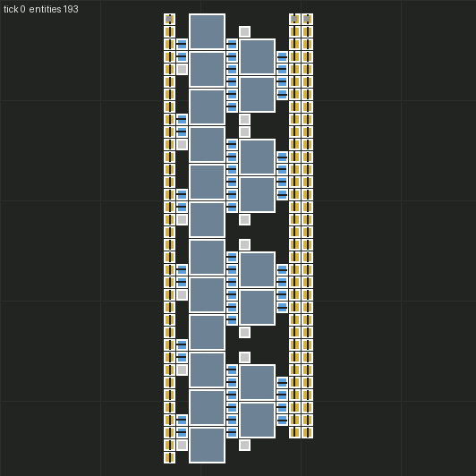
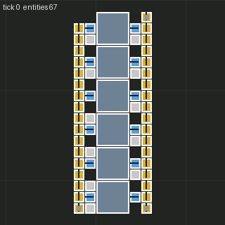
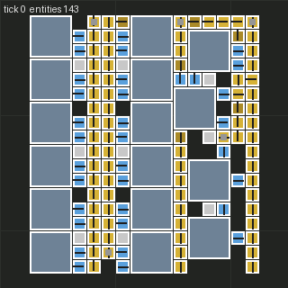

# Prototype: module sourcing (`proto/module-sourcing`)

Throwaway prototype for SPEC §5.4 (D9, D19). It answers four questions: can we read the blueprint
library, can we load the user's saves, can we cluster built bases into modules, and can we use online
blueprints. Tools are in `tools/modules/` (see its README). Date: 2026-10-14. Factorio: headless
2.0.77. Inputs were copied to `tools/modules/input/`, and `~/.factorio` was never written.

## Summary

| Question | Answer |
|---|---|
| 1. Blueprint library | **Inventory: yes. Contents: only via a one-time in-game export.** A third-party Go decoder reads the 2.0 `.dat` structure (books, labels, entity counts) but leaves blueprint bodies opaque. The library holds **195 blueprints, 16 books and 1 decon planner**. That is 5 large standalone builds plus a ~190-blueprint *balancer book*, and **no early-game production modules**. |
| 2. Saves | **1.0+ saves: yes, 0.16/0.17: no.** 2.0.77's minimum map input version is 1.0.0. The 1.1 save, the 2.0.28 Space Age save and the 2.0.47 save all loaded with vanilla `base` only and were dumped (242k entities in total). The inventory's 0.16/0.17 saves need a 1.1 conversion step (documented below, not done). |
| 3. Clustering | **Works for the classic layouts**: furnace columns, assembler rows and direct-insertion chains. 289 candidates from two saves, 136 early-game, **115 structurally usable after review flags**, and 13 with no flags at all. Port items are good when belts carry items. Chunking and power ports need work. |
| 4. Online | **factorioprints: yes.** It has an open Firebase REST API with summaries, full records and author display names, but no licence stated. **factoriobin: link-only** (no listing/search API). The string decoder and blueprint→dump converter are done. 3 samples were fetched, and 4 tileable science blueprints became 4 single-module candidates. |

**Recommendation for M4:** curated modules come mainly from **online tileable blueprints**, which are
small and come with designed ports. Save harvesting covers smelting columns and intermediates. Every
module goes through the same tag → filter → **in-game validation** gate. The parametric generator stays
the fallback. Details are at the end.

---

## 1. Blueprint library (`blueprint-storage-2.dat`)

**What exists.**
- `asheiduk/factorio-blueprint-decoder` (Python) is the well-known parser. It supports only 1.0–1.1.x
  (last commit 2023), so it doesn't apply.
- `galpodlipnik1/factorio-blueprint-decoder` (Go, 2026, no licence file) handles 2.0. It hard-gates on
  storage versions 2.0.76/2.0.77. The user's file is **2.0.72** (header `02 00 00 00 48 00 00 00`).
  After adding 2.0.72 to the allow-list, it decoded **strictly with zero diagnostics**. Its own README
  says blueprint **entity bodies are opaque** ("fully accounted for but opaque"). It gives the book tree,
  labels, icons and entity counts, but no entities. See `tools/modules/library-structure/run.sh`
  (pinned commit, builds locally, not vendored).
- Nobody has a full 2.0 body decoder. Wube says the format changes with each release. A body decoder
  would be a reverse-engineering project, so it's not worth it.

**What's inside** (labels only):

| Item | Entities | Relevance |
|---|---|---|
| Solar | 348 | power, not a production module |
| Shuttle | 347 | Space Age platform, no |
| Nuclear Powerplant | 362 | no (beyond v1) |
| City Block | 936 | train city-block template, no |
| Gleba Bus | 1314 | Space Age, no |
| book "balancer book (fall 2024)" | 11 sub-books: 1_x … 9_x balancers, other_balancers, FAQ (~180 blueprints) | **useful later for the router** (belt balancers), not as modules |
| 1 deconstruction planner | – | no |

So **the library contributes no early-game production modules.** This lowers the priority of
library import.

**Can a mod export it?** Yes, but only in the graphical client. Factorio 2.0 added
`LuaPlayer.blueprints` (a read-only `LuaRecord[]` for the "My blueprints" shelf) and
`LuaRecord.export_record()`. The library is client-side, so a headless server has no local player
library. The Go decoder's oracle notes confirm this: headless access sees only a save-embedded snapshot.
I wrote `tools/modules/library-export-mod/re-library-export`. Its `/re-export-library` command writes
every record's string plus `index.json` to `script-output/re-library/`. It loads cleanly in headless
2.0.77, but the export can't be exercised there.

**User action (optional, one-time, ~2 min):** copy the mod folder into the Steam client's mods, start
any single-player game, wait a few seconds, run `/re-export-library`, and then remove the mod. Given
the inventory above, this is low priority. It's only worth doing if the user wants the balancer book
for the router.

## 2. Loading saves in headless 2.0.77

Setup: `tools/modules/run_dump.sh` uses its own `config.ini` and write-data dir
(`tools/modules/out/factorio-run`) and its own mod dir, with `base` enabled and
`space-age`/`quality`/`elevated-rails` disabled. It runs `--benchmark SAVE --benchmark-ticks 1`, so no
server and no port. The dump mod `re-save-dump` runs in `on_init`, which fires when the mod is added to
an existing save. It writes `script-output/re-save-dump.json` with name, type, position, direction,
force, recipe (`get_recipe()` or furnace `previous_recipe`), underground type, inserter pickup/drop
positions, belt contents and the mining target. It also writes the used recipes, crafting speeds and a
full prototype table. The format is a superset of `mod/src/remote.ts` `dumpEntities`, so
`tools/render/render.py` reads it unchanged.

| Save | Version (from load) | Result | Entities | Time |
|---|---|---|---|---|
| `MyFirstBase15.2.zip` | **0.17.43** (inventory said 0.16.51) | refused | – | – |
| `1.17 Base.zip` | 0.17.34 | refused | – | – |
| `Kevins Base.zip` | 0.17.68 | refused | – | – |
| `FactorySimulator2024.zip` | 1.1.109 (QoL mods absent) | **loaded**, migrated to 2.0 names (`bulk-inserter`, `legacy-straight-rail`) | 131,265 | 30 s |
| `space-exploration.zip` (Space Age) | 2.0.28 | **loaded without space-age**. Nauvis entities kept, SA-only entities dropped. | 106,113 | 7 s |
| `minecraft.zip` | 2.0.47 (aai-loaders absent) | loaded. 0 crafting machines (belts, chests, generators), so no use. | 5,776 | 1 s |

Exact error for old saves:
`Error Util.cpp:81: Map version 0.17.34-0 cannot be loaded because it is lower than the minimum input version (1.0.0-0).`
`factorio --version` on 2.0.77 also prints `Map input version: 1.0.0-0`.

**Feasible path for 0.16/0.17 saves (documented, not done):** convert through 1.1. No Steam beta is
needed, because Wube publishes headless tarballs of old versions at
`https://factorio.com/get-download/1.1.110/headless/linux64`.
1. Unpack 1.1.110 headless into a scratch dir and run `--version`. Check that its "Map input version"
   is ≤ 0.17. I believe it is 0.18.0. If it is, step through 0.18.47 first: load in 0.18, save, then
   load in 1.1.
2. Re-save. `--benchmark` doesn't save, so use `--start-server SAVE --port <non-default>
   --bind 127.0.0.1` with a tiny mod that calls `game.server_save("converted")` on tick 1 and then
   `game.auto_save`/exit. Or skip the server and dump directly with a 1.1 build of the dump mod (`game.write_file`
   and `game.table_to_json` instead of `helpers.*`; 8-way directions).
3. Feed the 1.1 save to `run_dump.sh`. 2.0's own migration does the entity renames.
Expected value: the 0.16/0.17 bases are early/mid-game, which is what v1 wants. That makes this the
best use of the conversion work if save harvesting continues. Risk: 0.16→0.17 recipe changes, which
the 2.0 migration fixes on load.

## 3. Clustering into candidate modules

`tools/modules/cluster.py` works like this:
1. **Graph.** Index tile → entity. Each inserter links the entities under its pickup and drop tiles.
2. **Union-find over crafting machines with a recipe**, using three links:
   - (a) direct insertion between machines;
   - (b) same recipe, and their inserters touch the same or an adjacent belt tile, which joins
     two-sided rows;
   - (c) same recipe, aligned neighbours (gap ≤ 1) **along the row axis only**. The axis is
     perpendicular to the side the inserters sit on, so back-to-back columns stay separate.

   Clusters with more than `--max-machines` (24) machines are cut along their long axis.
3. **Membership.** Machines, their inserters and the belts those inserters touch, plus fillers fully
   inside the bounding box (belts, undergrounds, splitters, poles, pipes, chests). Belt chains inside
   the box that no module inserter touches are dropped (bus belts passing through). Machines from other
   clusters inside the box are counted as foreign tiles.
4. **Ports.** These are module belts that push into an outside belt (`belt-out`) and outside belts that push
   into a module belt (`belt-in`), including underground pairs. Dangling belt ends become ports only if
   inserters drop on (out) or pick from (in) the chain. Items come from the belt contents along the
   chain, intersected with the module's external ingredients and products. If the belts are empty,
   the role of the touching inserters decides. A module with no pole inside gets a `power` port.
5. **Rates** are computed from crafting speed and recipe energy, with internal intermediates netted
   out. **Normalisation:** translate to the origin and rotate so the first `belt-out` faces north.
6. **Filter** (§5.4 step 3). It flags beacons, roboports, logistic chests and robots, oil/chemistry/
   centrifuge categories, recipes outside an early-game allow-list, and review flags (`no-belt-out`,
   `unfed-ingredients`, `foreign-entities-in-box`, `port-item-unknown`, `pass-through-belt`,
   `no-poles-inside`, `chunk-of-larger-cluster`).

**Numbers.** The whole pipeline runs in under 2 s per save after the dump.

| Save | Machine clusters | Candidates (≥2 machines) | Early-game, v1 tech | …structurally usable* | No flags at all |
|---|---|---|---|---|---|
| FactorySimulator2024 | 155 | 123 | 59 | 46 | 8 |
| Space Age (Nauvis) | 215 | 166 | 77 | 69 | 5 |

\*No `no-belt-out`, `unfed-ingredients`, `foreign-entities-in-box` or `port-item-unknown`. Chunks,
pass-through belts and external power are allowed. The usable ones are mostly smelting columns
(iron 32, steel 21, copper 16), plus gears 5, green circuits 6, cables 7, red/green/military science
6, engines 4 and a few mall items.

**Renders** (`tools/render/render.py`, extracted modules only, normalised; grey squares are ports):

| Green circuits, 20 assemblers, 3:2 (Space Age save) | Red science, 6 assemblers (Space Age save) | Green science tile (factorioprints, see §4) |
|---|---|---|
|  |  |  |

Sample ModuleDef JSON: `tools/modules/samples/*.module.json`.

**How well it works on real bases:**
- **Good:** furnace columns, assembler rows, the 3:2 green-circuit block and direct-insertion science.
  Belt contents in a running save give reliable port items.
- **Late-game saves are a poor source for early-game modules.** Both saves are megabase-ish (rails,
  solar fields, bots, AM2/AM3, steel furnaces). Rows are 30–48 machines long, so they get chunked, and
  the chunks have pass-through belts and power from outside (substations or big poles: 41 + 77
  `no-poles-inside`). Machine tiers would also need **downgrading to AM1 and stone furnaces** for v1,
  which changes rates. Normalisation must swap the machine and recompute rates, then validation checks
  the result.
- **Not handled yet:** lane-level item assignment (mixed belts list both items); splitters as ports;
  pipe ports have no direction or fluid; furnaces in blueprints carry no recipe, so blueprint smelters
  give 0 candidates (fix: infer from the input belt or tag as `smelting:*`); `requiresTech` (derive from
  prototype unlocks); ingredient balance across a module (e.g. a surplus of belts shows up as an output).
- **Ambiguity is the norm.** Only 13/289 candidates have no flags at all. Every candidate needs the
  in-game validation gate (§5.4 step 4), and a review file for the flagged ones.

## 4. Online sources

- **factorioprints.com** stores its data in a public Firebase Realtime DB with no key, under
  `https://facorio-blueprints.firebaseio.com/` (the typo is real):
  - `blueprintSummaries.json?orderBy="numberOfFavorites"&limitToLast=N` returns the top-N by favourites
    (title, image);
  - `blueprints/<key>.json` returns the full record: `blueprintString`, `author.userId`, `tags`
    (e.g. `/general/early game/`, `/production/science/`, `/version/0,17/`) and description;
  - `users/<uid>/displayName.json` returns the author name for attribution;
  - `byTag/...` holds a tag index.

  The site states **no licence**. D19 only requires attribution, so we record title, author display
  name, URL and "licence: none stated" (`factorioprints.py fetch` → `ATTRIBUTION.jsonl`). The top early
  results include "Tileable Science Production 1.0-2.0 (Vanilla)" (Christoffer Ramqvist, 4039 favs),
  "Early game smelting" and "Modular Green Circuits" (Nilaus), and "Green Circuits (Early Game)". Note
  that the Firebase API is undocumented and could change. Cache what we use under `data/modules/`.
- **factoriobin.com** is a pastebin with posts at `/post/<id>` and no listing, search or documented API.
  It's usable only when someone hands us a link, so it's not a discovery source.
- **Decoder:** `bpstring.py` handles `0`+base64(zlib(JSON)) both ways, flattens books, converts 0.17/1.x
  8-way directions and renames to 2.0, and fixes the half-tile offset that some exports have. Pre-0.15
  strings (`H4sI…`, gzip of a Lua table, e.g. the 2016 "Green Circuits (Early Game)") are **not**
  supported. They're a dead end, and they're old anyway.
- **Samples fetched (3):** the tileable science book (9 blueprints, 0.17 format), "Early game smelting"
  (180 entities, furnaces without recipes, so 0 candidates) and "Modular Green Circuits" (152 entities).
  Clustering the science book with `--whole` gives one module per blueprint (red ×2, green, military).
  Ports are correct as tileable pass-throughs: an input belt continues and the output belt comes from
  the previous tile. Rates match the titles (1.5/s red and green, 0.75/s military).

## Recommended pipeline for M4

1. **Online first, for the v1 recipe set.** Hand-pick about 10–20 factorioprints blueprints tagged
   early game + vanilla (red/green science, gears, circuits, smelting columns, ammo, walls). Fetch with
   attribution, then `bpstring.py to-dump` → `cluster.py --whole`. They're small, designed as modules,
   and have clean ports. Commit the strings and `ATTRIBUTION.md` under `data/modules/`.
2. **Saves second.** Harvest smelting columns and intermediates from the 1.1 and Space Age dumps (already
   possible), and from the 0.16/0.17 bases once converted via 1.1 headless (§2), which are closer to
   v1's tech level. For chunked rows, cut at repeat boundaries (period detection on machine spacing)
   instead of at a fixed count. Then each chunk becomes a tileable module with explicit pass-through ports.
3. **Library: skip for modules.** If the user runs the one-time `/re-export-library`, use the balancer
   book for the router (M3/M5), not as modules.
4. **Normalise to v1:** swap machines to AM1/AM2 and stone furnaces, recompute rates, strip beacons and
   modules, and add a power port or pole placement. Keep `provenance` and `rotatable`.
5. **Tag → filter → validate** exactly as in §5.4. The validation lab is the real quality gate. Expect
   about half of the candidates to need a fix or a drop. Write the flags to a review file. The
   parametric generator covers every recipe without a passing module.

**Risks.**
- Port inference is heuristic: mixed lanes, sideloads, splitters and empty belts.
- The factorioprints API is undocumented and has no licence.
- 0.16/0.17 conversion needs older headless builds, and possibly two hops.
- Late-game sources need tier downgrades that change ratios.
- The `.dat` body format is unparsed, so it depends on the in-game export.

## Dead ends / time-box notes
- `asheiduk/factorio-blueprint-decoder` is 1.1 only. The Go decoder gives structure only.
- Headless 2.0 can't see a player's library, so library export must be done by the user in the GUI
  client.
- `minecraft.zip` has no crafting machines.
- factoriobin has no discovery API.
- Pre-0.15 blueprint strings aren't supported.

## Assumptions
- QoL mods that are absent from the 1.1 save (YARM, helmod, Bottleneck…) don't affect entities. The
  load confirmed it migrated cleanly.
- Loading the Space Age save without `space-age` is acceptable for harvesting Nauvis early-game builds.
- Belt contents at save time are a fair proxy for what each belt carries.
